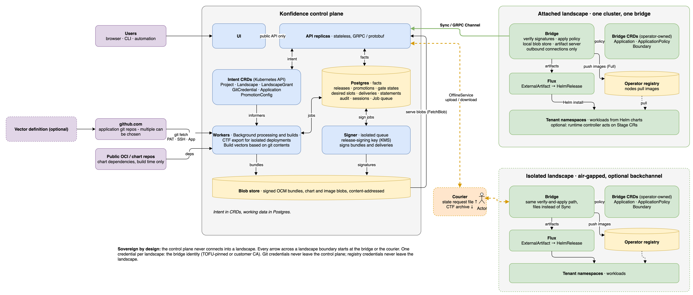
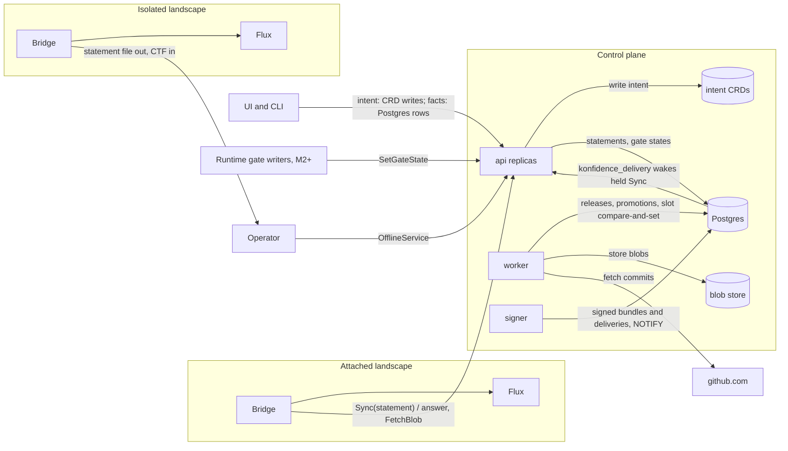

# Overview and product boundary

Intent lives in CRDs, facts live in Postgres. Every landscape has one desired
slot per application, and gated wave promotions write those slots with a
single compare-and-set on promotion sequence. A slot points at a bundle or at
nothing (a tombstone). The control plane answers each bridge statement with
the landscape's signed delivery (all its slots) plus the blobs the bridge
lacks, over gRPC, or as a file and CTF. Every rollout status is a function
of the slots and the bridge's newest signed statement.

Edit the diagram by opening `architecture.drawio.svg` or this PNG in draw.io; both embed the source.

This page holds the vision, the boundary against the vector runtime, the
three runtime contracts and the glossary. Names live in
[02-domain-model.md](02-domain-model.md), milestones in
[09-roadmap.md](09-roadmap.md).

## Konfidence turns git commits into signed deliveries on every landscape

A project owner declares an `Application` with git sources and a
`PromotionConfig` with ordered waves. The control plane builds each new set
of inputs into a release and a signed bundle (D-REL-01, D-BUN-01). A
promotion takes one release, or a removal, through the waves. Each wave step
writes the slots of its landscapes, and each landscape whose slots change
gets a new signed delivery (D-PROMO-06, D-BUN-04).

The bridge sends a signed statement: what it holds, what it can read, what
it last verified and applied, and what runs. The control plane answers with
the newest delivery and the blobs the bridge lacks. The bridge verifies the
delivery, applies the operator's `ApplicationPolicy` inside a `Boundary`, and
hands the charts to Flux. Its next statement reports the result.

Attached and isolated landscapes move the same two messages through the same
verify-and-unpack code (D-XFER-05). An attached bridge calls `Sync` over
gRPC. An operator carries an isolated landscape's statement out as a file and
its answer in as a CTF. The control plane never connects into a landscape
(D-PROD-05).

One binary runs in the modes `api`, `worker` and `signer`;
[01-control-plane.md](01-control-plane.md) owns them. The bridge runs as one
pod per landscape; [06-landscape-bridge-and-policy.md](06-landscape-bridge-and-policy.md)
owns it.

## The vector runtime is a separate product behind three contracts

The vector runtime leaves konfidence (D-PROD-02). Its API, UI, `Stage` and
`Vector` CRDs move to the runtime team. Konfidence imports no runtime Go
types and has no runtime-specific code path. To konfidence a `Stage` is a
manifest in a chart, like a `ConfigMap`.

The runtime plugs in at three points, each owned and versioned by konfidence
(D-PROD-03).

| Contract | Shape in one line | Owner | Milestone |
| --- | --- | --- | --- |
| Builder `builder/v1` | A registered container turns a source tree into extra chart resources; no egress, no credentials | [07](07-sources-and-releases.md) | M2+; M1 uses the built-in Helm builder |
| Gate (ADR-0039) | A `gate_states` row on one wave, written only through `SetGateState`; `set_by` is the caller identity | [05](05-promotion-and-rollout.md) | M1 explicit approval; M2+ external writers |
| Statement `statement.v1` | The bridge's signed statement, its entries capped by the reporting level | [04](04-trust-and-attestation.md) | M1 |

Three rules hold across all three contracts:

- Builder output becomes ordinary charts. The bridge cannot tell a built chart
  from a hand-written one.
- The wave step ANDs gate states and never interprets a gate type. External
  writers authenticate with short-lived OIDC tokens (D-API-04, M2+), read
  facts through the public API ([08](08-api-and-ui.md)) and poll. Konfidence
  pushes no events to them.
- A runtime resource is visible if it follows the Kubernetes
  `status.conditions` convention with `Ready` and `observedGeneration`. No
  resource `status` subtree leaves a landscape (D-POL-05). Deep links come
  only from `Landscape.spec.linkTemplates`, never from bundle content
  (D-UI-03).

## Konfidence leaves these out

- Konfidence does not run, schedule or activate runtime workloads.
- Charts pass no data to each other. v1 has no ordering across applications.
- No landscape reads git or uses OCI as a transfer protocol.
- The control plane never opens a connection into a landscape.
- Bridges do not update themselves. Operators upgrade them.
- Secrets never pass through the control plane.
- Konfidence ships no image registry and never changes node or containerd
  configuration (D-XFER-04, D-XFER-06).
- One landscape is one cluster. Git means github.com only for now.
- The UI has no plugin system in v1.

## Glossary of terms every doc uses

| Term | Meaning |
| --- | --- |
| Answer | The control plane's reply to a statement: the newest signed delivery and the blobs the bridge lacks. Offline it travels as a CTF. |
| Application (control plane) | A deployable unit of a project: git sources plus chart layout. |
| Bundle (bridge CR) | Cluster-scoped CR on a landscape for one slot as installed, named `<project>.<application>`: 1..n charts as `HelmRelease`s. |
| ApplicationPolicy | Operator-owned CR on a landscape. It decides allow or deny, namespace, value overrides, secret bindings, image rules, reporting level and local acceptance. |
| Attached landscape | A landscape whose bridge calls `Sync` over gRPC. |
| Blob inventory | The sorted digests a bridge holds. A statement carries it, or its digest when unchanged; only missing blobs travel. |
| Boundary | Landscape-admin CR that fences one project UID into namespaces, RBAC and quota. Writing it approves the grant. |
| Bridge | The landscape agent. One single-pod Deployment per landscape. |
| Builder | A registered container that turns a git source into extra chart resources. |
| Bundle | A signed OCM component version per release: Helm charts, vendored dependencies and optionally images. |
| Capability | A string a bridge lists and a bundle requires, such as `bundle.v1`. The only compatibility primitive. |
| CTF | OCM Common Transport Format archive. The offline carrier of an answer and its blobs. |
| Delivery | A small signed OCM component version per landscape that lists all its slots, tombstones included, plus the CRL. |
| Delivery sequence | Global counter from Postgres, carried in every delivery. Only rises. |
| Enrollment code | 16 base32 characters both sides compare before trust counts. |
| Full transfer | Image blobs travel and the bridge pushes them into the landscape registry. |
| Gate | A named condition on a wave that a writer sets through `SetGateState`. |
| Isolated landscape | An air-gapped landscape. Its statement leaves as a file, its answer arrives as a CTF. |
| Landscape | Exactly one Kubernetes cluster with exactly one bridge. |
| Landscape registry | The operator's registry that the nodes already pull from. Images land there. |
| LandscapeGrant | CRD that lets one project use one landscape. |
| Live | Status from an attached bridge whose newest statement is younger than `staleAfter`, as opposed to *attested at T*. |
| Project UID | Minted, immutable `prj-` ID of a project. The grant identity a `Boundary` names. |
| Promotion | A Postgres row that moves one release, or a removal, through a snapshot of ordered waves. |
| Promotion sequence | Global counter that orders promotions. The slot compare-and-set uses it. |
| PromotionConfig | CRD that declares how promotions of one application run: source, mode, values, waves. |
| Release | An immutable Postgres row for one build-input manifest. Labelled `payments-api@42`. |
| Release ID | SHA-256 of the canonical build-input manifest. |
| Reporting level | `None`, `Health` or `Resources`, set per application by the landscape policy. |
| Rollout target | One landscape in one wave of a promotion. Only its frozen outcome is stored. |
| Slot | The `desired` row for one application on one landscape. It points at a bundle or at nothing. |
| Statement | The bridge's only message: signed, sequenced, with capabilities, inventory, delivery sequences and application entries. Offline it travels as the statement file. |
| Statement sequence | Counter owned by the bridge. The highest per landscape counts. |
| Thin transfer | No image blobs travel; the bridge checks that every digest exists in the landscape registry. |
| Tombstone | A slot that points at nothing, sent as a delivery entry with an empty bundle reference. |
| Wave | One step of a promotion: a landscape selector with gates, a failure threshold and a timeout. |
