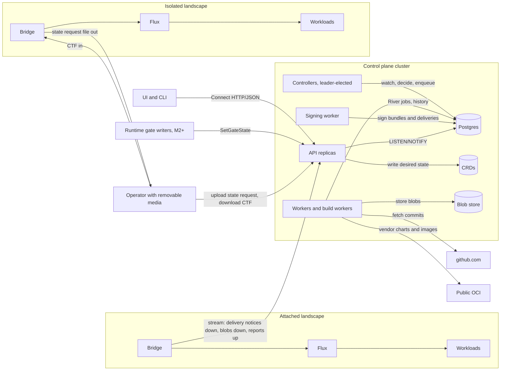
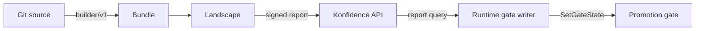

# Overview and product boundary

Konfidence is a standalone deployment orchestrator. A central control plane
builds signed bundles from git and delivers them to hundreds of Kubernetes
landscapes, attached or air-gapped. This page holds the target vision, the
product boundary against the vector runtime, the three runtime contracts and
the glossary. Names live in [02-domain-model.md](02-domain-model.md), the
milestones in [09-roadmap.md](09-roadmap.md).

## Konfidence turns git commits into attested deployments on every landscape

A project owner registers an `Application` with git sources. The control
plane snapshots the commits into a `Release`, builds a signed bundle and
promotes the release through waves of landscapes. For each landscape it signs
one small delivery that lists everything the landscape should run. The bridge
pulls the delivery and the blobs it lacks, checks the signature and delivery
sequence, applies the operator's `ApplicationPolicy` and hands Helm charts to
Flux. It then signs a report of what runs, and the report travels back.

Attached and isolated landscapes get the same artifacts through the same
verify-and-unpack code. Attached bridges pull over a gRPC stream they open.
Isolated landscapes get a CTF archive that an operator carries in, and the
state request file with the signed reports comes out the same way. The control
plane never connects into a landscape (D-PROD-05).

### Five control-plane processes and one bridge per landscape

| Component | Runs where | Does |
| --- | --- | --- |
| API | control plane, stateless replicas | Authorizes, writes CRDs, holds bridge streams, serves blobs, UI and CLI |
| Controllers | control plane, leader-elected | Reconcile CRDs and decide; never read the DB to decide |
| Workers, build workers | control plane, stateless | Run River jobs: git, builds, CTF export, maintenance |
| Signing worker | control plane, isolated | Only holder of the release-signing key (D-TRUST-06) |
| UI | browser | Uses the public API only |
| Bridge | each landscape, single pod | Pulls or imports deliveries, enforces policy and boundaries, drives Flux, signs reports |

[01-control-plane.md](01-control-plane.md) owns processes, jobs and state
placement. [06-landscape-bridge-and-policy.md](06-landscape-bridge-and-policy.md)
owns the bridge.

## The vector runtime is a separate product behind three contracts

The vector runtime leaves konfidence (D-PROD-02). Its API, UI, `Stage` and
`Vector` CRDs move to the runtime team. Konfidence imports no runtime Go
types and has no runtime-specific code path. To konfidence a `Stage` is a
manifest in a chart, like a `ConfigMap`.

The runtime plugs in at three points, each owned and versioned by konfidence
(D-PROD-03). Each contract has exactly one owner doc; this page only names
them.

| Contract | Shape in one line | Owner | Milestone |
| --- | --- | --- | --- |
| Builder `builder/v1` | A registered container turns a source tree into extra chart resources; no egress, no credentials | [07](07-sources-and-releases.md) | M2+; M1 uses the built-in Helm builder |
| Gate (ADR-0039) | An entry in `Promotion.status.gates`, set only through the API; `setBy` is the caller identity | [05](05-promotion-and-rollout.md) | M1 explicit approval; M2+ external writers |
| Status report `application/vnd.konfidence.attestation.v1+json` | A DSSE report signed by the bridge, content capped by the reporting level | [04](04-trust-and-attestation.md) | M1 |

Three rules hold across all three contracts:

- Builder output becomes ordinary charts. The bridge cannot tell a built chart
  from a hand-written one.
- The promotion controller ANDs gate entries and never interprets a gate
  type. External writers authenticate with short-lived OIDC tokens
  (D-API-04, M2+), read facts from the report query API (`DeploymentService`
  in [08](08-api-and-ui.md)) and poll; konfidence pushes no status events to
  them.
- A runtime resource is visible if it follows the Kubernetes
  `status.conditions` convention with `Ready` and `observedGeneration`.
  Reporting levels are `None`, `Health` and `Resources` (D-POL-05). No
  resource `status` subtree leaves a landscape. Deep links come only from
  `Landscape.spec.linkTemplates`, never from bundle content (D-UI-03).

## Non-goals

- Konfidence does not run, schedule or activate runtime workloads.
- Charts pass no data to each other: no outputs feeding values, no
  cross-chart templating. v1 has no ordering across applications.
- No landscape reads git or uses OCI as a transfer protocol.
- The control plane never opens a connection into a landscape.
- Bridges do not update themselves. Operators upgrade them.
- Secrets never pass through the control plane.
- Konfidence ships no image registry and never changes node or containerd
  configuration (D-XFER-04, D-XFER-06).
- One landscape is one cluster. Git means github.com only for now.
- The UI has no plugin system in v1.

## Glossary

| Term | Meaning |
| --- | --- |
| Application (control plane) | A deployable unit of a project: git sources plus chart layout. |
| Application (bridge) | Cluster-scoped CR on a landscape for one installed application: 1..n charts as `HelmRelease`s. |
| ApplicationPolicy | Operator-owned CR on a landscape. It decides allow or deny, namespace, value overrides, secret bindings, image rules, reporting level and update acceptance. |
| Attached landscape | A landscape whose bridge keeps a gRPC stream to the control plane. |
| Attestation | A report signed by the bridge identity key. It binds landscape ID, component digest, resource status, effective values digest, policy version and report sequence. |
| Blob inventory | The sorted digests a bridge already holds. Sent in full with every transfer plan; only missing blobs travel. |
| Boundary | Landscape-admin CR that fences one grant into namespaces, RBAC and quota. Policies work inside it. |
| Bridge | The landscape agent. One single-pod Deployment per landscape. |
| Builder | A registered container that turns a git source into extra chart resources. |
| Bundle | A signed OCM component version per release: Helm charts, vendored dependencies, metadata and optionally images. |
| Component digest | Hash over the bundle bytes. Separate from the release ID. |
| CTF | OCM Common Transport Format archive. The offline carrier of a delivery and its blobs. |
| Delivery | A small signed OCM component version per landscape that lists its full desired set: bundle references, target values, grant IDs, tombstones and the CRL. The unit of dispatch. |
| Delivery sequence | Monotonic per-landscape counter, allocated only in Postgres, carried in every delivery. |
| Deployment | The record of one promotion on one landscape. Waves and the UI track it. |
| Dispatch record | The Postgres rows that list which `Deployment`s a delivery covers. |
| Enrollment code | 16 base32 characters both sides compare before trust counts. |
| Full transfer | Image blobs travel and the bridge pushes them into the landscape registry. |
| Gate | A named condition on a promotion or wave that a writer satisfies through the API. |
| Grant ID | Minted, immutable ID of a `LandscapeGrant`. The only key a `Boundary` matches on. |
| Isolated landscape | An air-gapped landscape. Deliveries arrive as CTF, reports leave in the state request file. |
| Landscape | Exactly one Kubernetes cluster with exactly one bridge. |
| Landscape registry | The operator's registry that the nodes already pull from. Images land there. |
| LandscapeGrant | Control-plane CR that gives a project access to a landscape. |
| Live | Status from an attached bridge's current stream, as opposed to *attested at T*. |
| Policy version | SHA-256 of the effective policy for one application, computed by the bridge. |
| Project | The tenant unit on the control plane. It owns applications, credentials and grants. |
| Promotion | Moves one release, or a removal, to a set of landscapes in waves behind gates. |
| Promotion sequence | Per-application counter that orders promotions; supersede and the dispatch fence use it. |
| PromotionConfig | Template that creates promotions: source, targets, waves, gates. |
| Release | Immutable snapshot of an application's deployable inputs. Labelled `payments-api@42`. |
| Release ID | Hash over commits, dependency digests and the deploy-relevant layout. |
| Report sequence | Monotonic per-landscape counter owned by the bridge, carried in every report. |
| Reporting level | `None`, `Health` or `Resources`, set per application by the landscape policy. |
| State request file | The one file an operator exports per offline trip: bridge version, capabilities, blob inventory, transfer-relevant policy, last applied delivery sequence and unacknowledged reports. |
| Thin transfer | No image blobs travel; the bridge checks that every digest exists in the landscape registry. |
| Tombstone | A delivery entry that removes a whole application from a landscape. |
| Wave | One step of a promotion: a subset of target landscapes with `maxConcurrent`, a failure threshold and a completion rule. |

## Doc map

| Doc | Owns |
| --- | --- |
| [decisions.md](decisions.md) | Every decision. Docs refine, never contradict. |
| [01-control-plane.md](01-control-plane.md) | Processes, River job kinds and queues, streams, sizing, recovery. |
| [02-domain-model.md](02-domain-model.md) | Every CRD field, enum, reason, Postgres table and the NOTIFY channel. |
| [03-bundles-and-transfer.md](03-bundles-and-transfer.md) | Bundle and delivery format, CTF, transfer planning, thin and full. |
| [04-trust-and-attestation.md](04-trust-and-attestation.md) | Keys, enrollment, rotation, CRL, reports, counters. |
| [05-promotion-and-rollout.md](05-promotion-and-rollout.md) | Promotions, waves, gates, tombstones, `Deployment` transitions. |
| [06-landscape-bridge-and-policy.md](06-landscape-bridge-and-policy.md) | Bridge, Flux integration, policies, boundaries. |
| [07-sources-and-releases.md](07-sources-and-releases.md) | Git credentials, polling, release IDs, the builder contract. |
| [08-api-and-ui.md](08-api-and-ui.md) | Proto names and the only proto sketch, auth, roles, UI. |
| [09-roadmap.md](09-roadmap.md) | Milestones. M1 is the acceptance test (D-PROD-04). |

## Path

[09-roadmap.md](09-roadmap.md) owns the milestone list and the M1 scope.
Every step in the other docs carries an M1 or M2+ tag.
