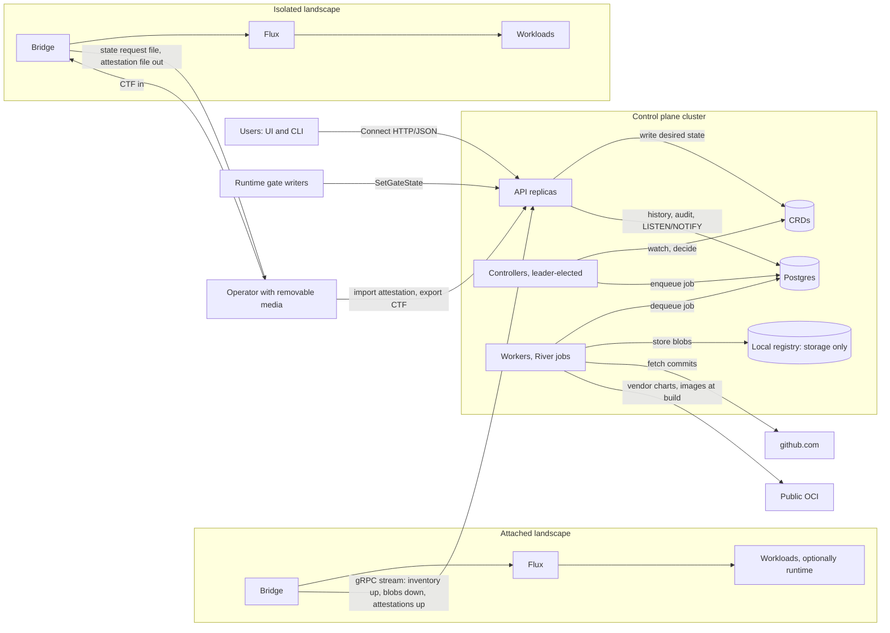
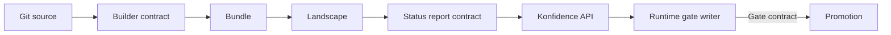

# Overview and product boundary

Konfidence is a standalone deployment orchestrator. A central control plane
builds signed bundles from git and delivers them to hundreds of Kubernetes
landscapes, attached or air-gapped. This page holds the target vision, the
product boundary against the vector runtime, the three runtime contracts, the
glossary for the doc set, and the doc map. Field names live in
[02-domain-model.md](02-domain-model.md); each mechanism lives in its own doc.

## 1. Target design

### Konfidence turns git commits into attested deployments on every landscape

A project owner registers an `Application` with one or more git sources. The
control plane snapshots the commits into a `Release`, builds a signed bundle,
and promotes the release through waves of landscapes. On each landscape the
bridge pulls the bundle, checks its signature and sequence, applies the
operator's `ApplicationPolicy`, and hands Helm charts to Flux. The bridge then
signs an attestation of what runs, and the attestation travels back.

Every landscape gets the same artifact through the same verify-and-unpack
code, attached or isolated alike. Attached landscapes pull it over a
gRPC stream that the bridge opens. Isolated landscapes receive a CTF archive
that an operator carries in, and the attestation file comes out the same way.
The control plane never connects into a landscape (D-PROD-05).



### Four components make up the control plane and one runs on each landscape

| Component | Runs where | Does |
|-----------|------------|------|
| API | Control plane, stateless replicas | Authorizes (OIDC, project, grants), writes CRDs, serves bridge streams and UI/CLI over Connect. |
| Controllers | Control plane, leader-elected | Reconcile CRDs and decide what happens next. They never read the DB to decide. |
| Workers | Control plane, stateless | Run River jobs: git fetch, builds, bundle assembly, transfers. |
| UI | Browser | Uses the public API only. |
| Bridge | Each landscape, active/passive | Pulls or imports bundles, enforces policy and boundaries, drives Flux, signs attestations. |

CRDs hold desired state. Postgres holds history, audit, sessions and the job
queue. [01-control-plane.md](01-control-plane.md) owns this split.

### The vector runtime is a separate product behind three contracts

The vector runtime leaves konfidence (D-PROD-02). Its API, UI, `Stage` and
`Vector` CRDs move to the runtime team. Konfidence imports no runtime Go types
and has no runtime-specific code path. To konfidence a `Stage` is a manifest in
a chart, like a `Deployment` or a `ConfigMap`.

The runtime plugs in at exactly three points, each owned and versioned by
konfidence (D-PROD-03):



Each contract has a version string and a conformance test suite that ships
with konfidence. A runtime that passes the suite works with every konfidence
release that supports that contract version.

#### Builder contract `builder.konfidence.cloud/v1`

A builder turns a git source into extra Helm charts for the bundle. It runs as
a container image, pinned by digest on the `Application` source. A worker runs
it as a River job inside the control plane.

- **Input:** the source tree at the snapshotted SHA, read-only at `/in`, plus
  `/in/.konfidence/build.json` with application name, source name, release ID
  and contract version.
- **Output:** one or more chart directories under `/out/charts/<name>/`, and
  `/out/result.json` listing chart names and declared secret requirements.
- **Constraints:** no git credentials and no network by default. Exit code 0
  means success; anything else fails the release with the last 64 KiB of
  stderr as reason.

Builder output becomes ordinary charts in the bundle. The bridge cannot tell a
built chart from a hand-written one. A builder that needs network declares it,
and the project admin allows it per `Application`.

#### Gate contract (ADR-0039)

A gate is an entry in `Promotion.status.gates`, keyed by a DNS-style `type`
such as `explicit-approval.konfidence.cloud` or `stage-active.vector.example`.
The promotion controller only ANDs the entries; it never interprets a type.

```yaml
status:
  gates:
    - type: stage-active.vector.example
      state: Satisfied        # Pending | Satisfied | Error
      reason: StageActive
      setBy: system:serviceaccount:vector:gate-writer
      setAt: "2026-10-29T09:00:00Z"
```

External writers, including runtime writers, set a gate through the API call
`SetGateState`, never by patching the CRD. The API takes `setBy` from the
caller's authenticated identity. A writer gets the facts it needs from the
status report API. Gates exist per promotion and optionally per wave
(D-PROMO-02). [05-promotion-and-rollout.md](05-promotion-and-rollout.md) owns
the lifecycle.

#### Status report contract `report.konfidence.cloud/v1`

The bridge reports the status of every resource it applied, inside the signed
attestation. The runtime gets no special reporting path. A runtime resource is
visible to konfidence if it follows the Kubernetes `status.conditions`
convention with a `Ready` condition and `status.observedGeneration`.

| Reporting level | Report contains |
|-----------------|-----------------|
| `none` | No report. Waves can only complete as `dispatched`. |
| `health` | One health state per application and chart. |
| `resources` | Per resource: group, kind, namespace, name, `Ready` status, reason, message, observed generation. |
| `full` | `resources` plus the resource's `status` subtree, capped at 16 KiB per resource. |

A resource can carry the annotation `report.konfidence.cloud/link` with a URL.
The UI renders it as a deep link to the runtime's own UI (D-UI-03). The level
is set per application in the operator's `ApplicationPolicy` (D-POL-05).
[04-trust-and-attestation.md](04-trust-and-attestation.md) owns the signed
envelope.

## 2. Non-goals

- Konfidence does not run, schedule or activate runtime workloads.
- Charts pass no data to each other. No outputs feed values, and no
  cross-chart templating exists.
- v1 has no ordering across applications.
- No landscape reads git, and no landscape uses OCI as a transfer protocol.
- The control plane never opens a connection into a landscape.
- Bridges do not update themselves. Operators upgrade them.
- Secrets never pass through the control plane.
- One landscape is one cluster. Multi-cluster landscapes are out of scope.
- GitHub Enterprise Server and other git hosts are out of scope for now.
- The UI has no plugin system in v1.

## 3. Glossary of terms used across the design docs

| Term | Meaning |
|------|---------|
| Application (control plane) | A deployable unit owned by a project: one or more git sources with credentials. |
| Application (bridge) | Cluster-scoped CR on a landscape for one installed application: 1..n charts as `HelmRelease`s. |
| ApplicationPolicy | Operator-owned CR on a landscape. It decides allow/deny, namespace, value overrides, secret bindings, image rules and reporting level. |
| Attached landscape | A landscape whose bridge keeps a gRPC stream to the control plane. |
| Attestation | A report signed by the bridge identity key. It binds landscape, release digest, resource status, values digest, policy version and sequence number. |
| Blob inventory | The list of content digests a bridge already holds. Transfers send only missing blobs. |
| Boundary | Landscape-admin CR that grants a project namespaces, RBAC and quota on a shared landscape. Policies work inside it. |
| Bridge | The landscape agent. One per landscape, active/passive. |
| Builder | A container that turns a git source into extra charts for a bundle. |
| Bundle | A signed OCM component version holding Helm charts, vendored dependencies, metadata and optionally images. |
| Component version digest | Hash over the bundle bytes. Separate from the release ID. |
| Control plane | API, controllers, workers, Postgres and CRDs in the central cluster. |
| CTF | OCM Common Transport Format archive. The offline carrier of a bundle. |
| Deployment | The record of one release on one landscape within a promotion. Identity is release plus policy version. |
| Full transfer | A transfer that includes images, loaded into a landscape-local registry. |
| Gate | A named condition on a promotion or wave that an external writer satisfies. |
| Isolated landscape | An air-gapped landscape. Bundles arrive as CTF, attestations leave as files. |
| Landscape | Exactly one Kubernetes cluster with exactly one bridge. |
| LandscapeGrant | Control-plane CR that gives a project access to a landscape. |
| Live | Status from an attached bridge's current stream, as opposed to *attested at T*. |
| Project | The tenant unit on the control plane. It owns applications, credentials and grants. |
| Promotion | Moves one release to a set of landscapes in waves, behind gates. |
| PromotionConfig | Template that creates promotions: source, targets, waves, gates. |
| Release | Immutable snapshot of an application's commits and resolved dependency digests. Labelled `payments@42`. |
| Release ID | Hash over the canonical serialization of commits and dependency digests. |
| Reporting level | `none`, `health`, `resources` or `full`. Set per application by the landscape policy. |
| Sequence number | Monotonic per-landscape counter carried by bundles, tombstones and attestations. Replaces wall-clock freshness. |
| State request file | File an operator exports from an isolated bridge: version, capabilities, blob inventory, transfer-relevant policy. |
| Status report | The resource status section inside an attestation. |
| Thin transfer | A transfer of charts and metadata only. Images come from the operator's registry. |
| Tombstone | A signed bundle entry that removes a whole application from a landscape. |
| Wave | One step of a promotion: a subset of target landscapes with `maxConcurrent`, a failure threshold and a completion rule. |

## 4. Decisions applied

- **D-PROD-01:** the target design and the context diagram describe one
  control plane serving attached and isolated landscapes.
- **D-PROD-02:** the runtime section removes `Stage`, `Vector`, runtime API
  and UI from konfidence and forbids runtime Go imports.
- **D-PROD-03:** builders, gates and status reports are the only runtime
  integration points, each with a minimal versioned shape.
- **D-PROD-04:** the acceptance test is the last v1 step and the exit
  criterion of the walking skeleton.
- **D-PROD-05:** every arrow into a landscape starts at the bridge or the
  operator.
- **D-PROMO-01:** the gate contract is ADR-0039 Option 1, with writers going
  through the API.
- **D-POL-05, D-PROMO-03:** reporting levels map to report content and limit
  wave completion rules.
- **D-UI-03:** the status report contract carries the runtime deep link.

## 5. Interfaces other docs and implementers depend on

- Glossary terms above. Other docs link here instead of redefining terms.
- Builder contract `builder.konfidence.cloud/v1`: `/in`, `/in/.konfidence/build.json`,
  `/out/charts/`, `/out/result.json`. Used by
  [07-sources-and-releases.md](07-sources-and-releases.md) and
  [03-bundles-and-transfer.md](03-bundles-and-transfer.md).
- Gate entry shape and the API call `SetGateState`. Used by
  [05-promotion-and-rollout.md](05-promotion-and-rollout.md) and
  [08-api-and-ui.md](08-api-and-ui.md).
- Status report contract `report.konfidence.cloud/v1`, reporting levels and
  the `report.konfidence.cloud/link` annotation. Used by
  [04-trust-and-attestation.md](04-trust-and-attestation.md),
  [06-landscape-bridge-and-policy.md](06-landscape-bridge-and-policy.md) and
  [08-api-and-ui.md](08-api-and-ui.md).

### Doc map

| Doc | Owns |
|-----|------|
| [01-control-plane.md](01-control-plane.md) | API, controllers, workers, Postgres, River, scale-out. |
| [02-domain-model.md](02-domain-model.md) | Every CRD, field name and relation. |
| [03-bundles-and-transfer.md](03-bundles-and-transfer.md) | Bundle format, CTF, gRPC transfer, thin and full transfer. |
| [04-trust-and-attestation.md](04-trust-and-attestation.md) | Keys, pinning, rotation, CRL, attestations, sequence numbers. |
| [05-promotion-and-rollout.md](05-promotion-and-rollout.md) | Promotions, waves, gates, tombstones. |
| [06-landscape-bridge-and-policy.md](06-landscape-bridge-and-policy.md) | Bridge, Flux integration, policies, boundaries. |
| [07-sources-and-releases.md](07-sources-and-releases.md) | Git credentials, polling, release snapshots, builders. |
| [08-api-and-ui.md](08-api-and-ui.md) | Protobuf schema, Connect, compatibility, UI. |

## 6. Path

### v1 first steps build a walking skeleton toward the acceptance test

1. Define the protobuf schema with one bridge stream service and one public
   service. Turn on `buf breaking` in CI.
2. Implement `Project`, `Landscape`, `GitCredential` (PAT only) and
   `Application` with git polling. Snapshot a `Release` with its ID.
3. Build a bundle from one Helm chart in a River job. Sign it and store it in
   the local registry.
4. Enroll a bridge with fingerprint check. Transfer the bundle over gRPC
   against the blob inventory. Apply it through `ExternalArtifact` and
   `HelmRelease.spec.chartRef`.
5. Send a signed attestation at level `resources`. Show *dispatched* and
   *attested at T* in the UI.
6. Export a state request file from a second bridge. Build a CTF against it,
   import it, and import the attestation file back.
7. Run a `Promotion` with one wave per landscape and the explicit-approval
   gate. Pass D-PROD-04 for `example-app` on kind clusters in CI, with no
   runtime installed.

### Later

- Builder contract and its conformance suite, then the runtime team's first
  builder.
- Runtime gate writers through `SetGateState`, with a status report query API.
- SSH deploy keys, GitHub App and webhooks.
- Thin transfer and image rewriting for operator registries.
- `Boundary` automation for shared landscapes, and tombstones.
- Customer CA, CRL and the bridge key deny list.
- Selector-based targets, multi-wave rollouts and failure thresholds at
  500–1000 landscapes.

## 7. Open questions

1. Does the runtime team need a builder with network access in v1? If yes, the
   egress allow-list moves from "later" into the builder contract.
2. Should gate writers read status through the API, or should konfidence push
   status report events to them? Polling is the default until a writer proves
   it too slow.
3. Is 16 KiB per resource enough for the `full` level, or does the runtime UI
   need more of its status in attestations?
