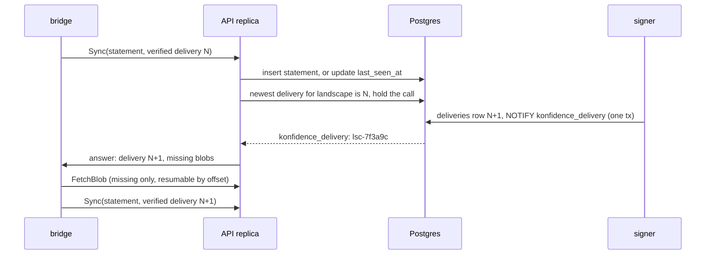

# Control plane architecture and scale

The control plane is one Go binary around Postgres, a blob store, and six
intent CRDs. This page owns the process modes, the River job kinds and
queues, how API replicas hold `Sync` calls, what 1000 landscapes cost, and
recovery. Table, field and channel names come from
[02-domain-model.md](02-domain-model.md), RPC names from
[08-api-and-ui.md](08-api-and-ui.md).

## One binary runs in three modes

Each deployment below runs with its own ServiceAccount and NetworkPolicy.
`konfidence all` runs every mode in one process for development and the CI
acceptance test.

| Deployment | Command | Replicas | Runs | Reaches |
| --- | --- | --- | --- | --- |
| API | `konfidence api` | 2–n, stateless | Connect server for UI, CLI and bridges; writes intent CRDs and rows; holds `Sync` calls; serves blobs | Kubernetes API, Postgres, blob store |
| Worker | `konfidence worker --queues=sync,rollout,maintenance` | 2–n | Light jobs; controller-runtime for intent CRD status, leader-elected | Kubernetes API, Postgres, blob store, github.com |
| Build worker | `konfidence worker --queues=build` | 1–n | Resolve, vendor, builder Jobs, OCM assembly, image mirroring | Kubernetes API, Postgres, blob store, github.com, dependency registries |
| Signer | `konfidence signer` | 1–2 | The `signing` queue only | Postgres, blob store |

Only the signer mounts the signing key (D-TRUST-06). It re-hashes every blob
it signs over, so a compromised build worker cannot get a forged blob signed.
Build workers are the only processes that reach chart and OCI registries
named as dependencies (D-SRC-01, D-BUN-01).

Controller-runtime does one thing: it writes intent CRD status
(D-TOPO-05). It sets `GitCredential.status` from an hourly credential check,
and `Landscape.status` from `bridge_keys` every 30 s and on every
`Landscape` change. It never decides progress.

## Every state change inserts its job in the same transaction

Progress is a chain of River jobs. A handler commits its state change and
inserts the next job in one transaction through River's transactional insert
(D-TOPO-05). Nothing polls for work except the periodic jobs below.

Each kind is unique over River's default states except `completed`:
`available`, `pending`, `running`, `retryable` and `scheduled`
([River unique jobs](https://riverqueue.com/docs/unique-jobs)). River always
counts `running`, so an insert during a run is a no-op. Two kinds must not
lose such an insert, so each holds an advisory lock on its unique key and
completes with `river.JobCompleteTx`
([River transactional completion](https://riverqueue.com/docs/transactional-job-completion)).
Every inserter takes the same lock first, waits out a running job, and then
inserts a fresh one. `delivery.build` locks the landscape ID.
`promotion.advance` locks the promotion sequence; statement import takes
these locks in sorted order. This table is the only definition of job kinds.

| Kind | Queue | Unique key | Inserted by | Effect |
| --- | --- | --- | --- | --- |
| `source.poll` | `sync` | repo URL, ref, credential, per `pollInterval` period (`ByPeriod`) | a 15 s ticker per poll key; webhook (M2+) | on a new head SHA inserts `release.build` per application |
| `release.build` | `build` | application, head SHAs | `source.poll`, `SyncApplication` | writes the manifest; for a new release ID inserts `releases` (`Building`), vendors, assembles, inserts `bundle.sign` |
| `bundle.sign` | `signing` | release ID | `release.build` | re-hashes and signs; sets `bundle_digest` and `Ready`, inserts `release.promote` |
| `release.promote` | `rollout` | release ID | `bundle.sign`; `promotion.advance` on `Succeeded` (M2+ chains) | inserts a `promotions` row and `promotion.advance` per `Auto` config |
| `promotion.advance` | `rollout` | promotion sequence | `CreatePromotion`, `SetGateState`, statement import, `promotion.sweep` | runs the wave step in [05](05-promotion-and-rollout.md) |
| `delivery.build` | `signing` | landscape ID | slot write, capability change in a statement, enrollment confirmed | builds, signs, and announces one delivery |
| `promotion.sweep` | `rollout` | none, periodic 60 s | periodic | inserts `promotion.advance` for every promotion past a wave timeout |
| `blob.gc`, `statement.prune` | `maintenance` | kind, periodic 1 h | periodic | rules under recovery below |

Failures split in two. Infrastructure errors (Postgres, blob store, registry
unreachable) return a retryable error; River retries with backoff. A
permanent failure sets the subject's terminal state in the same transaction
as the job completion: `releases.state` `Failed`, or the promotion's
`Failed` outcome through the wave step. Every handler is idempotent, because
River runs jobs at least once.

## One delivery job per landscape builds, signs, and announces

`delivery.build(landscape)` runs on the signer in one transaction:

1. Take `pg_advisory_xact_lock` on the landscape ID. The wave step takes the
   same lock before its compare-and-set, in sorted landscape order.
2. Before `Enrolled`, complete the job and stop (D-TRUST-02). Otherwise
   read the landscape's slots and the capabilities of its newest statement.
   List every slot whose `required_capabilities` the bridge has; a NULL
   `bundle_digest` becomes a tombstone (D-PROMO-04). A slot left out
   reports `MissingCapability` through the status function.
3. Compare the entry digests with the newest delivery. If nothing changed,
   complete the job and stop.
4. Take `nextval('delivery_seq')`. Build the delivery (D-BUN-04) and sign it.
5. Insert the `deliveries` row with `signed_at`, set `first_delivery_seq` on
   slots listed for the first time, send `NOTIFY konfidence_delivery` with
   the landscape ID, and complete the job with `river.JobCompleteTx`.

The lock rule above makes coalescing safe. A rolled-back run leaves a gap in
`delivery_seq`, never a reused number (D-ATT-02). Postgres
delivers `NOTIFY` only after commit
([PostgreSQL NOTIFY](https://www.postgresql.org/docs/current/sql-notify.html)),
so no bridge hears of a delivery that does not exist.

Attached and isolated landscapes use the same job. An isolated landscape's
delivery waits in Postgres until the operator uploads a statement file
([08](08-api-and-ui.md)).

## API replicas hold Sync calls without owning state

Any replica answers any bridge (D-TOPO-03). A `Sync` call carries a signed
statement; the replica imports it and then answers or holds the call.

The replica follows four rules:

1. **Answer at once when behind.** If the newest signed delivery is above the
   statement's `verified_delivery_seq`, the replica answers immediately.
2. **Hold otherwise.** The call waits up to 4 min ±10 %, then returns an
   empty answer. The bridge calls again at once; that call is its heartbeat.
3. **One listener per replica.** Each replica keeps one session-mode
   connection that `LISTEN`s on `konfidence_delivery` and wakes the held
   calls for that landscape ID. No transaction-mode pooler may sit on that
   path (install requirement).
4. **Notifications are hints.** When the listener reconnects, the replica
   wakes every held call, and each re-reads Postgres. A missed notice costs
   at most one hold period.

Statement import commits before the hold starts. It inserts
`promotion.advance` for every promotion with an open target on the landscape,
and `delivery.build` when the capabilities differ from the previous
statement. Liveness is `statements.last_seen_at` of the newest statement.
The load balancer idle timeout must exceed 5 min (install requirement).
Alert when `pg_notification_queue_usage()` exceeds 0.5: a full queue means a
stuck listener, and delivery commits would start failing.

## Sizing for 1000 landscapes fits three API replicas

This is a back-of-envelope estimate, not a measurement. Assumptions: 1000
landscapes, 500 applications, each on 100 landscapes on average, 10
applications per landscape.

- **Held calls.** About 330 per replica at 3 replicas, one goroutine each.
  The 4 min hold means about 4 heartbeat calls per second fleet-wide, each
  one `last_seen_at` update.
- **Postgres writes.** New statements only on change: one per landscape per
  rollout step plus health changes, well under 20 inserts per second. One
  mid-size instance handles this (inference).
- **Rows.** `desired` holds 50 000 slots. The six intent CRDs stay in the
  low thousands of objects, so etcd and informers need no sizing.
- **Inventory.** A statement carries the full inventory, about 700 KB for
  10 000 blobs, only when it changed. Otherwise it carries the digest.
- **Egress.** A first full transfer of 2 GiB to 1000 landscapes is 2 TB,
  about 30 min at 10 Gbit/s. A typical release changes about 200 MiB, so a
  fleet rollout moves about 200 GiB (D-XFER-03). Waves pace the fan-out.
- **Blob store.** 500 applications × 6 retained releases × 300 MiB is about
  900 GiB before deduplication. Use object storage with HTTP range reads.

## Landscapes keep running when the control plane is gone

Flux reconciles from artifacts the bridge serves in-cluster. A control-plane
outage stops new releases, promotions and statements, but never stops or
rolls back a running application (D-PROD-05).

While Postgres is unreachable, readiness fails and liveness checks the
process only. The API ends held calls with `unavailable` and serves no
`FetchBlob`. Bridges retry with exponential backoff and full jitter from
1 s to 5 min.

| Lost | Effect | Recovery |
| --- | --- | --- |
| One API replica | its bridges call another replica within seconds | automatic |
| Worker or signer mid-job | River rescues the job; the handler reruns idempotently | automatic |
| Postgres, restored | facts after the backup point gone; sessions reset | one runbook rule below |
| Intent CRDs, restored | intent at backup time; new promotions use it | none; facts and slots stay in Postgres |
| Blob store | new transfers fail; landscapes keep local blobs | restore from backup, or rebuild releases |

After a Postgres restore, before any `signer` starts, run
`ALTER SEQUENCE delivery_seq RESTART WITH <highest reported + 1000>`, where
the highest reported value is the largest `applied_delivery_seq` any bridge
or courier file shows (D-ATT-04). Landscapes then converge to the restored
slots. A promotion lost after the backup point must be created again.

Retention rules:

| Data | Kept | Knob |
| --- | --- | --- |
| `events`, `audit_log` | forever, monthly partitions | `history.retentionDays` (unset) |
| `statements` | newest per landscape forever, others 90 days (`statement.prune`) | `statements.retentionDays` (90) |
| River completed, discarded | 24 h, 7 days | River defaults |
| blobs | while a slot, one of the last 5 releases per application, or one of the last 5 deliveries per landscape references them, then 7 days grace (`blob.gc`) | `blobs.gcGraceDays` (7) |

A rollback to a release whose blobs are gone needs `release.build` first;
the release ID stays the same.

## Path

1. **M1** Ship `api`, `worker`, `signer` and `all` with one migration runner
   for the konfidence schema and River's, plus the five queues.
2. **M1** Wire retryable errors and terminal states in the completing job.
3. **M1** Run `source.poll`, `release.build`, `bundle.sign` and
   `release.promote` end to end for `example-app`.
4. **M1** Build `delivery.build` with the advisory lock, `JobCompleteTx` and
   `NOTIFY`.
5. **M1** Build the held `Sync`: listener, wake-up, 4 min hold, reconnect
   rule, degraded-mode rules, the 50-stream `FetchBlob` cap.
6. **M1** Add controller-runtime status writers for `GitCredential` and
   `Landscape`.
7. **M2+** Run a bridge simulator with 1000 landscapes against 2 replicas,
   including a full-transfer fan-out. Record memory, held calls and delivery
   latency.
8. **M2+** Run a restore drill in CI: restore Postgres, apply the sequence
   rule, check that every landscape converges.

Later: dependency mirror rewrites, an extra CA bundle, and `HTTPS_PROXY` for
build workers; read replicas; a multi-region control plane.
