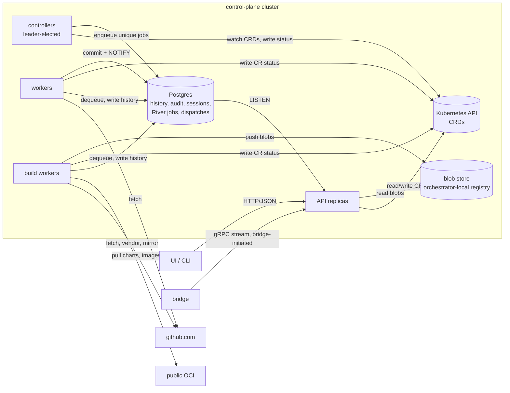
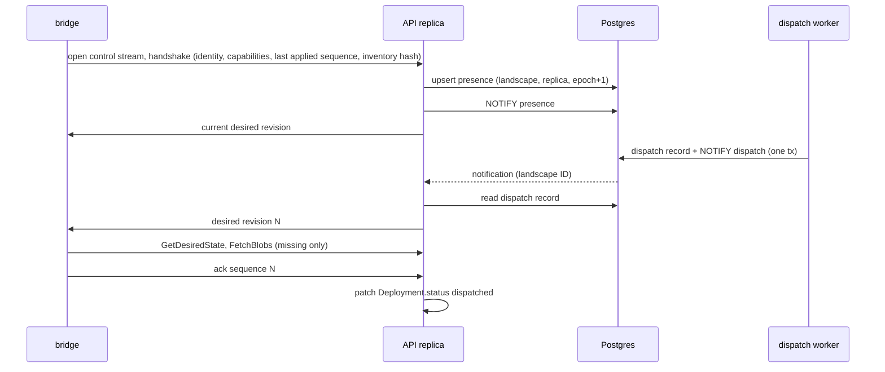

# Control plane architecture and scale

The control plane is one Kubernetes deployment of four process types around
Postgres, a blob store, and a set of CRDs. This page fixes which process does
what, where state lives, how bridge streams work across stateless API
replicas, what 1000 landscapes cost, and how the control plane recovers from
loss. CRD fields live in [02-domain-model.md](02-domain-model.md). The bundle
and transfer wire format lives in
[03-bundles-and-transfer.md](03-bundles-and-transfer.md), key handling in
[04-trust-and-attestation.md](04-trust-and-attestation.md), and the public API
surface in [08-api-and-ui.md](08-api-and-ui.md).

## Target design

### Four process types share one binary and one database

The control plane ships as one Go binary, `konfidence`, started in one of
three modes. Each process type runs as its own Kubernetes `Deployment` with
its own ServiceAccount and NetworkPolicy.

| Process | Mode | Replicas | Does | Reaches |
|---|---|---|---|---|
| API | `konfidence api` | 2–n, stateless | Connect server for UI, CLI and bridges; authorizes, writes CRDs, serves blobs, holds bridge streams | Kubernetes API, Postgres, blob store |
| Controllers | `konfidence controllers` | 2, leader-elected | Reconcile CRDs, decide, enqueue River jobs | Kubernetes API, Postgres (insert only) |
| Workers | `konfidence worker --queues=sync,dispatch,maintenance` | 2–n | Run light River jobs | Kubernetes API, Postgres, blob store, github.com |
| Build workers | `konfidence worker --queues=build,export` | 1–n | Run heavy River jobs: vendoring, builders, OCM assembly, image mirroring, signing, CTF export | Postgres, blob store, github.com, public OCI registries |

Build workers are the same mode as workers with a different queue list. They
get their own `Deployment` because they need more CPU and ephemeral disk,
outbound access to public OCI registries, and access to the release-signing
key. Nothing else in the control plane talks to the public internet except
workers reaching github.com (D-SRC-01, D-BUN-01).

For development and the acceptance test (D-PROD-04), `konfidence all` runs
all modes in one process against one Postgres.

### Controllers decide, workers execute

Controllers run controller-runtime with leader election. A reconcile reads
only CRDs (D-TOPO-07), decides the next step, and either writes CR status or
enqueues a River job through an insert-only River client. A River client
that is never started and has no queues or workers configured only inserts
jobs ([River insert-only clients](https://riverqueue.com/docs/insert-only-clients)).

Enqueueing is idempotent. Every job kind has a unique key, so a controller
re-enqueues on every reconcile until the CR status shows the result. River
enforces uniqueness with a partial unique index on `river_job`; by default a
completed job keeps blocking duplicates until River prunes it after 24 h
([River unique jobs](https://riverqueue.com/docs/unique-jobs)).

Workers report results by writing to Kubernetes, never by asking the
controller to read the DB:

- They create CRs with deterministic names. A `Release` is named after its
  release ID, so a retried sync creates nothing new.
- They patch status on the CR the job belongs to, for example
  `Release.status` with the component version digest after a build.
- They append the execution record to Postgres history in the same job.

If the DB commit succeeds and the CR patch fails, the job retries. All job
handlers are idempotent because River jobs run at least once
([River unique jobs](https://riverqueue.com/docs/unique-jobs)).

A job that fails permanently moves to `discarded`, which River excludes from
uniqueness by default. The controller would then re-enqueue immediately. To
stop that loop, the worker sets a `Failed` condition with an attempt count on
the CR before giving up, and the controller requeues with exponential backoff
based on that condition.

### Job kinds and their unique keys

| Kind | Queue | Unique key | Enqueued by | Result lands in |
|---|---|---|---|---|
| `source.sync` | `sync` | application, 1 min period | `Application` reconcile on poll interval or webhook | new `Release` CR or no-op |
| `credential.check` | `sync` | git credential, 1 h period | `GitCredential` reconcile | `GitCredential.status` conditions (D-SRC-04) |
| `release.build` | `build` | release ID | `Release` reconcile | blob store, blob index, `Release.status` |
| `deployment.dispatch` | `dispatch` | release, landscape | `Deployment` reconcile when its wave admits it | dispatch record, `NOTIFY`, `Deployment.status` |
| `transfer.export` | `export` | release, landscape, state request digest | API on CTF export request | CTF blob in blob store |
| `blob.gc`, `history.partition`, `cr.prune` | `maintenance` | kind, 1 h period | worker periodic job | blob store, Postgres, CRDs |

`release.build` mirrors every image a release references into the blob store,
once per digest. A full transfer (D-XFER-04) therefore never needs a job at
transfer time: the blobs already exist. Thin and full differ only in which
blobs the API offers.

`deployment.dispatch` is the step D-TOPO-05 calls "transfer". It allocates the
next per-landscape bundle sequence number (D-ATT-02), writes a dispatch record
that pins release, component version digest and sequence, and sends `NOTIFY`
in the same transaction. Postgres delivers notifications only after commit
([PostgreSQL NOTIFY](https://www.postgresql.org/docs/current/sql-notify.html)),
so a bridge never hears about a dispatch that does not exist.

Moving bytes is not a job. The bridge pulls them (D-XFER-01, D-PROD-05), so
the API replica that receives the request streams the blobs from the blob
store.

### API replicas hold bridge streams without owning state

Each bridge opens one long-lived control stream to whichever API replica the
load balancer picks. The stream carries notices, never bundle content. Bundle
content travels on separate, resumable transfer RPCs that the bridge opens
after a notice ([03-bundles-and-transfer.md](03-bundles-and-transfer.md)).

The design rests on four rules.

1. **One owner per landscape stream.** At handshake the replica increments
   the presence epoch for the landscape in Postgres and sends `NOTIFY
   presence`. A replica that holds an older epoch for that landscape closes
   its stream. Two replicas never both push to one bridge.
2. **One channel, small payloads.** All replicas `LISTEN` on one channel,
   `konfidence_events`. A payload is `<kind>:<landscape-id>` and stays far
   below the Postgres limit of 8000 bytes
   ([PostgreSQL NOTIFY](https://www.postgresql.org/docs/current/sql-notify.html)).
   Replicas drop notifications for landscapes they do not hold. Kinds are
   `dispatch`, `presence`, `revoke` and `attested` (the last one feeds UI
   live views).
3. **Notifications are hints, the DB is truth.** A listener that is
   disconnected misses notifications; Postgres guarantees order, not
   durability ([PostgreSQL NOTIFY](https://www.postgresql.org/docs/current/sql-notify.html)).
   A replica therefore resyncs every stream it holds when its `LISTEN`
   connection reconnects, and compares desired revisions every 60 s per held
   stream. A missed notice costs at most 60 s of delay.
4. **Streams end on purpose.** The server closes a control stream after
   30 min ±10 % jitter with a `reconnect` reason. The bridge then dials a new
   connection, so the load balancer places it again (D-TOPO-06). Transfer
   RPCs are not cut; they finish or resume on the new connection.

Rule 4 differs in mechanism from the decision text. Connect runs on
`net/http`, and its deployment guide names no connection-age setting
([Connect deployment](https://connectrpc.com/docs/go/deployment/)). The
grpc-go `MaxConnectionAge` option (GOAWAY after a jittered age,
[grpc keepalive](https://pkg.go.dev/google.golang.org/grpc/keepalive#ServerParameters))
belongs to the grpc-go server, which konfidence does not use. The stream-age
limit in the handler gives the same rebalancing effect.

The bridge must open a fresh TCP connection on `reconnect`, not reuse the
pooled HTTP/2 connection. Otherwise an L4 load balancer keeps it on the same
replica (inference from how L4 balancing works).

### CRDs hold desired state, Postgres holds everything that grows

| Data | Store | Why |
|---|---|---|
| `Project`, `Landscape`, `LandscapeGrant`, `GitCredential`, `Application`, `PromotionConfig` | CRD | desired state, low count |
| `Release`: current plus previous 5 per landscape | CRD | reconcile input (D-TOPO-07) |
| `Promotion`, `Deployment`: active plus last completed per application and landscape | CRD | reconcile input for waves and gates |
| Summary status: phase, conditions, `dispatched`, `attested at T`, health rollup | CRD status | controllers decide on it |
| All releases, all deployments, all promotions | Postgres history, append-only | grows without bound |
| Signed attestation reports, per-resource status | Postgres | too large and too chatty for etcd |
| Audit log, OIDC sessions | Postgres | D-TOPO-04 |
| River jobs | Postgres | D-TOPO-05 |
| Dispatch records, per-landscape sequence counters | Postgres | must be transactional with `NOTIFY` |
| Bridge presence, last reported inventory | Postgres | high churn |
| Blob index (bundle to blob digests, reference counts) | Postgres | used by GC and transfer planning |
| Blobs: charts, OCM descriptors, images, CTF archives | blob store | content-addressed bytes |
| Key material | Kubernetes Secret | never in the DB (D-SRC-03) |

The rule for implementers: a controller reads CRDs only. The API and workers
read both stores, and they move any fact a controller needs into CR status.
Attestation import is the main example. The API verifies the report, appends
it to Postgres, then patches the `Deployment` summary status.

### Retention is bounded in etcd and configurable in Postgres

| Store | Object | Default retention | Removed by |
|---|---|---|---|
| CRD | `Release` | current plus previous 5 per landscape, kept while any `Deployment` references it | `cr.prune` |
| CRD | `Promotion`, `Deployment` | active plus last completed per application and landscape | `cr.prune` |
| Postgres | history, audit | 400 days, monthly partitions, dropped whole | `history.partition` |
| Postgres | attestation reports | latest per application and landscape forever, others 90 days | `history.partition` |
| Postgres | River completed jobs | 24 h (River default) | River leader maintenance |
| Postgres | River discarded jobs | 7 days | River leader maintenance |
| blob store | blobs | while referenced by a retained `Release` or by the last 5 dispatches of any landscape, then 7 days grace | `blob.gc` |

River's elected leader runs job pruning and rescues stuck jobs
([River leader election](https://riverqueue.com/docs/leader-election)).
Pruning a CR never loses history, because every CR state change was already
appended to Postgres.

### Sizing for 1000 landscapes fits three API replicas

The numbers below are a back-of-envelope estimate, not a measurement. The
assumptions: 1000 landscapes, 50 projects, 500 applications, each
application on 100 landscapes on average, 10 applications per landscape.

**Streams.** 1000 control streams over 3 API replicas is about 330 per
replica. The 30 min stream age causes about 0.6 reconnects per second in
total. Each reconnect costs one signature check, one presence upsert and one
dispatch read. Handshakes carry an inventory hash; the full inventory (about
5000 digests, 350 KB) travels only when the hash differs.

**Postgres write load.** Attestations arrive on change plus a 10 min
heartbeat: 10 000 application instances / 600 s is about 17 inserts per
second. Presence and dispatch add under 5 writes per second. One
mid-size Postgres instance handles this (inference).

**etcd objects.** The large kind is `Deployment`. With active plus last
completed promotion, 500 applications × 100 landscapes × 2 is 100 000
objects. At about 3 KB each that is 300 MB, below the 2 GiB default etcd
quota and far below the 8 GiB suggested maximum
([etcd limits](https://etcd.io/docs/v3.5/dev-guide/limit/)). `Release` CRs
stay under 3000 because releases are shared across landscapes. Controllers
and API replicas cache `Deployment` in informers, so each needs about 1 GiB
of memory for that cache (inference: 2–3× object size in Go).

Two constraints follow:

- `Deployment.status` carries a summary only. Per-resource status lives in
  Postgres.
- `Promotion.status` carries wave counters, not per-landscape lists, so it
  stays far below the 1.5 MiB etcd request limit
  ([etcd limits](https://etcd.io/docs/v3.5/dev-guide/limit/)).

**Egress for full transfers.** A first full transfer of a 2 GiB
application to 1000 landscapes is 2 TB. At 10 Gbit/s that takes about
30 min of line rate. A typical later release changes about 200 MiB of layers.
Because only missing blobs travel (D-XFER-03), a fleet-wide rollout of such a
release moves about 200 GiB, about 3 min at 10 Gbit/s. Each API replica caps
concurrent blob streams at 50. Above the cap the replica answers
`resource_exhausted` with a retry delay, and the bridge resumes from its last
chunk. Wave `maxConcurrent` (D-PROMO-02) is the user-facing throttle; the
per-replica cap protects the replica.

**Blob store.** 500 applications × 6 retained releases × 300 MiB unique
content is about 900 GiB before deduplication. Back the orchestrator-local
registry with object storage, not a PVC.

### Landscapes keep running when the control plane is gone

Landscapes do not depend on the control plane at runtime (D-PROD-05). Flux
reconciles from artifacts the bridge serves in-cluster
([06-landscape-bridge-and-policy.md](06-landscape-bridge-and-policy.md)). A
control-plane outage stops new releases, promotions and reporting. It does
not stop or roll back any running application.

| Lost | Effect | Recovery |
|---|---|---|
| One API replica | its bridges reconnect elsewhere within seconds | automatic |
| Controller leader | standby takes the lease | automatic |
| A worker mid-job | River rescues the stuck job, the handler reruns idempotently | automatic |
| Postgres, restored from point-in-time backup | history and audit after the backup point are gone; jobs, sessions and presence reset | see below |
| CRDs (control-plane cluster) | desired state gone | restore from backup, then repair from Postgres history |
| Blob store | new transfers fail; landscapes keep their local blobs | restore from backup; rebuild from release snapshots is best effort |

After a Postgres restore, the system repairs itself in this order:

1. Controllers re-reconcile all CRs and re-enqueue missing jobs. Unique keys
   make this safe.
2. Sequence counters restart at `max(restored value, value reported by the
   bridge) + 1`. Connected bridges report their last applied sequence at
   handshake.
3. Bridges resend their latest signed attestation on reconnect.
4. Users log in again.

Isolated landscapes need one extra rule. After a restore, the API refuses a
CTF export for an isolated landscape without a state request file. That file
carries the last applied sequence (D-XFER-05). Without the rule, the bridge
would reject the CTF as a replay (D-ATT-02).

After a CRD loss, restore from an etcd snapshot or a Kubernetes-level
backup. `Release` CRs can be regenerated from Postgres history because the
history stores the full release snapshot: commits and dependency digests.
`Deployment` CRs regenerate from dispatch records. `Project`, `Landscape`,
`Application` and `PromotionConfig` need the backup or a git copy managed by
the operator.

Rebuilding a lost bundle from its release snapshot produces new signatures.
Upstream images may also have disappeared. Back up the blob store; do not
plan on rebuilding it.

## Decisions applied

- **D-PROD-05**: the bridge opens every stream and pulls every byte; the
  control plane only answers.
- **D-TOPO-02**: the sizing section sets the budget for 1000 landscapes.
- **D-TOPO-03**: API replicas keep no per-landscape state beyond the open
  stream; presence and dispatches live in Postgres.
- **D-TOPO-04**: one `LISTEN` channel fans dispatch, presence, revoke and
  attestation events to all replicas; history, audit, sessions and River
  share one Postgres.
- **D-TOPO-05**: controllers enqueue unique River jobs; workers and build
  workers run them; unique key `(release, landscape)` on
  `deployment.dispatch`.
- **D-TOPO-06**: implemented as a 30 min jittered stream-age limit in the
  Connect handler plus a fresh connection on the bridge, not as grpc-go
  `MaxConnectionAge`.
- **D-TOPO-07**: controllers read CRDs only; Postgres facts reach controllers
  through CR status; `Release` keeps current plus previous 5 per landscape.
- **D-SRC-01**: only workers and build workers reach github.com.
- **D-BUN-01**: only build workers reach public OCI.
- **D-XFER-02**: the orchestrator-local registry sits behind the API; only
  workers and the API touch it.
- **D-XFER-03**: the API plans transfers as a set difference between blob
  index and bridge inventory.
- **D-ATT-02**: the dispatch worker allocates sequence numbers in Postgres;
  restore rules keep them monotonic.

## Interfaces other docs depend on

- **Process modes**: `konfidence api | controllers | worker --queues=<list> |
  all`. Queues: `sync`, `build`, `dispatch`, `export`, `maintenance`.
- **Job kinds and unique keys**: the job table above. A new job kind declares
  its queue, unique key and the CR its result lands in.
- **Notification channel**: `konfidence_events`, payload
  `<kind>:<landscape-id>`, kinds `dispatch`, `presence`, `revoke`,
  `attested`. Payload never carries data; receivers read Postgres.
- **Bridge control stream** (messages owned by
  [03-bundles-and-transfer.md](03-bundles-and-transfer.md) and
  [08-api-and-ui.md](08-api-and-ui.md)): handshake with identity,
  capabilities, last applied sequence and inventory hash; server notices
  `desired revision` and `reconnect`; bridge acks applied sequence. Stream
  age 30 min ±10 %.
- **Status write-back**: the API sets `Deployment.status` `dispatched` on
  bridge ack and `attested at T` on report import
  ([05-promotion-and-rollout.md](05-promotion-and-rollout.md) consumes both).
- **Postgres tables owned here** (names, not schema): `history_events`,
  `audit_log`, `sessions`, `dispatches`, `landscape_sequences`,
  `bridge_presence`, `bridge_inventory`, `attestations`, `blob_index`, plus
  River's tables.
- **Retention knobs**: `release.retainPerLandscape` (5),
  `history.retentionDays` (400), `attestations.retentionDays` (90),
  `blobs.gcGraceDays` (7).

## Path

### v1 first steps

1. Ship the binary with `api`, `controllers`, `worker` and `all` modes, and
   one migration runner for the konfidence schema and River's schema.
2. Wire River: insert-only client in controllers, worker pool with the five
   queues, `Failed` condition plus backoff for discarded jobs.
3. Build `source.sync` and `release.build` end to end against `example-app`,
   writing `Release` CRs and status.
4. Build the control stream: handshake, presence epoch, one `LISTEN` channel,
   resync on reconnect, 60 s revision check, 30 min stream age.
5. Build `deployment.dispatch` with sequence allocation and `NOTIFY` in one
   transaction, then the ack path to `Deployment.status`. This closes the
   connected half of D-PROD-04.
6. Add `transfer.export` with the state-request rule, closing the isolated
   half of D-PROD-04.
7. Write a bridge simulator that opens 1000 streams and acks dispatches. Run
   it against 2 API replicas in CI and record memory, reconnect rate and
   dispatch latency.
8. Run a restore drill in CI: drop Postgres, restore, check that sequences
   stay monotonic and every landscape converges.

### Later

- `history.partition` once real data volume exists. `cr.prune` ships with
  step 3, because D-TOPO-07 bounds CRs from the start.
- Per-replica blob stream cap and `resource_exhausted` backoff, once the
  simulator shows egress pressure.
- Read replicas for Postgres history queries from the UI.
- Multi-region control plane. Out of scope until a customer needs it.

## Open questions

1. Does `Deployment` stay a CR per landscape at 100 000 objects, or does it
   become a Postgres row with one summary CR per promotion wave? The
   simulator in step 7 decides.
2. Which registry implementation backs the blob store, and does it serve
   HTTP range reads so the API can resume chunked transfers without
   buffering? (unverified for any candidate)
3. Who holds the release-signing key at build time: build workers directly,
   or a separate signing queue with a narrower ServiceAccount?
   [04-trust-and-attestation.md](04-trust-and-attestation.md) should decide.
