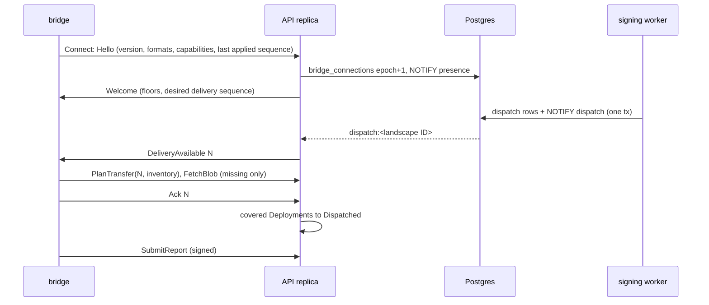

# Control plane architecture and scale

The control plane is one Go binary in five process types around Postgres, a
blob store and a set of CRDs. This page owns which process does what, the
River job kinds and queues, how bridge streams work across stateless API
replicas, what 1000 landscapes cost, and how the control plane recovers. Field,
table and channel names come from [02-domain-model.md](02-domain-model.md),
RPC names from [08-api-and-ui.md](08-api-and-ui.md).

## Five process types share one binary and one database

Each process type runs as its own Kubernetes `Deployment` with its own
ServiceAccount and NetworkPolicy. `konfidence all` runs every mode in one
process for development and the CI acceptance test.

| Process | Mode | Replicas | Runs | Reaches |
| --- | --- | --- | --- | --- |
| API | `konfidence api` | 2–n, stateless | Connect server for UI, CLI and bridges; writes CRDs, serves blobs, holds streams | Kubernetes API, Postgres, blob store |
| Controllers | `konfidence controllers` | 2, leader-elected | Reconcile CRDs, decide, enqueue jobs | Kubernetes API, Postgres (insert only) |
| Workers | `konfidence worker --queues=sync,export,maintenance` | 2–n | Light jobs | Kubernetes API, Postgres, blob store, github.com |
| Build workers | `konfidence worker --queues=build` | 1–n | Resolve, vendor, builder Jobs, OCM assembly, image mirroring | Kubernetes API, Postgres, blob store, github.com, and dependency chart and OCI registries |
| Signing worker | `konfidence worker --queues=signing` | 1–2 | Bundle and delivery signing | Postgres, blob store, Kubernetes API only |

Only the signing worker mounts the release-signing key (D-TRUST-06). It
re-hashes every blob it signs over, so a compromised build worker cannot get
a forged blob signed. Build workers are the only processes that reach chart
and OCI registries named as dependencies. Everything else reaches github.com
at most (D-SRC-01, D-BUN-01).

## Controllers decide, workers execute

A reconcile reads only CRDs (D-TOPO-07), decides the next step, and either
writes CR status or inserts a River job through an insert-only client
([River insert-only clients](https://riverqueue.com/docs/insert-only-clients)).
Inserting is idempotent: every job kind has a unique key, and the controller
re-inserts on every reconcile until CR status shows the result.

Workers report results by writing to Kubernetes, never by asking a controller
to read the DB. They patch status on the CR the job belongs to and append the
execution record to Postgres history in the same job. If the DB commit
succeeds and the CR patch fails, the job retries; every handler is
idempotent because River runs jobs at least once.

Failures split in two:

- **Infrastructure errors** (Postgres, blob store, registry unreachable)
  return a retryable error to River. They never set `Failed` before River
  gives up.
- **Permanent failures** move the job to `discarded`, which uniqueness
  ignores. The worker first sets a `Failed` condition with an attempt count
  on the CR, and the controller requeues with exponential backoff on it.

## Job kinds, queues and unique keys

This table is the only definition of job names. A new kind declares its
queue, unique key and where its result lands.

| Kind | Queue | Unique key | Inserted by | Result lands in |
| --- | --- | --- | --- | --- |
| `source.poll` | `sync` | poll key (repo URL, ref, credential), period = poll interval | periodic scheduler every 15 s | `Application.status.sources` |
| `source.resolve` | `build` | application, head SHAs | `Application` reconcile on new SHAs | `Application.status.resolved` |
| `bundle.build` | `build` | release | `Release` reconcile | unsigned descriptor and blobs; inserts `bundle.sign` |
| `bundle.sign` | `signing` | release | `bundle.build` | signed bundle, `Release.status.component` |
| `delivery.prepare` | `signing` | landscape, non-finished states | `Deployment` reconcile on `Dispatching`, attached landscapes only; `ctf.export` | `dispatches`, `dispatch_entries`, `NOTIFY`, `Deployment.status.delivery` |
| `ctf.export` | `export` | landscape, non-finished states | API on `ImportStateRequest`, or `ExportCTF` without one ([08](08-api-and-ui.md#public-services-group-by-resource-family)) | CTF blob; covered `Deployment`s to `Dispatched` |
| `credential.check` | `sync` | credential, period 1 h | `GitCredential` reconcile | `GitCredential.status` |
| `cr.prune`, `blob.gc`, `history.partition` | `maintenance` | kind, period 1 h | periodic | CRDs, blob store, Postgres |

The controller creates each `Release` itself from `Application.status.resolved`,
named `<application>-<sequence>`, only for a release ID the application does
not have yet (D-REL-01). `bundle.build` mirrors every image into the blob
store once per digest, so no job runs at transfer time.

"Non-finished states" means River `ByState` of `available`, `pending`,
`scheduled`, `running` and `retryable`; `completed` is excluded
([River unique jobs](https://riverqueue.com/docs/unique-jobs)). Changes that
arrive while a job runs coalesce into the next run, and a completed job never
blocks a later change such as a rollback from B to A (D-TOPO-05).

## One delivery job per landscape builds, fences and announces

`delivery.prepare(landscape)` is the dispatch step. It runs in five steps:

1. Allocate the delivery sequence with `UPDATE landscape_sequences …
   RETURNING` in its own committed transaction. A failed run leaves a gap and
   never reuses a number (D-ATT-02).
2. List the landscape's `Deployment`s with a live, uncached API read. The
   desired set is, per (project, application), the non-superseded
   `Deployment` with the highest promotion sequence in `Dispatching` or later.
   An application whose release format the bridge cannot read stays at its
   last readable release with reason `BridgeTooOldForBundleFormat`
   (D-BUN-03).
3. Build the delivery (D-BUN-04) and sign it.
4. In one transaction: run the dispatch fence, write `dispatches` and
   `dispatch_entries`, send `NOTIFY dispatch`. The fence checks only newly
   listed `Deployment`s, whose `deployment_uid` has no `dispatch_entries` row
   for the landscape yet; already dispatched entries pass unchanged. It
   refuses a new entry whose promotion sequence is not above the last
   dispatched one for (application, landscape), or whose promotion is
   terminal in `promotion_history`. The job marks that `Deployment`
   `Superseded` with `FencedByHistory` and retries without it (D-TOPO-07).
5. Patch `status.delivery` on newly listed `Deployment`s and mirror the
   sequence to `Landscape.status.deliverySequence`.

The controller re-inserts the job while any `Dispatching` `Deployment` of an
attached landscape has no `status.delivery.sequence`, so a change that lands mid-run ships next run.
Postgres delivers `NOTIFY` only after commit
([PostgreSQL NOTIFY](https://www.postgresql.org/docs/current/sql-notify.html)),
so no bridge hears of a delivery that does not exist. A bridge `Ack` of
sequence N moves exactly the `Deployment`s in N's `dispatch_entries` that are
still `Dispatching` to `Dispatched`.

Isolated landscapes never get an unrequested `delivery.prepare`. The operator
uploads a state request file, and `ctf.export(landscape)` inserts
`delivery.prepare`, snoozes until the signed delivery exists, then packs the
CTF minus the uploaded blob inventory. It moves the covered `Deployment`s to
`Dispatched` with reason `Exported`; the UI shows "exported at T".

## API replicas hold bridge streams without owning state

Each bridge opens one `Connect` stream to whichever replica the load balancer
picks. The stream carries notices only; bytes travel on `PlanTransfer` and
`FetchBlob`, reports on `SubmitReport`.

Four rules make this work on stateless replicas:

1. **One owner per stream.** On `Hello` the replica increments the epoch in
   `bridge_connections` and sends `NOTIFY presence`. A replica holding an
   older epoch for that landscape closes its stream.
2. **One channel, small payloads.** All replicas `LISTEN` on
   `konfidence_events`. Payloads are `<kind>:<landscape ID>`; receivers read
   Postgres and drop landscapes they do not hold.
3. **Notifications are hints.** A replica resyncs every held stream when its
   `LISTEN` connection reconnects, and compares desired delivery sequences
   every 60 s. A missed notice costs at most 60 s.
4. **Streams end on purpose.** The handler ends a stream after 30 min ±10 %
   with `Reconnect` (D-TOPO-06). Connect on `net/http` has no connection-age
   setting ([Connect deployment](https://connectrpc.com/docs/go/deployment/)).
   The bridge dials a fresh TCP connection so an L4 load balancer places it
   again; in-flight transfer RPCs finish or resume by offset.

`LISTEN` needs one dedicated session-mode connection per replica; no
transaction-mode pooler may sit on that path (install requirement). Alert when
`pg_notification_queue_usage()` exceeds 0.5: a full queue means a stuck
listener, and dispatch commits would start failing.

## CRDs hold desired state, Postgres holds everything that grows

A controller reads CRDs only. The API and workers read both stores and move
every fact a controller needs into CR status. The dispatch fence is the one
executor-side DB check (D-TOPO-07).

| Data | Store |
| --- | --- |
| `Project`, `Landscape`, `LandscapeGrant`, `GitCredential`, `Application`, `PromotionConfig` | CRD |
| `Release`, `Promotion`, `Deployment` within the retention rule | CRD |
| History, attestations, audit, sessions, sequences, dispatch records, bridge keys and connections, blob index, River | Postgres, tables in [02](02-domain-model.md) |
| Charts, descriptors, images, CTF archives | blob store, content-addressed |
| Key material | Kubernetes Secret, never in the DB (D-SRC-03) |

Attestation import verifies the report, appends it to `attestations`, then
patches `Deployment.status.attestation` only when a decision-relevant field
changes (D-ATT-05). Heartbeat reports cause no Kubernetes writes. Each API
replica keeps the last report time per landscape in memory, seeded from
`attestations` at start and refreshed on `attested` notices; that feeds the
UI's live-versus-stale view.

`cr.prune` enforces the one D-TOPO-07 retention rule defined in
[02](02-domain-model.md#retention-keeps-etcd-at-the-sized-budget). Pruning
loses nothing, because every CR change is already in Postgres.

| Store | Data | Default | Knob |
| --- | --- | --- | --- |
| Postgres | history, audit | kept, monthly partitions | `history.retentionDays` (unset) |
| Postgres | attestations | latest per (application, landscape) forever, others 90 days | `attestations.retentionDays` (90) |
| Postgres | River completed, discarded | 24 h, 7 days | River defaults |
| blob store | blobs | while a retained `Release` or one of the last 5 dispatches per landscape references them, then 7 days grace | `blobs.gcGraceDays` (7) |
| CRD | `Release` beyond the referenced set | 5 highest sequences per application | `release.retainPerApplication` (5) |

## Sizing for 1000 landscapes fits three API replicas

This is a back-of-envelope estimate, not a measurement. Assumptions: 1000
landscapes, 500 applications, each on 100 landscapes on average, 10
applications per landscape.

- **Streams.** About 330 per replica at 3 replicas. The 30 min lifetime
  causes about 0.6 reconnects per second fleet-wide, each one epoch upsert.
  Every `PlanTransfer` carries the full inventory: about 700 KB for 10 000
  blobs.
- **Postgres writes.** Reports on change plus a 10 min heartbeat: 10 000
  application instances / 600 s ≈ 17 inserts per second. Dispatch and
  presence add under 5. One mid-size instance handles this (inference).
- **etcd.** `Deployment` dominates: 1–2 per (application, landscape) in
  steady state, 3 at most. That is 100 000 objects, worst case 150 000, at
  about 3 KB each: 300–450 MB, below the 2 GiB default quota
  ([etcd limits](https://etcd.io/docs/v3.5/dev-guide/limit/)). Informer
  caches cost about 1–1.5 GiB per controller and API replica (inference).
  `Deployment.status` carries a summary and `Promotion.status` carries wave
  counters only, so both stay far below the 1.5 MiB request limit.
- **Egress.** A first full transfer of 2 GiB to 1000 landscapes is 2 TB,
  about 30 min at 10 Gbit/s. A typical release changes about 200 MiB, so a
  fleet rollout moves about 200 GiB (D-XFER-03). Onboarding is bounded by
  manual enrollment and waves, not 1000 simultaneous joins.
- **Blob streams.** Each replica caps concurrent `FetchBlob` streams at 50.
  Above the cap it answers `resource_exhausted` with a retry delay; the
  bridge waits that delay plus full jitter and resumes from its offset. Wave
  `maxConcurrent` is the user-facing throttle.
- **Blob store.** 500 applications × 6 retained releases × 300 MiB is about
  900 GiB before deduplication. Use object storage with HTTP range reads;
  without them the API reads and discards up to the offset, which is correct
  but wasteful.

## Landscapes keep running when the control plane is gone

Flux reconciles from artifacts the bridge serves in-cluster, so a
control-plane outage stops new releases, promotions and reporting, but never
stops or rolls back a running application (D-PROD-05).

Degraded mode while Postgres is unreachable:

- Liveness checks the process only; readiness checks Postgres.
- The API keeps existing streams open, refuses new `Connect` calls with
  `unavailable`, and serves no `PlanTransfer` or `FetchBlob`.
- Bridges retry with exponential backoff and full jitter from 1 s to 5 min.

| Lost | Effect | Recovery |
| --- | --- | --- |
| One API replica | its bridges reconnect elsewhere in seconds | automatic |
| Controller leader | standby takes the lease | automatic |
| Worker mid-job | River rescues the job; the handler reruns idempotently | automatic |
| Postgres, restored | history after the backup point gone; sessions reset | steps below |
| CRDs, restored | desired state at backup time | steps below |
| Blob store | new transfers fail; landscapes keep local blobs | restore from backup; rebuilds sign anew and may miss upstream images |

After a Postgres restore, before controllers start:

1. Set each `delivery_sequence` to max(restored, highest reported by any
   bridge) + 1000 (D-ATT-04). No signed number, including one in a courier's
   CTF, is ever reissued.
2. Run `konfidence admin reseed`: it sets each
   `Application.status.nextPromotionSequence` to max(CR, history) + 1.
3. Start controllers; unique keys make re-inserting every job safe. Bridges
   resubmit unacknowledged reports, and users log in again.
4. The API refuses the first CTF export for an isolated landscape without a
   state request file, because only that file carries its last applied
   delivery sequence.

After a CRD restore, the dispatch fence refuses every entry older than what
`dispatch_entries` already holds, so restored promotions never roll a
landscape back. `Release` CRs regenerate from `releases`; `Project`,
`Landscape`, `Application` and `PromotionConfig` need the backup.

## Path

1. **M1** Ship `api`, `controllers`, `worker` and `all` modes with one
   migration runner for the konfidence schema and River's.
2. **M1** Wire River: insert-only client in controllers, the five queues,
   retryable infrastructure errors, `Failed` condition plus backoff.
3. **M1** Run `source.poll`, `source.resolve`, `bundle.build` and
   `bundle.sign` end to end for `example-app`, plus `cr.prune`.
4. **M1** Build the stream: `Hello` and `Welcome`, epoch, one `LISTEN`
   connection, resync, 60 s check, 30 min lifetime, degraded-mode rules.
5. **M1** Build `delivery.prepare` with the fence and `dispatch_entries`,
   the `Ack` path, and the 50-stream `FetchBlob` cap.
6. **M1** Add `ctf.export` with the state-request rule.
7. **M2+** Run a bridge simulator with 1000 streams and 150 000
   `Deployment`s against 2 replicas, including a full-transfer fan-out.
   Record memory, reconnect rate and dispatch latency.
8. **M2+** Run a restore drill in CI: restore Postgres and CRDs, run
   `reseed`, check that sequences stay monotonic and every landscape
   converges.

Later:

- `Deployment` as a Postgres row plus one summary CR per wave, with API lists
  from Postgres, if the step-7 simulator shows etcd or informer pressure.
- A separate `konfidence blobs` mode and a fleet-wide transfer budget, if the
  simulator shows pressure on streams or UI.
- Dependency mirror rewrite rules, an extra CA bundle and `HTTPS_PROXY` for
  build workers.
- Read replicas for UI history queries; a multi-region control plane.
