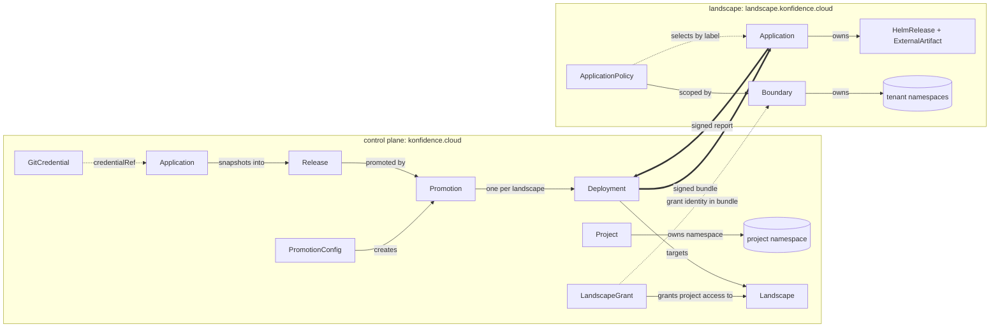

# Domain model

This page is the authoritative resource model of the konfidence deployment
orchestrator. It defines every custom resource in the control-plane group
`konfidence.cloud` and the bridge group `landscape.konfidence.cloud`: purpose,
writer, scope, the fields other docs rely on, and lifecycle. It also lists the
main Postgres tables. Other docs defer to this page for field names. How
controllers, workers and the bridge act on these resources lives in the topic
docs linked per section.

## Target design

### Two API groups, one direction of truth

The control plane runs on its own Kubernetes cluster. Its CRDs hold desired
state and the current position of every rollout (D-TOPO-07). Postgres holds
everything append-only or high-volume: history, audit, sessions, the blob
index, attestations and the River queue (D-TOPO-04). Reconcile decisions read
CRDs only.

The bridge CRDs live on each landscape cluster. The bridge writes
`Application`; the landscape operator writes `ApplicationPolicy` and
`Boundary`. The control plane never reads or writes them directly. It learns
their state only from signed status reports (D-PROD-05, D-ATT-01).

Both groups start at `v1alpha1`. Bridge CRDs follow versioned-CRD
compatibility rules from their first release, because operators upgrade
bridges by hand (D-LAND-02, D-API-02).

| Group | Kind | Scope | Writer |
| --- | --- | --- | --- |
| `konfidence.cloud` | `Project` | cluster | API (platform admin) |
| `konfidence.cloud` | `Landscape` | cluster | API (platform admin); status by controllers |
| `konfidence.cloud` | `LandscapeGrant` | namespaced (project) | API (project admin requests, landscape admin approves) |
| `konfidence.cloud` | `GitCredential` | namespaced (project) | API (project admin) |
| `konfidence.cloud` | `Application` | namespaced (project) | API (project admin); status by controllers and workers |
| `konfidence.cloud` | `Release` | namespaced (project) | release controller; status by workers |
| `konfidence.cloud` | `PromotionConfig` | namespaced (project) | API (project pm) |
| `konfidence.cloud` | `Promotion` | namespaced (project) | promotion-config controller or API; gate status by gate writers |
| `konfidence.cloud` | `Deployment` | namespaced (project) | promotion controller; status by controllers and workers |
| `landscape.konfidence.cloud` | `Application` | cluster | bridge only |
| `landscape.konfidence.cloud` | `ApplicationPolicy` | cluster | landscape operator |
| `landscape.konfidence.cloud` | `Boundary` | cluster | landscape operator |

### Resources relate through project namespaces and the bundle identity



All project-owned kinds live in the project namespace. A cross-project
reference exists in one place only: a `credentialRef` to a `GitCredential`
another project has shared (D-SRC-03). The link between control plane and
landscape is the verified bundle identity: project, application and
landscape grant. The bridge stamps it as `konfidence.cloud/` labels
(D-POL-04).

### Project owns a namespace and its role bindings

`Project` keeps the ADR-0028 shape: a cluster-scoped resource that owns one
namespace and carries `roleBindings`. The API enforces the roles (D-API-03).

```yaml
apiVersion: konfidence.cloud/v1alpha1
kind: Project
metadata: { name: payments }
spec:
  namespace: kden-project-payments   # immutable, defaulted
  roleBindings:                      # ADR-0028: admin, pm, dev
    admin: [{ session: { memberOf: [payments-admins] } }]
status:
  namespace: kden-project-payments
  conditions: [Ready]
```

Lifecycle: a finalizer deletes the namespace and every project resource in it.
Deleting a project with live `Deployment`s is refused until removal promotions
have run. Tombstones need the project to exist.

### Landscape is the control plane's record of one cluster and its bridge

`Landscape` is cluster-scoped because several projects share one landscape
(D-TEN-01). Platform admins create it. Its own `roleBindings` name the
landscape admins who approve grants. Labels on the `Landscape` are what
promotion selectors match.

```yaml
apiVersion: konfidence.cloud/v1alpha1
kind: Landscape
metadata:
  name: de-fra-prod-1
  labels: { env: prod, region: eu-central }
spec:
  mode: Attached            # Attached | Isolated
  trust:
    mode: Pinned            # Pinned (TOFU, D-TRUST-01) | CustomerCA (D-TRUST-04)
    caSecretRef: { name: acme-ca }   # CustomerCA only
  roleBindings:
    admin: [{ session: { memberOf: [fra-cluster-ops] } }]
status:
  bridge:
    version: 1.4.2
    capabilities: [thin-transfer, ctf-v1]
    identityKeyFingerprint: SHA256:4f…   # mirror of the pinned key in bridge_keys
    reportingLevelMax: full
  bundleSequence: 118       # last sequence issued to this landscape
  reportSequence: 977       # last accepted report sequence
  connection: { state: Connected, since: 2026-10-29T08:12:00Z }
  conditions: [Enrolled, Connected, BridgeOutdated]
```

Controllers write `status.connection` on transitions only. Heartbeats go to
the `bridge_connections` table, so 1000 landscapes do not churn the
Kubernetes API (D-TOPO-02). The pinned key itself lives in Postgres; the CRD
carries only its fingerprint for display. Enrollment, pinning and rotation
are in [04-trust-and-attestation.md](04-trust-and-attestation.md).

Lifecycle: `Pending` until enrollment pins the bridge key, then `Enrolled`.
Deleting a `Landscape` with active grants is refused.

### LandscapeGrant is a project's approved access to one landscape

A project admin creates the `LandscapeGrant` in the project namespace as a
request. A landscape admin approves it through the API. The approval
follows the ADR-0039 provenance pattern: the API writes it to status with the
acting identity from the session. v1 allows one grant per project and
landscape; the grant's name is the landscape name.

```yaml
apiVersion: konfidence.cloud/v1alpha1
kind: LandscapeGrant
metadata: { name: de-fra-prod-1, namespace: kden-project-payments }
spec:
  landscapeRef: de-fra-prod-1
  request:
    namespaces: [payments, payments-jobs]
    clusterScoped: [{ group: apiextensions.k8s.io, kind: CustomResourceDefinition }]
status:
  approval: { state: Approved, setBy: alice@acme, setAt: 2026-10-20T10:00:00Z }
  boundary:                 # from the latest bridge report
    state: WaitingForApproval   # Unknown | WaitingForApproval | Ready
    pendingKinds: [CustomResourceDefinition]
```

Promotions can target only landscapes with an approved grant. The grant
identity `payments/de-fra-prod-1` travels in every bundle. The bridge matches
it against a local `Boundary`. Approval on the control plane allows sending.
The `Boundary` on the landscape decides what runs.

### GitCredential points at a Secret and never holds key material

```yaml
apiVersion: konfidence.cloud/v1alpha1
kind: GitCredential
metadata: { name: github-app, namespace: kden-project-payments }
spec:
  type: GitHubApp           # GitHubPAT | SSHDeployKey | GitHubApp (D-SRC-02)
  secretRef: { name: github-app-key }   # same namespace
  knownHosts: "github.com ssh-ed25519 AAAA…"   # required for SSHDeployKey (D-SRC-04)
  sharedWith: [checkout, platform]      # projects allowed to reference it
status:
  expiresAt: 2027-01-31T00:00:00Z       # PAT only
  conditions: [Valid, ExpiringSoon]
```

The API writes the Secret on upload and keeps no copy in Postgres
(D-SRC-03). Workers read the Secret at fetch time. Nothing on the landscape
side ever references a `GitCredential` (D-SRC-01).

### Application declares sources and chart layout

The control-plane `Application` is the unit a team delivers. It names its git
sources and the charts built from them (D-SRC-06). Application values live in
git as values files, so they are part of the commit snapshot. The CR holds no
inline values.

```yaml
apiVersion: konfidence.cloud/v1alpha1
kind: Application
metadata: { name: payments-api, namespace: kden-project-payments }
spec:
  sources:
    - name: app
      url: https://github.com/acme/payments-api
      ref: main                 # branch or tag to track
      credentialRef: { name: github-app }   # optional project: for shared ones
  charts:
    - name: api
      source: app
      path: deploy/chart
      valuesFiles: [deploy/values.yaml]
      dependsOn: []
      crds: CreateReplace       # Skip | Create | CreateReplace (Flux policy)
      overridable: [/replicaCount, /ingress/host]   # D-POL-02 allow-list
  secretRequirements:
    - { name: db, keys: [username, password] }       # D-POL-03
  builders: []                  # D-PROD-03 builder contract, see 07
  pollInterval: 5m              # D-SRC-05
status:
  sources:
    - { name: app, latestCommit: 9c1e…, observedAt: 2026-10-29T08:00:00Z }
  latestRelease: { name: payments-api-42, sequence: 42 }
  nextSequence: 43
  conditions: [SourcesReady, CredentialsValid]
```

Charts within one application form a `dependsOn` graph. There is no data flow
between them and no ordering across applications (D-LAND-03).

### Release is an immutable snapshot of commits and layout

The release controller creates a `Release` when a source moves or the chart
layout changes. Workers resolve dependencies, compute the release ID and build
the bundle, then write `status`. A `Release` never changes after it reaches
`Ready`. Its name is `<application>-<sequence>`.

```yaml
apiVersion: konfidence.cloud/v1alpha1
kind: Release
metadata:
  name: payments-api-42
  namespace: kden-project-payments
  labels: { konfidence.cloud/application: payments-api }
spec:
  application: payments-api
  sequence: 42                  # human label payments-api@42 (D-REL-02)
  sources:                      # sorted by name
    - { name: app, url: https://github.com/acme/payments-api, path: deploy/chart, sha: 9c1e… }
  layout: { … }                 # copy of spec.charts, secretRequirements, builders
  layoutDigest: sha256:77ab…
status:
  phase: Ready                  # Resolving | Building | Ready | Failed
  releaseID: sha256:e3b0…       # D-REL-01: commits + dependency digests
  dependencies:
    - { chart: api, name: postgresql, version: 15.5.0, digest: sha256:aa12… }
  component:                    # OCM component version (D-BUN-01)
    name: acme.example/payments/payments-api
    version: 42.0.0
    digest: sha256:5d41…        # bytes identity, D-REL-02
  conditions: [Ready]
```

The release ID follows D-REL-01 and identifies sources. The component digest
identifies bytes. A layout-only change therefore yields a new sequence, the
same release ID and a new component digest. The controller deduplicates on
`(releaseID, layoutDigest)`. Bundle content and signing are in
[03-bundles-and-transfer.md](03-bundles-and-transfer.md).

Retention: a `Release` stays while any retained `Deployment` references it,
or while it is among the latest 10 of its application. The `releases` table
keeps every release permanently for diffs (D-REL-03).

### PromotionConfig defines targets, waves and gates

```yaml
apiVersion: konfidence.cloud/v1alpha1
kind: PromotionConfig
metadata: { name: prod, namespace: kden-project-payments }
spec:
  application: payments-api
  trigger:
    after: { promotionConfig: staging }   # or { newRelease: true }
    mode: Auto                            # Auto | Manual
  targets:
    - selector: { matchLabels: { env: prod } }   # or landscapes: [names]
      values: { ingress: { host: pay.acme.example } }   # promotion-target layer
  gates:                                   # ADR-0039 typed list
    - type: explicit-approval.konfidence.cloud
  waves:                                   # ordered; first matching wave wins
    - name: canary
      selector: { matchLabels: { canary: "true" } }
      maxConcurrent: 1
      failureThreshold: 0
      completion: Attested                 # Attested | Dispatched (D-PROMO-03)
    - name: rest
      selector: {}
      maxConcurrent: 20
      failureThreshold: 2
      completion: Attested
      gates: [{ type: soak-1h.konfidence.cloud }]
```

Validation rejects a config at admission when a target landscape's reporting
level cannot satisfy its wave's completion rule or gates (D-POL-05). Every
target landscape must fall into exactly one wave. Rollout semantics are in
[05-promotion-and-rollout.md](05-promotion-and-rollout.md).

### Promotion is a frozen rollout of one release

A `Promotion` snapshots the release, the resolved landscape list, values,
gates and waves at creation (ADR-0039). Later config edits never change a
running promotion. Removal uses the same kind with `operation: Remove`, which
produces tombstones (D-PROMO-04).

```yaml
apiVersion: konfidence.cloud/v1alpha1
kind: Promotion
metadata: { name: prod-17, namespace: kden-project-payments }
spec:
  promotionConfig: prod
  release: payments-api-42
  operation: Deploy             # Deploy | Remove
  gates: [{ type: explicit-approval.konfidence.cloud }]
  waves:
    - { name: canary, landscapes: [de-fra-prod-1], maxConcurrent: 1, failureThreshold: 0, completion: Attested }
    - { name: rest, landscapes: [de-fra-prod-2, …], maxConcurrent: 20, failureThreshold: 2, completion: Attested, gates: [...] }
  values: { de-fra-prod-1: { ingress: { host: pay.acme.example } } }
status:
  state: InProgress   # Waiting | Ready | InProgress | Succeeded | Failed | Superseded | Blocked
  gates:              # ADR-0039 entries: type, state, reason, setBy, setAt
    - { type: explicit-approval.konfidence.cloud, state: Satisfied, setBy: bob@acme, setAt: … }
  waves:
    - { name: canary, state: Succeeded, total: 1, completed: 1, failed: 0 }
    - { name: rest, state: InProgress, total: 480, completed: 212, failed: 1, gates: [...] }
```

At 1000 landscapes the per-landscape values map can grow large. Values per
landscape are stored once per distinct value set and referenced by digest
when the snapshot exceeds 64 KiB. Sketch shape only; 05 owns the mechanics.

### Deployment is one release on one landscape

The promotion controller creates one `Deployment` per target landscape
(D-PROMO-02). It is the unit the UI shows as dispatched, attested or live
(D-UI-02). Its name is `<promotion>-<landscape>`.

```yaml
apiVersion: konfidence.cloud/v1alpha1
kind: Deployment
metadata:
  name: prod-17-de-fra-prod-1
  namespace: kden-project-payments
  labels:
    konfidence.cloud/application: payments-api
    konfidence.cloud/landscape: de-fra-prod-1
spec:
  promotion: prod-17
  release: payments-api-42
  landscape: de-fra-prod-1
  grant: de-fra-prod-1
  wave: canary
  operation: Deploy
  valuesDigest: sha256:91f2…    # promotion-target values sent in the bundle
status:
  phase: Attested
  bundle:
    sequence: 118               # landscape bundle sequence (D-ATT-02)
    digest: sha256:c0ff…
    transfer: Thin              # Thin | Full (D-XFER-04)
    dispatchedAt: 2026-10-29T09:02:00Z
  attestation:                  # latest accepted report for this deployment
    reportSequence: 977
    at: 2026-10-29T09:05:11Z
    componentDigest: sha256:5d41…
    effectiveValuesDigest: sha256:0a9b…
    policy: { versions: [default@3, payments-api@7], digest: sha256:be11… }
    health: Healthy
  reason: ""                    # set for Refused, SecretsUnbound, WaitingForBoundary
  conditions: [Dispatched, Attested, Superseded]
```

Phases run `Pending → Building → Dispatched → Applied → Attested`.
Terminal failures are `Failed` and `Refused` (D-LAND-05). Blocking phases with
a reason are `WaitingForBoundary`, `SecretsUnbound` and `PolicyAmbiguous`.
`Superseded` marks a `Deployment` when a newer one for the same application
and landscape dispatches. Deployment identity is release plus policy version
(D-POL-06), so `status.attestation.policy` changes without a new
`Deployment`. Each change appends a row to `deployment_history`.

The bundle sequence comes from `Landscape.status.bundleSequence`. The
controller increments it with an optimistic-concurrency update before
dispatch, so a landscape never sees two bundles with the same sequence.

Retention: the controller keeps the current and the previous 5 `Deployment`s
per application and landscape (D-TOPO-07). Older ones are deleted; their
history stays in Postgres.

### Bridge Application is the installed form of one bundle

The bridge creates one cluster-scoped `Application` per installed control-plane
application, named `<project>.<application>`. Operators read it but do not edit
it. A local deletion is undone from the last bundle (D-LAND-05).

```yaml
apiVersion: landscape.konfidence.cloud/v1alpha1
kind: Application
metadata:
  name: payments.payments-api
  labels:                         # set by the bridge from verified identity only
    konfidence.cloud/project: payments
    konfidence.cloud/application: payments-api
    konfidence.cloud/landscape-grant: de-fra-prod-1
spec:
  release: { id: sha256:e3b0…, label: payments-api@42, componentDigest: sha256:5d41… }
  bundleSequence: 118
  charts:
    - { name: api, artifactDigest: sha256:ab01…, dependsOn: [], crds: CreateReplace }
  secretRequirements: [{ name: db, keys: [username, password] }]
  overridable: { api: [/replicaCount, /ingress/host] }
status:
  phase: Ready     # Pending | Applying | Ready | Degraded | Refused | Blocked | Removing
  policy: { versions: [default@3, payments-api@7], digest: sha256:be11… }
  boundary: payments-fra
  targetNamespace: payments
  effectiveValuesDigest: sha256:0a9b…
  charts: [{ name: api, helmRelease: payments/payments-api-api, ready: true }]
  conditions: [Ready, SecretsBound, PolicyResolved, BoundaryReady]
```

It owns one `HelmRelease` and one `ExternalArtifact` per chart in the target
namespace. Kubernetes permits a cluster-scoped owner for namespaced
dependents. A tombstone moves it to `Removing`. It is deleted once Helm
uninstalls all charts (D-LAND-04, D-PROMO-04).

### ApplicationPolicy is the operator's authoritative say

The policy named `default` is the landscape-wide default. Every other policy
selects applications by label inside one `Boundary` (D-POL-04). Two
non-default matches set `PolicyAmbiguous` and block the application.

```yaml
apiVersion: landscape.konfidence.cloud/v1alpha1
kind: ApplicationPolicy
metadata: { name: payments-api }
spec:
  boundaryRef: payments-fra      # ignored for "default"
  selector: { matchLabels: { konfidence.cloud/application: payments-api } }
  action: Allow                  # Allow | Deny (D-LAND-05 refusal)
  targetNamespace: payments
  values: { api: { replicaCount: 4 } }   # highest precedence (D-POL-02)
  secretBindings:
    - { requirement: db, secretStoreRef: { name: vault, kind: SecretStore } }
  images:
    transfer: Thin               # Thin | Full (D-XFER-04)
    registries: [registry.fra.acme.internal]
    requireSignatures: true
  reporting: health              # none | health | resources | full (D-POL-05)
status:
  matchedApplications: [payments.payments-api]
  conditions: [Valid]
```

Policy version is `<name>@<metadata.generation>`. The policy digest is
SHA-256 over the canonical spec of the default and the matching policy. Both
go into every report. Policy semantics are in
[06-landscape-bridge-and-policy.md](06-landscape-bridge-and-policy.md).

### Boundary is the tenant fence a landscape admin draws

```yaml
apiVersion: landscape.konfidence.cloud/v1alpha1
kind: Boundary
metadata: { name: payments-fra }
spec:
  grants: [{ project: payments, grant: de-fra-prod-1 }]
  namespaces:
    allowed: [payments, payments-jobs]
    template: { labels: { team: payments } }
  quota: { hard: { requests.cpu: "40", requests.memory: 80Gi } }
  approvedClusterScoped:                 # always manual (D-TEN-01)
    - { group: apiextensions.k8s.io, kind: CustomResourceDefinition, names: [ledgers.payments.acme] }
status:
  namespaces: [payments, payments-jobs]
  serviceAccount: konfidence-payments    # Flux impersonation target
  pendingClusterScoped: []               # drives WaitingForBoundary
  conditions: [Ready]
```

The `Boundary` owns its namespaces, ServiceAccount, RBAC and ResourceQuota.
Every `HelmRelease` inside it runs as `status.serviceAccount` through
`spec.serviceAccountName` (D-TEN-01). Deleting a `Boundary` deletes its
namespaces, so the bridge holds a finalizer while installed applications
reference it.

### Postgres holds history, audit and everything high-volume

Tables below are the stable set. Column lists name what other docs query;
migrations own the rest. Every history table is append-only.

| Table | Purpose | Main columns |
| --- | --- | --- |
| `releases` | Permanent release index for diffs and paths | `project, application, sequence, release_id, layout_digest, component_digest, sources jsonb, created_at` |
| `deployment_history` | Append-only record per deployment state change | `id, project, application, landscape, release_id, sequence, component_digest, policy_versions, policy_digest, values_digest, phase, bundle_sequence, promotion, wave, at` |
| `promotion_history` | Promotion and gate transitions | `id, project, promotion, release_id, state, gate_type, set_by, reason, at` |
| `audit_log` | Every mutating API call and override | `id, at, actor, actor_kind, project, action, object_ref, reason, request_digest` |
| `sessions` | OIDC sessions (D-API-03) | `id_hash, subject, issuer, groups, created_at, expires_at, last_seen_at` |
| `enrollment_tokens` | One-time bridge enrollment | `token_hash, landscape, created_by, expires_at, used_at` |
| `bridge_keys` | Pinned, rotated and revoked bridge identity keys (D-TRUST-05) | `landscape, fingerprint, public_key, state, predecessor, pinned_by, pinned_at, revoked_at` |
| `bridge_connections` | Live stream presence and heartbeats | `landscape, api_replica, bridge_version, capabilities, connected_at, last_heartbeat_at` |
| `attestations` | Every accepted signed report, gRPC or file | `landscape, report_sequence, deployment, component_digest, values_digest, policy_digest, health, key_fingerprint, via, received_at, payload jsonb`; unique `(landscape, report_sequence)` |
| `blobs` | Content-addressed blob index over registry storage | `digest, size, media_type, storage_ref, created_at, last_referenced_at` |
| `component_blobs` | Which blobs a component version needs | `component_digest, blob_digest` |
| `landscape_blobs` | Reported bridge inventory (D-XFER-03) | `landscape, blob_digest, reported_at` |
| `transfers` | Resumable transfer state | `id, landscape, bundle_sequence, mode, content, bytes_total, bytes_done, state, updated_at` |
| `river_*` | River job queue, created by `rivermigrate` | `river_job`, `river_leader`, `river_queue`, `river_migration` |

API replicas get change signals through `LISTEN/NOTIFY` on channel
`landscape_dispatch`, payload = landscape name. The replica holding that
landscape's stream then offers the new bundle (D-TOPO-04).

## Decisions applied

- D-PROD-02: no runtime kinds; a `Stage` is a manifest inside a chart or builder output.
- D-PROD-05: control plane learns bridge-side state only from signed reports.
- D-TOPO-01: `Landscape` models one cluster with one bridge.
- D-TOPO-04: Postgres tables above, `LISTEN/NOTIFY` channel `landscape_dispatch`.
- D-TOPO-05: River unique jobs keyed by `(release, landscape)` args.
- D-TOPO-07: CRDs hold desired and current state; Deployment retention of current plus 5.
- D-SRC-01, D-SRC-03: `GitCredential` with `secretRef`, `sharedWith`; no landscape reference.
- D-SRC-02, D-SRC-04: `type` enum; `knownHosts` required for SSH; `expiresAt` and `ExpiringSoon`.
- D-SRC-05, D-SRC-06: `pollInterval`; `sources[]` with per-source `credentialRef`.
- D-REL-01, D-REL-02: `status.releaseID`, `status.component.digest`, `spec.sequence`.
- D-REL-03: `releases` and `deployment_history` tables feed diffs and paths.
- D-XFER-03, D-XFER-04: `landscape_blobs` inventory; `Deployment.status.bundle.transfer`.
- D-LAND-02, D-LAND-03, D-LAND-04: bridge kinds, chart `dependsOn`, `crds` policy, ownership.
- D-LAND-05: `action: Deny` yields `Refused` on the `Deployment`.
- D-POL-01 to D-POL-06: `ApplicationPolicy` fields, `overridable`, `secretRequirements`, policy version and digest.
- D-TEN-01: `LandscapeGrant` request and approval; `Boundary` with manual `approvedClusterScoped`.
- D-TRUST-01, D-TRUST-04, D-TRUST-05: `Landscape.spec.trust`; `bridge_keys` with revocation.
- D-ATT-01, D-ATT-02: `attestations` table; `bundleSequence` and `reportSequence` on `Landscape`.
- D-PROMO-01 to D-PROMO-04: ADR-0039 `gates`, `waves`, `completion`, `operation: Remove`.
- D-UI-02: `Deployment` phases separate dispatched from attested.

## Interfaces other docs depend on

- Field names in every sketch above. Topic docs may add fields only after
  this page lists them.
- Identity triple in bundles and labels: `konfidence.cloud/project`,
  `konfidence.cloud/application`, `konfidence.cloud/landscape-grant`.
- Naming: `Release` = `<application>-<sequence>`, `Deployment` =
  `<promotion>-<landscape>`, bridge `Application` = `<project>.<application>`.
- Two sequences per landscape: `bundleSequence` (control plane issues, bridge
  enforces) and `reportSequence` (bridge issues, control plane enforces).
- Policy version format `<name>@<generation>` and the policy digest
  definition, used by attestations (04) and history (08).
- `Deployment.status.phase` values, used by rollout (05) and UI (08).
- Postgres table names and the `landscape_dispatch` channel (01, 03, 04).

## Path

### v1 first steps

1. Generate Go types and CRDs for `Project`, `Landscape`, `GitCredential`,
   `Application`, `Release` with kubebuilder markers. Add CEL rules for
   immutable fields (`Project.spec.namespace`, `Release.spec`).
2. Add `Deployment` and a minimal `Promotion` with a single wave and
   `explicit-approval` only. `PromotionConfig` with `landscapes` lists, no
   selectors.
3. Generate the bridge `Application` and a `default`-only `ApplicationPolicy`.
   Deploy `example-app` to one attached landscape with a full transfer.
4. Create Postgres migrations for `releases`, `deployment_history`,
   `audit_log`, `sessions`, `bridge_keys`, `attestations`, `blobs`,
   `landscape_blobs`, plus River's own migrations.
5. Add `LandscapeGrant` and `Boundary`, then per-application policies. Run the
   D-PROD-04 acceptance test across one attached and one isolated landscape.

### Later

- Selectors, multiple waves and wave gates in `PromotionConfig`.
- More than one grant per project and landscape.
- `CustomerCA` trust mode and CRL handling.
- Promote both groups to `v1beta1` once the acceptance test passes twice
  without schema changes.

## Open questions

1. Where do per-landscape promotion values live when 1000 targets differ? The
   64 KiB spill-over to a Postgres table conflicts in spirit with
   "decisions read CRDs only". 05 decides.
2. Does a removed application's tombstone need a `Release`, or should
   `Promotion` accept an application with no release for removal?
3. Should the release ID cover the chart layout digest? Today a layout-only
   change keeps the release ID, which makes "same release ID" mean "same
   sources", not "same deployable".
