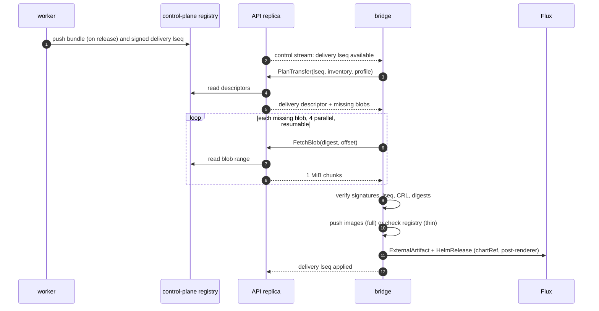
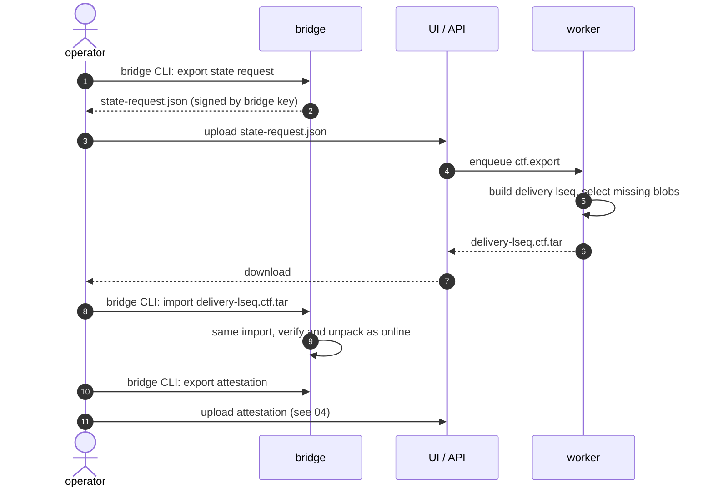

# Bundles and transfer

This page defines what a bundle is, how the control plane builds it from a
release, and how its bytes reach a landscape over gRPC or as a CTF archive.
It ends where Flux takes over: a verified chart served in-cluster as an
`ExternalArtifact` and images at a digest-pinned location. Values layering,
policy evaluation and `Boundary` handling are in
[06-landscape-bridge-and-policy.md](06-landscape-bridge-and-policy.md). Key
custody, pinning and attestations are in
[04-trust-and-attestation.md](04-trust-and-attestation.md). [02-domain-model.md](02-domain-model.md) owns field names;
sketches here show only what transfer needs.

## Target design

### Two signed component versions: the bundle and the delivery

A release produces exactly one **bundle**: a signed OCM component version
holding everything that is the same for every landscape. Per-landscape facts
cannot live in it, because the control plane signs the bundle once and the landscape
sequence (D-ATT-02) differs per landscape. They go into a second, small
signed component version, the **delivery**.

| Object   | OCM component name                               | Version       | Built                      | Content |
|----------|--------------------------------------------------|---------------|----------------------------|---------|
| Bundle   | `konfidence.cloud/p/<project>/<application>`     | `<seq>.0.0`   | once per `Release`         | charts, image references, values schema, secret requirements, metadata |
| Delivery | `konfidence.cloud/l/<landscape>/delivery`        | `<lseq>.0.0`  | per landscape, per change  | desired state of the landscape, tombstones, CRL |

`<seq>` is the per-application sequence number (`payments@42`, D-REL-02).
`<lseq>` is the monotonic per-landscape sequence (D-ATT-02). The version
format assumes OCM wants semver versions (unverified). The release ID goes
into a signed label, not into the version.

The delivery references each installed bundle through an OCM component
reference with its digest. OCM signs a digest of the normalized component
descriptor, and that digest includes reference descriptors and their digests
([OCM signing](https://ocm.software/docs/concepts/signing-and-verification/)).
One signature check on the delivery therefore pins every bundle it names.
The bundle keeps its own signature, so the control plane and bridge can
verify, cache, and diff it on its own.

The delivery is declarative. It lists the full desired set of applications
for the landscape, not a delta. The bridge applies the highest sequence it
has verified and rejects anything lower. A lost or skipped delivery causes
no drift, and two offline CTFs imported out of order resolve to the newer one.

### Bundle resources

The bundle stores all resources by value (OCM `localBlob` access) except
images, which stay OCI artifacts next to the descriptor. Resource names are
stable so release diffs (D-REL-03) compare like with like.

| Resource name            | OCM type                       | Content |
|--------------------------|--------------------------------|---------|
| `chart.<chart>`          | `helmChart`                    | packaged chart `.tgz`, dependencies vendored |
| `image.<chart>.<n>`      | `ociImage`                     | image manifest or index, by digest |
| `values-schema.<chart>`  | `konfidence.cloud/values-schema/v1` | JSON Schema plus the overridable-key allow-list (D-POL-02) |
| `secret-requirements`    | `konfidence.cloud/secret-requirements/v1` | required secrets: name, keys, consuming chart (D-POL-03) |
| `metadata`               | `konfidence.cloud/bundle-metadata/v1` | chart order (`dependsOn`), CRD policy, cluster-scoped kinds, CRDs and webhooks found at build, image list per chart |
| `builder.<builder>.<n>`  | declared by the builder        | extra resources from builders (D-PROD-03) |

Signed labels on the bundle: `konfidence.cloud/bundle-format`,
`konfidence.cloud/release-id`, `konfidence.cloud/project`,
`konfidence.cloud/application`. OCM includes labels marked `signing: true` in
the signed digest (verified, same source as above). The bridge derives the
policy-matching labels from these signed labels, never from chart content
(D-POL-04).

The `metadata` resource is what lets the bridge decide "waiting for boundary
approval" (D-TEN-01) and "secret unbound" (D-POL-03) before it creates any
`HelmRelease`.

### Delivery resources

| Resource name | OCM type                               | Content |
|---------------|----------------------------------------|---------|
| `manifest`    | `konfidence.cloud/delivery/v1`         | landscape ID, `lseq`, format version, per application: bundle reference, promotion-target values, transfer mode used; tombstones |
| `crl`         | `konfidence.cloud/crl/v1`              | current revocation list (D-TRUST-04) |

A tombstone is an entry in `manifest` that names an application and says
"remove". The delivery signature and `lseq` cover it (D-PROMO-04).
An application that disappears from the desired set without a tombstone is a
control-plane bug; the bridge keeps it running and reports the mismatch.

### Signing and the format version

The control plane signs bundle and delivery with its release-signing key,
using OCM signatures in the component descriptor. The algorithm is
`RSASSA-PSS`, OCM's default; normalization is `jsonNormalisation/v4alpha1`
(both verified, OCM signing page). Signatures exclude `access`, so moving
blobs between the control-plane registry, a CTF and the bridge store does not
break them (verified, same page).

`konfidence.cloud/bundle-format` is an integer major version, independent of
the API version (D-BUN-03). Within a major, changes are additive and old
bridges ignore unknown fields. A new major needs a new bridge. The bridge
advertises the majors it reads in its handshake and state request file. The
control plane refuses to plan a delivery whose bundles use a major the bridge
does not read, and shows "bridge too old for bundle format" on the
`Deployment`.

### The build turns a release into a bundle

A River job `bundle.build`, unique per release ID, runs on a worker
(D-TOPO-05). Controllers only enqueue it.

1. Check out every source of the release at its pinned SHA. Only the control
   plane reads git (D-SRC-01).
2. For each chart path, run `helm dependency build` against the committed
   `Chart.lock` and `helm package` (D-BUN-01). The resolved dependency
   digests are already part of the release ID (D-REL-01).
3. Run configured builders and collect their output as resources.
4. Run `helm template` with chart defaults. From the output, collect
   container images, cluster-scoped kinds, CRDs, and admission webhooks.
5. Merge the discovered images with the optional image list in the
   application config. Resolve every tag to a digest and copy each image
   into the control-plane registry (D-XFER-02).
6. Assemble the component descriptor, sign it, and push it with its blobs to
   the control-plane registry.
7. Write the bundle digest to the `Release` status.

The build is the only step that reaches public OCI registries or chart
repositories. A failed resolution fails the build, not a later deployment.
Image discovery from `helm template` misses images that only appear with
non-default values; the image list in the application config covers those.

### One content-addressed blob layout for gRPC and CTF

Every byte that crosses to a landscape is a blob named by its SHA-256 digest:
component descriptors, chart `.tgz` files, schema files, OCI manifests,
configs, and layers. The build splits images into their OCI blobs instead of
one tarball, so a base layer shared by twenty images travels once.

The layout is the OCM CTF directory format: `artifact-index.json` at the root
and a `blobs/` directory beside it
([CTF spec](https://github.com/open-component-model/ocm-spec/blob/main/doc/04-extensions/03-storage-backends/ctf.md)).
The spec examples name blob files `sha256.<hex>` and reference them as
`sha256:<hex>` in the index; konfidence uses that naming. The spec is
inconsistent about the index file name in places; konfidence uses
`artifact-index.json`.

Three places use the same layout:

- the CTF archive the operator carries, as a `tar` file,
- the bridge store on the landscape, as a directory,
- the logical view the gRPC transfer exposes, blob by blob.

The bridge has one import routine: blobs land in `incoming/`, the bridge
checks each digest, moves the blob into `blobs/`, then merges index entries.
gRPC and CTF import both call it, and both then call the same verify-and-unpack
step (D-XFER-01).

### The bridge pulls blobs it lacks over gRPC

The bridge opens every connection (D-PROD-05). Transfer is a Connect service
on the API, served by any replica (D-TOPO-03). API replicas read blobs from
the control-plane registry and hold no transfer state, so a stream cut by
`MaxConnectionAge` (D-TOPO-06) resumes on another replica.

1. The API announces delivery `lseq` on the bridge's control stream, which
   [01-control-plane.md](01-control-plane.md) defines.
2. The bridge calls `PlanTransfer` with the `lseq`, its full blob inventory
   and its transfer profile.
3. The API returns the delivery descriptor and the list of missing blobs with
   digest and size: required blobs minus inventory (D-XFER-03).
4. The bridge calls `FetchBlob(digest, offset)` for each missing blob, 4 in
   parallel. The server streams 1 MiB chunks.
5. After a cut, the bridge calls `FetchBlob` again with the size of its
   partial file as `offset`.
6. When all blobs are present, the bridge runs verify-and-unpack and reports
   the result on the control stream.

The inventory is a sorted list of digests, sent in full on every plan. A
landscape with 10 000 blobs sends about 320 KB of hashes. That is cheap
enough to skip an incremental protocol in v1.

### The plan picks thin or full per target

The bridge reports a transfer profile in `PlanTransfer` and in the state
request file. It holds, per application, the effective image mode from
`ApplicationPolicy` and whether the operator configured registry credentials on
the bridge. The control plane does not evaluate landscape policy; it trusts the
profile for content selection only.

- **Thin**: the plan includes descriptors, charts and metadata, no image
  blobs. Before unpacking, the bridge checks with its credentials that every
  image digest exists in the operator's registry. A missing image blocks the
  application with "image not in registry".
- **Full**: the plan includes all image blobs. The bridge pushes them into
  the landscape-local registry without credentials. That registry is either
  the one the bridge ships or one the operator provides (D-XFER-04).

The delivery `manifest` records the mode per application, so
history shows how each landscape got its images.

### Offline transfer uses a state request file and a CTF

The state request file is a JSON document the operator exports with the
bridge CLI. It contains bridge version, readable bundle-format majors,
landscape ID, last applied `lseq`, blob inventory, and transfer profile
(D-XFER-05). The bridge signs it with its identity key, so the control plane
rejects files from unknown or revoked bridges (D-TRUST-05).

The operator uploads it through the UI or CLI. A River job `ctf.export`
builds the next delivery and writes a CTF containing only the missing blobs.
Without a state request file the CTF holds every blob of the desired state.
The CTF is always self-verifying: it carries the delivery, its bundles' descriptors and
the CRL, so the bridge needs nothing else to check it.





### Verify, then unpack, then hand to Flux

Verification runs in this order and stops at the first failure:

1. The delivery signature is valid under the pinned release-signing key, or
   under the customer CA if configured (D-TRUST-01, D-TRUST-04).
2. The delivery's landscape ID is this landscape and `lseq` is higher than
   the last applied one (D-ATT-02).
3. The delivery's CRL is newer than or equal to the stored one; the bridge
   replaces it and checks the signing key against it.
4. Each referenced bundle's descriptor digest matches its component reference
   and its own signature is valid.
5. Each resource blob matches the digest in its descriptor.

Unpacking per application, after policy checks in
[06-landscape-bridge-and-policy.md](06-landscape-bridge-and-policy.md) pass:

- **Charts.** The bridge store serves each chart `.tgz` over in-cluster HTTP.
  The bridge creates one `ExternalArtifact` per chart in the target namespace
  and sets `status.artifact` with `url`, `digest` and `revision`. Flux
  defines these fields and expects a `tar.gz` artifact
  ([ExternalArtifact](https://fluxcd.io/flux/components/source/externalartifacts/)).
  The `revision` is `<chart>-<version>@sha256:<hex>`.
- **HelmRelease.** One per chart, `spec.chartRef` of kind `ExternalArtifact`
  in the same namespace. helm-controller needs
  `--feature-gates=ExternalArtifact=true`
  ([HelmRelease](https://fluxcd.io/flux/components/helm/helmreleases/)).
  The same-namespace reference fits the Flux multi-tenancy lockdown
  (D-TEN-01). The cluster-scoped `Application` owns both objects (D-LAND-04).
- **Images.** In full mode the bridge pushes manifests and layers to
  `<local-registry>/<project>/<application>/<image>`. In thin mode images
  stay where the operator mirrored them. Either way the bridge adds a
  `postRenderers[].kustomize.images` entry per image with `newName` and
  `digest` (D-XFER-06). Flux supports `kustomize.images` as a post-renderer
  directive (verified, HelmRelease page).

kustomize `images` rewrites container image fields only (unverified). Images
passed through environment variables, arguments or custom resources are not
rewritten. Charts must expose such images as values; the bridge sets those
values from the same image map. The bundle `metadata` names the value path
per image when the application config declares one.

### The bridge store is a single-writer volume

The bridge runs active/passive (D-TOPO-01). The store lives on one
`ReadWriteOnce` volume owned by a single-replica `bridge-store` StatefulSet.
The bridge-store StatefulSet serves chart artifacts to Flux and accepts blob writes from the
active bridge. Bridge failover never moves the volume. A `bridge-store`
restart delays reconciles of changed charts; running workloads are not
affected, since Flux only fetches artifacts when it reconciles.

The store keeps blobs referenced by the current delivery and the previous N
applied deliveries (D-TOPO-07) and garbage-collects the rest after each
apply. The inventory reported in `PlanTransfer` is exactly what remains.

## Decisions applied

- **D-BUN-01**: bundle is a signed OCM component version; charts packaged
  with `helm dependency build`; only `bundle.build` reaches public OCI.
- **D-BUN-02**: every landscape gets a delivery referencing bundles; no git
  path to landscapes exists.
- **D-BUN-03**: `konfidence.cloud/bundle-format` major, negotiated at
  handshake and in the state request file.
- **D-XFER-01**: one CTF-shaped blob layout and one import plus
  verify-and-unpack routine for gRPC and CTF.
- **D-XFER-02**: control-plane registry stores bundles and images; landscapes
  only talk Connect to the API.
- **D-XFER-03**: `PlanTransfer` subtracts the mandatory inventory;
  `FetchBlob` is chunked and resumable by offset.
- **D-XFER-04**: transfer profile selects thin or full per application at
  plan time.
- **D-XFER-05**: signed state request file drives `ctf.export`; absent file
  means full CTF.
- **D-XFER-06**: `kustomize.images` post-renderer with `newName` and
  `digest`.
- **D-LAND-01**: `ExternalArtifact` per chart, `HelmRelease.spec.chartRef`.
- **D-ATT-02**, **D-PROMO-04**: `lseq` and tombstones live in the signed
  delivery.
- **D-TRUST-04**: CRL is a delivery resource, so every online and offline
  transfer carries it.
- **D-POL-03**, **D-TEN-01**: bundle `secret-requirements` and `metadata`
  give the bridge what it needs to block before install.
- **D-REL-02**: bundle digest is recorded on `Release` separately from the
  release ID.

## Interfaces other docs depend on

**Transfer service** (proto owned by [08-api-and-ui.md](08-api-and-ui.md);
shape fixed here):

```proto
service TransferService {
  rpc PlanTransfer(PlanTransferRequest) returns (PlanTransferResponse);
  rpc FetchBlob(FetchBlobRequest) returns (stream BlobChunk);
}
message PlanTransferRequest {
  uint64 delivery_sequence = 1;
  repeated string inventory = 2;        // sorted "sha256:<hex>"
  TransferProfile profile = 3;
}
message PlanTransferResponse {
  bytes delivery_descriptor = 1;
  repeated BlobRef missing = 2;         // digest, size
}
message FetchBlobRequest { string digest = 1; uint64 offset = 2; }
message BlobChunk { bytes data = 1; }
```

**River jobs**: `bundle.build` (unique per release ID), `delivery.prepare`
(unique per release and landscape, D-TOPO-05; builds and signs the next
delivery), `ctf.export` (per uploaded state request file).

**Sequence allocation**: `delivery.prepare` takes the next `lseq` from the
`Landscape` status with an optimistic-concurrency update. The field is
defined in [02-domain-model.md](02-domain-model.md).

**Inputs this doc consumes**:

- per-landscape desired state (application to release, promotion-target
  values, tombstones) from [05-promotion-and-rollout.md](05-promotion-and-rollout.md),
- release-signing key and CRL from [04-trust-and-attestation.md](04-trust-and-attestation.md),
- builder contract and application image list from
  [07-sources-and-releases.md](07-sources-and-releases.md).

**Outputs other docs consume**: bundle resource types and `metadata` for
policy evaluation in [06-landscape-bridge-and-policy.md](06-landscape-bridge-and-policy.md);
bundle digest and per-resource digests for release diffs in
[08-api-and-ui.md](08-api-and-ui.md).

## Path

### v1 first steps

1. Spike: one chart `.tgz` served over HTTP as an `ExternalArtifact`,
   consumed by a `HelmRelease` via `chartRef` on a kind cluster with the
   feature gate on. This settles the artifact content format.
2. `bundle.build` for `example-app`: package, vendor, sign, push to the
   control-plane registry with the OCM Go library. Verify with the `ocm` CLI.
3. Delivery component version with `manifest` and `crl`, signed, `lseq` from
   `Landscape` status.
4. Bridge store and import routine: CTF tar import only, verify-and-unpack,
   `ExternalArtifact` and `HelmRelease` creation. This covers the isolated
   landscape of D-PROD-04 first.
5. `PlanTransfer` and `FetchBlob` on the API, reusing the import routine. This
   covers the attached landscape.
6. Full mode with the bridge-shipped registry and the `kustomize.images`
   post-renderer.
7. State request file export and `ctf.export` with inventory subtraction.

### Later

- Thin mode with operator registry credentials and presence checks.
- Incremental inventory once landscapes report more than about 100 000 blobs.
- Image signature verification against policy rules
  ([06-landscape-bridge-and-policy.md](06-landscape-bridge-and-policy.md)).
- Non-Helm content from builders beyond plain manifests in a chart.
- Blob garbage collection in the control-plane registry, keyed on releases
  retained in CRDs.

## Open questions

1. Does helm-controller accept a packaged chart `.tgz` as `ExternalArtifact`
   content, or does it expect a tarball of the chart directory? The Flux docs
   do not say. Step 1 answers it.
2. How do kubelets reach and trust the bridge-shipped registry without
   containerd mirror config (D-XFER-06)? Likely a TLS endpoint with a
   certificate the nodes already trust; this needs an operator-facing
   decision.
3. Does the OCM Go library store an `ociImage` resource in a CTF as separate
   OCI blobs, or as one image tarball? If it uses one tarball, konfidence
   writes images into the CTF index itself to keep layer deduplication.
4. Is a separate `bridge-store` StatefulSet worth its cost, or does the bridge
   accept a short store outage on failover with one RWO volume?
