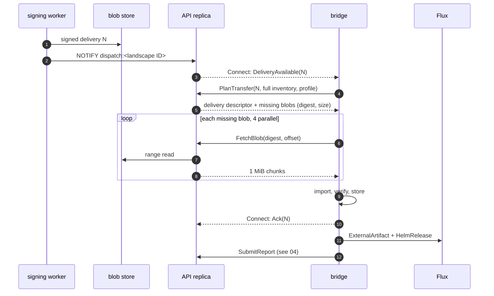

# Bundles and transfer

This page defines the bundle a release becomes, the delivery that lists what
a landscape runs, and how their bytes reach the bridge over gRPC or in a CTF
archive. It ends where Flux takes over. Policy checks are in
[06](06-landscape-bridge-and-policy.md), and keys and reports are in
[04](04-trust-and-attestation.md). Names come from [02](02-domain-model.md),
job kinds from [01](01-control-plane.md), and RPC messages from
[08](08-api-and-ui.md).

## Target design

### A release becomes one bundle, a landscape change one delivery

The control plane signs a bundle once per release. Per-landscape facts
cannot live in it, because the delivery sequence differs per landscape
(D-ATT-02). They go into a second, small signed component version: the
delivery (D-BUN-04).

| Object | OCM component | Version | Built | Content |
| --- | --- | --- | --- | --- |
| Bundle | `konfidence.cloud/p/<project>/<application>` | `<sequence>.0.0` | once per `Release` | charts, image references, values schema, secret requirements, metadata |
| Delivery | `konfidence.cloud/l/<landscape ID>/delivery` | `<delivery sequence>.0.0` | per landscape, per change | full desired set, tombstones, CRL |

The version form assumes OCM requires semver (unverified). The release ID is
a signed label.

The delivery references each bundle through an OCM component reference with
its digest. The OCM signature covers reference digests
([OCM signing](https://ocm.software/docs/concepts/signing-and-verification/)),
so one check on the delivery pins every bundle it names. Each bundle keeps its
own signature, so either side can verify and cache it alone.

The delivery is declarative: it lists the landscape's full desired set, never
a delta. The bridge applies only a delivery above its last applied sequence.
A lost delivery causes no drift. Two CTFs imported out of order resolve to the
newer one.

### The bundle carries everything that is equal on every landscape

The bundle holds every resource by value (OCM `localBlob`), except images,
which stay OCI artifacts. Names are stable, so release diffs (D-REL-03)
compare like with like.

| Resource | OCM type | Content |
| --- | --- | --- |
| `chart.<chart>` | `helmChart` | packaged chart `.tgz`, dependencies vendored |
| `image.<chart>.<n>` | `ociImage` | image manifest or index, by digest |
| `values-schema.<chart>` | `konfidence.cloud/values-schema/v1` | JSON Schema plus overridable keys (D-POL-02) |
| `secret-requirements` | `konfidence.cloud/secret-requirements/v1` | name, keys, consuming chart (D-POL-03) |
| `metadata` | `konfidence.cloud/bundle-metadata/v1` | per chart: `dependsOn`, CRD policy, cluster-scoped kinds, CRDs, webhooks, images, and image value paths |
| `builder.<builder>.<n>` | declared by the builder | builder output (contract in [07](07-sources-and-releases.md)) |

The bundle signs the labels `konfidence.cloud/bundle-format`, `release-id`,
`project` and `application` (`signing: true`). `metadata` lets the bridge decide
`WaitingForBoundaryApproval` and `UnboundSecret` before it creates any
`HelmRelease` (D-TEN-01). Tenant RBAC catches kinds that appear only with
landscape values (D-TEN-03).

### The delivery carries everything that differs per landscape

| Resource | OCM type | Content |
| --- | --- | --- |
| `manifest` | `konfidence.cloud/delivery/v1` | landscape ID, delivery sequence, last accepted report sequence, format major; per application: bundle reference, promotion-target values, grant ID; tombstones |
| `crl` | `konfidence.cloud/crl/v1` | current revocation list (D-TRUST-04), empty in `Pinned` mode |

The grant ID travels here, because one bundle serves many grants (D-TEN-02).
The bridge stamps it as `konfidence.cloud/landscape-grant`. A tombstone names
an application and the delivery sequence that removes it (D-PROMO-04). An
application that leaves the desired set without a tombstone is a
control-plane bug: the bridge keeps it running and reports the mismatch. The
last accepted report sequence lets a restored bridge raise its counter
(D-ATT-03).

### One worker builds, another worker signs

The build job runs on a build worker. It reaches git and public registries
and never holds the signing key (D-TRUST-06).

1. Check out every source at its pinned SHA (D-SRC-01). Per chart, run
   `helm dependency build` against `Chart.lock` and `helm package`.
2. Run configured builders and collect their output as resources.
3. Run `helm template` with chart defaults to find images, cluster-scoped
   kinds, CRDs, and webhooks. The application's image list adds images that
   need non-default values. Resolve tags to digests and copy each image into
   the control-plane blob store (D-XFER-02).
4. Upload all blobs and an unsigned component descriptor.

The signing job re-hashes every resource blob from the blob store, signs the
descriptor and writes the digest to `Release.status.component`. It signs what
the blob store holds, not what the build worker claims. Signatures use OCM's
default `RSASSA-PSS` with `jsonNormalisation/v4alpha1`. They exclude
`access`, so blobs can move between the blob store, a CTF, and the bridge store.

### The delivery job builds one delivery per landscape change

The per-landscape delivery job runs on the signing worker. It is unique per
landscape over non-finished states, so pending changes coalesce (D-TOPO-05).

1. Allocate the next delivery sequence in its own committed transaction. A
   failed run leaves a gap (D-ATT-02).
2. List the landscape's `Deployment`s with a live API read. Per application,
   take the non-superseded one with the highest promotion sequence in
   `Dispatching` or later. Build, sign, and push the delivery.
3. In one transaction, write `dispatches` and `dispatch_entries`, pass the
   dispatch fence (D-TOPO-07) and send `NOTIFY dispatch:<landscape ID>`.

An ack of delivery N moves exactly the `Deployment`s in its
`dispatch_entries` to `Dispatched` (D-BUN-04). The format major in `konfidence.cloud/bundle-format` is independent of the
API version (D-BUN-03). Changes within a major are additive. The build writes
each bundle in exactly one major. The bridge advertises the majors it reads
in `Hello` and in the state request file. If a bridge can't read the major of
an application's target release, the job keeps that application at its last
readable release, with `BridgeTooOldForBundleFormat` on its `Deployment`.
Every other application and every tombstone still deliver.

### gRPC and CTF share one content-addressed blob layout

Every byte that crosses to a landscape is a blob named by its SHA-256:
descriptors, chart `.tgz` files, schemas, OCI manifests, configs, and layers.
Images travel as their OCI blobs, so a base layer shared by twenty images
travels once.

The layout is the OCM CTF directory format: `artifact-index.json` and a
`blobs/` directory with files named `sha256.<hex>`
([CTF spec](https://github.com/open-component-model/ocm-spec/blob/main/doc/04-extensions/03-storage-backends/ctf.md)).
A CTF archive is that layout as a `tar` file, and the bridge store is that
layout as a directory. The gRPC transfer exposes it blob by blob.

The bridge has one import routine. Blobs land in `incoming/`, the bridge
checks each digest, moves the blob to `blobs/` and merges the index. gRPC and
CTF import both call it, then the same verify-and-unpack step (D-XFER-01).

The store lives in the bridge pod on one RWO volume (D-TOPO-01). After each
apply it keeps the blobs of every applied release, of the newest verified
delivery, and of the 3 applied deliveries before it. GC removes the rest, and
the next inventory is exactly what remains. A bridge outage pauses imports,
reports and reconciles of changed charts; running workloads keep running.

### The bridge pulls only the blobs it lacks

The bridge opens every connection (D-PROD-05). Any API replica serves any
transfer and holds no transfer state (D-TOPO-03). The RPCs are those of
`BridgeService` (D-API-05).

- **Inventory.** The bridge sends its full, sorted inventory with every plan
  (D-XFER-03). 10 000 blobs make about 700 KB of digest strings. No table
  stores inventory or progress.
- **Resume.** After a cut, `FetchBlob` restarts at the partial file's size.
  A `Reconnect` (D-TOPO-06) never cuts a running `FetchBlob`.
- **Back-pressure.** Each API replica serves at most 50 concurrent
  `FetchBlob` streams. Above that it answers `resource_exhausted` with a
  retry delay. The bridge waits that delay plus full jitter. Enrollment and
  waves bound fleet onboarding, so 1000 bridges never join at once.
- **Supersede.** On a higher `DeliveryAvailable` mid-transfer, the bridge
  plans the new delivery. Finished and partial blobs carry over; GC drops the
  partial ones the new plan doesn't need.
- **Ack.** The bridge acks a delivery once it has verified and stored it.
  Apply results arrive in reports. A delivery applies atomically, so a small
  fix waits for every blob of every changed application in it.

### The transfer profile picks image blobs per application

The bridge sends a transfer profile in `PlanTransfer` and in the state request
file. Per application, it holds `ApplicationPolicy.spec.images.transfer` and
whether a landscape registry is configured. The control plane uses it only to
select blobs and never evaluates landscape policy.

Images land in one landscape registry the operator provides and the nodes
already pull from (D-XFER-04). The operator sets endpoint, optional CA bundle
and a push credential in a Secret at bridge install. That credential never
leaves the landscape. Konfidence ships no registry and never changes node or
containerd configuration (D-XFER-06). Without a configured registry, the
bridge applies no application with images and reports `RegistryNotConfigured`.

- **Full** (default, M1): the plan carries image blobs. The bridge pushes them
  to `<registry>/<prefix>/<project>/<application>/<image>`.
- **Thin** (M2+): no image blobs travel. The bridge checks that every digest
  exists at that same path.

### One state request file goes out and one CTF comes in per trip

Isolated landscapes use the same import, verify and unpack code (D-XFER-05).

1. The operator runs `konfidence-bridge state export`. The bridge signs the
   state request file with its identity key. The file holds bridge version and
   capabilities, readable format majors, landscape ID, last applied delivery
   sequence, blob inventory, transfer profile, and the signed reports the
   control plane has not acknowledged.
2. The operator uploads it through the UI or CLI (`ImportStateRequest`). The
   API imports its reports as `SubmitReport` does and inserts `ctf.export`.
3. The CTF export job runs the delivery job's steps for the landscape. It
   packs the delivery, its bundle descriptors, the CRL and every missing blob.
   Listed `Deployment`s move to `Dispatched` with reason `Exported`.
4. The operator runs `konfidence-bridge ctf import <file>`.

Without a state request file the CTF holds every blob of the desired set. A
report-only trip uses the separate attestation export. The bridge CLI reaches
the bridge through its admin endpoint and needs no `exec` or Secret access
(D-LAND-06). Scanning stations check a CTF with stock `ocm verify`.

### The bridge verifies, then unpacks, then hands over to Flux

Verification stops at the first failure:

1. The delivery signature is valid under the pinned control-plane key, or the
   customer CA in M2+ (D-TRUST-01, D-TRUST-04).
2. The landscape ID is this landscape's. The delivery sequence is above the
   last applied one; an equal sequence with another digest raises an alarm.
3. The CRL is at least as new as the stored one and keeps the signing key.
4. Each bundle descriptor matches its reference digest and its own signature,
   and each blob matches its digest.

The bridge persists the delivery sequence, raises its report counter
(D-ATT-03) and acks. After the policy checks in
[06](06-landscape-bridge-and-policy.md), it unpacks per application:

- **Charts.** The bridge serves each chart over in-cluster HTTP. One
  `ExternalArtifact` per chart, in the target namespace, carries
  `status.artifact` with `url`, `digest` and revision
  `<chart>-<version>@sha256:<hex>`
  ([ExternalArtifact](https://fluxcd.io/flux/components/source/externalartifacts/)).
- **HelmRelease.** One per chart, `spec.chartRef` to that `ExternalArtifact`,
  helm-controller with `--feature-gates=ExternalArtifact=true`
  ([HelmRelease](https://fluxcd.io/flux/components/helm/helmreleases/)). The
  bridge `Application` owns both (D-LAND-04).
- **Images.** One `postRenderers[].kustomize.images` entry per image sets
  `newName` and `digest` (D-XFER-06). kustomize `images` rewrites container
  fields only (unverified). For images in env vars, args or custom resources,
  the bridge sets the value path named in `metadata`.

## Interfaces other docs depend on

- This page owns the delivery manifest layout, the verify order and the
  semantics of `PlanTransfer`, `FetchBlob` and the `Connect` notices.
  [08](08-api-and-ui.md) owns their proto names.
- [06](06-landscape-bridge-and-policy.md) reads bundle `metadata`. Inputs
  come from [05](05-promotion-and-rollout.md) (`Deployment`s) and
  [07](07-sources-and-releases.md) (builders, image lists).

## Path

[09-roadmap.md](09-roadmap.md) owns the milestone list.

1. **M1** Spike: a chart `.tgz` as `ExternalArtifact` behind `chartRef` on
   kind. This settles the artifact format.
2. **M1** Build and signing jobs for `example-app`, checked with `ocm verify`.
3. **M1** Delivery job: sequence from `landscape_sequences`, `manifest`,
   empty `crl`, dispatch records and `NOTIFY`.
4. **M1** Bridge store, import and verify-and-unpack, fed by CTF import for
   the isolated landscape.
5. **M1** `PlanTransfer`, `FetchBlob` and the 50-stream cap for the attached
   landscape.
6. **M1** Full mode against an operator registry, with the `kustomize.images`
   post-renderer. CI kind clusters run a local registry with kind's
   documented containerd config; that is test harness, not konfidence.
7. **M1** State request file with reports, driving the CTF export.
8. **M2+** Thin mode, tombstones and the format-major hold-back.

### Later

- Per-application apply: an application applies once its blobs are complete.
  Reports then carry the applied delivery sequence per application.
- Admin-set emitted format major with a fleet view of readable majors.
- Incremental inventory above about 100 000 blobs per landscape.
- A fleet transfer budget and a separate blob-serving process, if the
  simulator shows pressure.
- Image signature checks, CTF volume splitting, and a courier drop folder.

## Open questions

1. Does helm-controller accept a packaged chart `.tgz` as `ExternalArtifact`
   content, or a tarball of the chart directory? Path step 1 answers it.
2. Does the OCM Go library write an `ociImage` into a CTF as separate OCI
   blobs or as one tarball? If one tarball, konfidence writes image blobs into
   the CTF index itself to keep layer deduplication.
