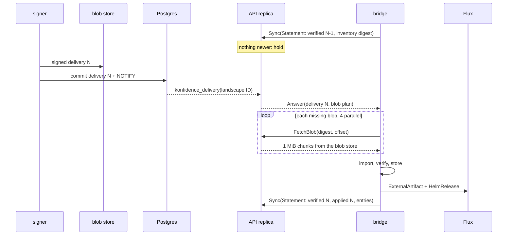

# Bundles and transfer

This page owns the bundle and delivery layout, the verify order, and the one
exchange that moves both: a statement goes in, an answer comes out, over
`Sync` or as files. It ends where Flux takes over. The statement payload is
in [04](04-trust-and-attestation.md), slot writes in
[05](05-promotion-and-rollout.md), policy checks in
[06](06-landscape-bridge-and-policy.md), names in [02](02-domain-model.md),
job kinds in [01](01-control-plane.md), and proto names in
[08](08-api-and-ui.md).

## A release becomes one bundle, a slot change one delivery

| Object | OCM component | Version | Signed |
| --- | --- | --- | --- |
| Bundle | `konfidence.cloud/p/<project>/<application>` | `<release seq>.0.0` | once per release |
| Delivery | `konfidence.cloud/l/<landscape ID>/delivery` | `<delivery seq>.0.0` | once per change to the landscape's slots |

The version form assumes OCM requires semver (unverified). The delivery
references each bundle by digest, and the OCM signature covers reference
digests ([OCM signing](https://ocm.software/docs/concepts/signing-and-verification/)),
so one check on the delivery pins every bundle it names. Each bundle keeps its
own signature, so either side can verify and cache it alone. A delivery
lists every slot of the landscape, never a delta. The bridge
applies only a delivery above its last applied sequence. A lost delivery
causes no drift, and two CTFs imported out of order resolve to the newer one.

### The bundle carries what is equal on every landscape

Every resource is a `localBlob` except images. Stable names keep release
diffs like for like (D-REL-03).

| Resource | OCM type | Content |
| --- | --- | --- |
| `chart.<chart>` | `helmChart` | packaged chart `.tgz`, dependencies vendored |
| `image.<chart>.<n>` | `ociImage` | image manifest or index, by digest |
| `values-schema.<chart>` | `konfidence.cloud/values-schema/v1` | JSON Schema plus overridable keys (D-POL-02) |
| `secret-requirements` | `konfidence.cloud/secret-requirements/v1` | name, keys, consuming chart (D-POL-03) |
| `metadata` | `konfidence.cloud/bundle-metadata/v1` | per chart: `dependsOn`, CRD policy, cluster-scoped kinds, CRDs, webhooks, images, image value paths |
| `builder.<builder>.<n>` | declared by the builder | builder output ([07](07-sources-and-releases.md)) |

The bundle signs the labels `konfidence.cloud/release-id`, `project`,
`application` and `required-capabilities`. The last equals
`releases.required_capabilities`; in M1 it is `bundle.v1`, which covers the
bundle and delivery layout on this page (D-BUN-03). `metadata` lets the
bridge decide `WaitingForBoundaryApproval` and `UnboundSecret` before it
creates any `HelmRelease` (D-TEN-01).

### The delivery carries what differs per landscape

The delivery has two resources. `manifest` (`konfidence.cloud/delivery/v1`)
holds the landscape ID, the delivery sequence, and one entry per slot. `crl`
(`konfidence.cloud/crl/v1`) holds the newest revocation list, empty in
`Pinned` mode (D-TRUST-04). An entry holds the project UID, the application, release ID and label, the
bundle reference, and the slot's values. A tombstone has an empty release
and bundle reference (D-PROMO-04). The bridge echoes each entry digest in its
statement, and `accept` takes it (D-POL-07). An application missing from a
delivery keeps what it runs; only a tombstone removes. A slot held back for
`MissingCapability` is missing in exactly this way.

## The signer signs what the blob store holds

`release.build` runs in `worker` mode without the signing key (D-TRUST-06).
It packages each chart with vendored dependencies at the pinned SHAs, runs
the builders, finds images and cluster-scoped kinds with `helm template`,
and copies images by digest into the blob store (D-XFER-02). `bundle.sign`
in `signer` mode re-hashes every blob, signs the descriptor, and sets
`releases.bundle_digest`. Signatures use OCM's default `RSASSA-PSS` and
exclude `access`, so blobs move between blob store, CTF, and bridge store
unchanged.

`delivery.build` also runs in `signer` mode, one per landscape;
[01](01-control-plane.md#one-delivery-job-per-landscape-builds-signs-and-announces)
owns its steps.

## One blob layout serves gRPC and CTF

Every byte that crosses to a landscape is a blob named by its SHA-256, image
layers included, so a shared base layer travels once. The layout is the OCM
CTF directory format: `artifact-index.json` and `blobs/sha256.<hex>`
([CTF spec](https://github.com/open-component-model/ocm-spec/blob/main/doc/04-extensions/03-storage-backends/ctf.md)).
A CTF is that layout as a `tar` file, the bridge store is that layout as a
directory, and `FetchBlob` serves it blob by blob. `Sync` and CTF import
share one digest-checked import and the verify-and-unpack step (D-XFER-01).

The store lives on the bridge's RWO volume (D-TOPO-01). After each apply it
keeps the blobs of every applied release, of the newest verified delivery,
and of the 3 applied deliveries before it. GC removes the rest.

## Sync takes a statement and answers with the newest delivery

The bridge opens every call (D-PROD-05). Any stateless API replica answers.

- **Hold.** The API imports the statement ([04](04-trust-and-attestation.md))
  and answers or holds the call by the rules in
  [01](01-control-plane.md#api-replicas-hold-sync-calls-without-owning-state).
  The repeated statement is the heartbeat (`last_seen_at`).
- **Blob plan.** The statement carries the full inventory after an import or
  GC changed it, and its digest otherwise (D-XFER-03). Against a full
  inventory the plan lists the missing blobs. Against a digest it lists every
  blob the delivery references, and the bridge skips those it holds. Image
  blobs of applications whose transfer profile says `Thin` stay out. No table
  stores an inventory.
- **Acknowledgement.** The next statement's delivery sequences are the only
  one; the status function reads them (D-PROMO-03).
- **Resume.** `FetchBlob` restarts at the partial file's size. A newer
  answer mid-transfer replaces the plan, and fetched blobs carry over.
- **Back-pressure.** Each API replica serves at most 50 concurrent
  `FetchBlob` streams and answers `resource_exhausted` with a retry delay
  above that. The bridge waits that delay plus full jitter.

A delivery applies atomically, so a small fix waits for every blob of every
changed application in it.

## Images go to the operator's registry

The statement's transfer profile holds, per application, the policy's
`images.transfer` and whether a landscape registry exists. The control plane
uses it only to plan blobs. The operator sets registry endpoint, CA bundle,
and push credential at bridge install; the credential never leaves the
landscape (D-XFER-04). Under `Full` (default, M1) image blobs travel, and the
bridge pushes them to `<registry>/<prefix>/<project>/<application>/<image>`.
Under `Thin` (M2+) none travel, and the bridge checks that every digest
exists at that path. Without a registry the bridge applies no application
with images and reports `RegistryNotConfigured`.

## Offline moves the same statement and answer as files

An isolated landscape gets deliveries signed like any other; only the
carrier differs (D-XFER-05).

1. The operator runs `konfidence-bridge state export`. The state request file
   is one signed statement with the full inventory.
2. The operator uploads it to `OfflineService` through UI or CLI. The API
   imports the statement as `Sync` does and returns a signed download URL.
   A `GET` on it streams the CTF of the answer and its planned blobs
   ([08](08-api-and-ui.md#the-offline-service-takes-a-statement-file-and-returns-a-ctf)).
3. The operator runs `konfidence-bridge ctf import <file>`.

A CTF exported without a state request file plans every blob. Scanning
stations check a CTF with stock `ocm verify`.

## The bridge verifies, then unpacks, then hands over to Flux

Verification stops at the first failure:

1. The delivery signature is valid under the pinned control-plane key, or
   the customer CA in M3 (D-TRUST-01, D-TRUST-04).
2. The landscape ID is this landscape's. The delivery sequence is above the
   last applied one; an equal sequence with another digest raises an alarm.
3. The CRL is at least as new as the stored one and keeps the signing key.
4. Each bundle matches its reference digest and its own signature, and each
   blob matches its digest.

The bridge persists the delivery sequence before it hands anything to Flux.
After the policy checks in [06](06-landscape-bridge-and-policy.md), it serves
each chart as an [ExternalArtifact](https://fluxcd.io/flux/components/source/externalartifacts/)
behind one `HelmRelease` `spec.chartRef`, with helm-controller run as
`--feature-gates=ExternalArtifact=true`. A `kustomize.images` post-renderer
pins each image by digest (D-XFER-06); it rewrites container fields only
(unverified), so other image fields use the value paths in `metadata`.

## Path

[09-roadmap.md](09-roadmap.md) owns the milestone list.

1. **M1** Spike: a chart `.tgz` as `ExternalArtifact` behind `chartRef` on
   kind. This settles the artifact format.
2. **M1** Build, signing and delivery jobs for `example-app`, with tombstone
   entries and the `MissingCapability` hold-back, checked with `ocm verify`.
3. **M1** Bridge store, import, verify-and-unpack, and tombstone handling,
   fed by CTF import.
4. **M1** `Sync` with hold and blob plan, `FetchBlob`, Full mode against an
   operator registry, and the offline files.
5. **M2+** Thin mode.

Later: per-application apply, incremental inventory above about 100 000
blobs, image signature checks, and CTF volume splitting.

## Open questions

1. Does helm-controller accept a packaged chart `.tgz` as `ExternalArtifact`
   content, or a tarball of the chart directory? Path step 1 answers it.
2. Does the OCM Go library write an `ociImage` into a CTF as separate OCI
   blobs or as one tarball? If one tarball, konfidence writes image blobs
   into the CTF index itself to keep layer deduplication.
