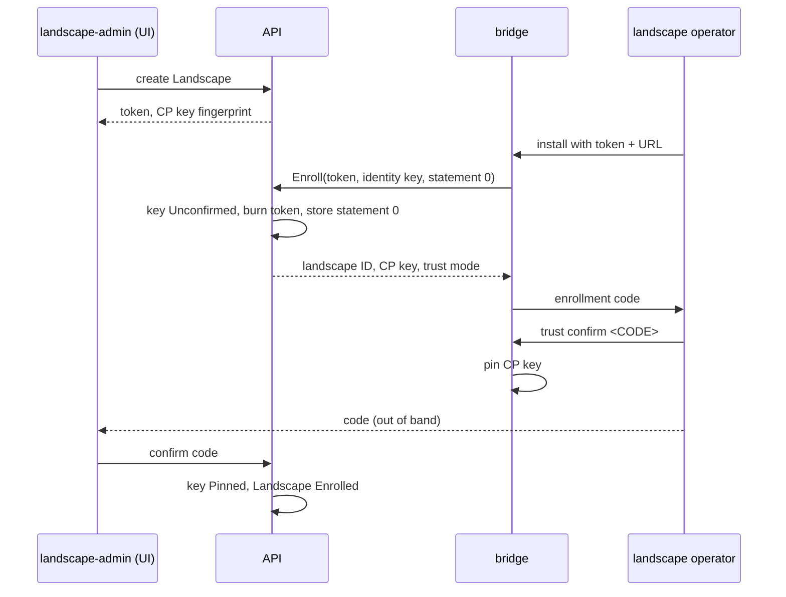

# Trust, identity, and attestation

This page owns how a bridge and the control plane come to trust each other,
how that trust survives compromise, and the signed statement that proves
what runs on a landscape: its envelope, payload, import, and the enrollment
files. Delivery and transfer are in [03](03-bundles-and-transfer.md), the
status function in [02](02-domain-model.md), proto names in
[08](08-api-and-ui.md), and the bridge CLI in
[06](06-landscape-bridge-and-policy.md).

## Two keys carry all trust

| Key | Held by | Algorithm | Signs | Pinned by |
| --- | --- | --- | --- | --- |
| Release-signing key | `signer` mode only (D-TRUST-06) | RSASSA-PSS, 3072 bit | bundles, deliveries, later key transitions | every bridge |
| Bridge identity key | one bridge process, generated on first start | Ed25519 | statements, enrollment requests; mTLS client auth | the control plane, in `bridge_keys` |

RSASSA-PSS is the OCM default, so stock `ocm verify` checks konfidence
bundles ([OCM signing](https://ocm.software/docs/how-to/sign-and-verify/sign-component-versions/)).
The bridge key never leaves the bridge process and its state Secret
(D-LAND-06). TLS protects the channel and signatures the content. The bridge
checks the server certificate against WebPKI or an operator-supplied CA and
authenticates every call with mTLS over its identity key. The API matches the
SHA-256 SPKI fingerprint against `bridge_keys`, or checks the chain in
`CustomerCA` mode (M3).

The `signer` runs as its own Deployment and ServiceAccount, with egress to
Postgres, the blob store, and the Kubernetes API only. It re-hashes every
blob before it signs, so it signs what the store holds, not what a build
claims. No process that fetches git, runs helm or builders, or reaches public
registries holds the key. The key lives in a Kubernetes Secret in M1, later
in an HSM through PKCS#11.

## Enrollment counts only after both sides confirm the code

An admin creates a `Landscape`. The API mints the landscape ID and a
one-time enrollment token (24 h TTL), stored as a `bridge_keys` row in state
`Invited`, and shows the control-plane key fingerprint. The operator
installs the bridge with token and URL.

Both sides compute the enrollment code: the first 16 base32 characters
(80 bits) of `SHA-256(landscapeID ‖ controlPlaneKeyFP ‖ bridgeKeyFP)`, shown
in groups of four. Each side computes it from the key it received, so one
code covers both directions (D-TRUST-02). 80 bits stop a courier who swaps
files from grinding a collision offline.

- **Control plane.** `bridge_keys.state` runs `Invited`, `Unconfirmed`,
  `Pinned`; the controller shows it as `Landscape.status.enrollment`
  `Pending`, `Unconfirmed`, `Enrolled`. Until `Enrolled` nothing is signed
  for the landscape and `Sync` fails with `EnrollmentUnconfirmed`.
- **Bridge.** The bridge pins the control-plane key only after
  `trust confirm` and applies nothing before.
- **Skipping.** Either side may skip the comparison with a reason. The bridge
  sets `enrollment_check_skipped` in its statements; the API writes
  `skip_reason` and an audit entry, and the UI labels the landscape.
- **Out-of-band fingerprint.** With `--cp-key-fingerprint <FP>`, the bridge
  pins only that key and needs no control-plane UI (D-TRUST-03).

Offline, `konfidence-bridge enroll request` writes the signed `Enroll`
request with a nonce. An admin imports it through `OfflineService`, which
replaces the token, and hands back the `Enroll` response with the nonce.
`konfidence-bridge enroll accept <file>` checks the nonce, prints the code,
and waits for `trust confirm`.

## Compromise recovery runs on the landscape, never from the control plane

A planned key rotation (Later) is a transition `{oldKeyFP, newPublicKey}`
signed by both keys; deliveries carry the chain and the bridge walks it. A
transition does not help after a compromise, because the attacker can sign
one too. Recovery is local on every bridge (D-TRUST-03):

1. Each operator freezes applies with `updates: Manual` on the `default`
   policy (D-POL-07). The control plane cannot accept on their behalf.
2. The security office rebuilds the control plane with a new key and
   publishes the fingerprint through its own channel.
3. Each operator runs `konfidence-bridge trust repin --cp-key-fingerprint
   <FP> --enroll-response <file>`. No control-plane message can start a
   repin.
4. A `landscape-admin` confirms the bridge's code on the clean control plane.

In `CustomerCA` mode (M3) both keys hold certificates from the customer CA;
the bridge certificate carries SAN URI
`urn:konfidence:landscape:<landscape ID>`. The operator installs the root on
the bridge, and the control plane can never deliver one. Every delivery and
CTF carries the newest CRL (D-TRUST-04). The bridge keeps the highest CRL
number and ignores `nextUpdate`, and operators can run
`konfidence-bridge trust crl import` against a control plane that withholds
one.

An admin revokes a bridge key (M2+) by setting `bridge_keys.state` to
`Revoked`. The API checks the key on every `Sync`, `FetchBlob` and statement
import (D-TRUST-05), so revocation takes effect within one `Sync` hold. The
landscape re-enrolls with a new key and token, keeps its landscape ID, and
starts a new statement sequence on the new key.

## A statement is the bridge's signed account of its landscape

A statement is a [DSSE](https://github.com/secure-systems-lab/dsse/blob/master/protocol.md)
envelope. The signature covers `PAE(payloadType, payload)`, so no canonical
serialization is needed, and consumers use the verified bytes. `payloadType`
is `application/vnd.konfidence.statement.v1+json`, the payload is protojson
of the `Statement` message in
[08](08-api-and-ui.md#the-bridge-service-moves-one-statement-up-and-one-answer-down),
and `keyid` is the bridge key fingerprint (D-ATT-01).

`reason` comes from the reason table in [02](02-domain-model.md). The
reporting level (D-POL-05) decides what an entry holds; `None` sends the
project, application and level only. The payload holds no wall-clock time;
`received_at` records first sight.

`Sync`, `Enroll` (statement 0), and a state request file run one import. It
stops at the first failure with an API error:

1. Look up the key by `keyid`: unknown or `Revoked` gives `KeyRevoked`;
   `Invited` or `Unconfirmed` gives `EnrollmentUnconfirmed`, except for
   statement 0 in `Enroll`.
2. Verify the signature, or the chain in M3: `SignatureInvalid`.
3. Match `landscapeID` to the key's landscape: `LandscapeMismatch`.
4. If the sequence and `payload_digest` are already stored, update
   `last_seen_at` and stop. Heartbeats and courier retries write nothing else.

Otherwise the import appends a `statements` row and inserts the wave steps
of open targets on the landscape ([05](05-promotion-and-rollout.md)).

## Two counters only move upward

Freshness never depends on wall-clock time (D-ATT-02).

| Counter | Allocated by | Stored | Receiver rule |
| --- | --- | --- | --- |
| delivery sequence | control plane, `delivery_seq` | `deliveries`; bridge state Secret | bridge rejects one at or below its last applied; equal with another digest alarms |
| statement sequence | bridge, per bridge key | bridge state Secret; `statements` | highest on the landscape's current `Pinned` key is the current statement; the rest is history |

The bridge persists the delivery sequence before it hands anything to Flux.
Gaps are fine: a courier may skip a CTF, and the newer one supersedes it.
After a Postgres restore the runbook runs
`ALTER SEQUENCE delivery_seq RESTART WITH <highest reported + 1000>`
(D-ATT-04), so no signed number in a courier's CTF is reissued.

## A compromised party can delay but never forge across a boundary

| Compromised party | Can do | Cannot do | Detection and recovery |
| --- | --- | --- | --- |
| Build | inject content into builds it runs | sign; change stored blobs after the re-hash | release ID ties content to inputs; rebuild affected releases |
| Control plane (API, DB, `signer`) | sign and deliver anything within each policy and `Boundary`; withhold deliveries and CRLs; sign a transition | connect into a landscape; read landscape secrets; override local policy or `Manual` acceptance; forge statements; start a repin; lower the delivery sequence | `Manual` brake, new key, local `trust repin`, local CRL import |
| One bridge | forge statements for its own landscape; read its bundles | forge statements for others; read git credentials or other landscapes' bundles | revoke the key, re-enroll |
| Network or broken TLS | read content; delay or drop messages | modify content; replay an older delivery; make an old statement current; impersonate a bridge | signatures and counters; "attested at T" makes delay visible |
| CTF courier | read; withhold, reorder or misroute archives; swap enrollment files | tamper; apply an older or foreign archive; make an old statement current; pass the 80-bit code check | stale "attested at T", sequence gaps |
| Stolen enrollment token | enroll a rogue bridge first | get past `Unconfirmed` | the real bridge finds its token burned; admin revokes and re-issues |

Bundles are signed, not encrypted. Anyone who reads the transport or a CTF
reads charts and images. Secrets never travel in bundles (D-POL-03).

## Path

[09-roadmap.md](09-roadmap.md) owns the milestone list.

1. **M1** Ed25519 identity key, mTLS, SPKI match against `bridge_keys`.
2. **M1** Secret key backend in `signer` mode with its NetworkPolicy and the
   re-hash. A test runs `ocm verify`.
3. **M1** Online and offline enrollment with both-side code and audited skip.
4. **M1** DSSE statements over `Sync` and in the state request file, one
   import. Test: an older CTF fails, an older statement never becomes current.
5. **M2+** Revocation, `trust repin`, and the Postgres restore drill.

Later: `CustomerCA` mode and PKCS#11 (M3), both before key transitions and
before any customer whose security office approves the trust root; key
transitions and bridge identity rotation; customer co-sign through
`BundleDeploymentPolicy.spec.requiredSignatures`; TPM-backed bridge identity.

## Open question

Does the OCM Go library accept an external `crypto.Signer`, or does PKCS#11
need an OCM signing handler plugin? (unverified)
