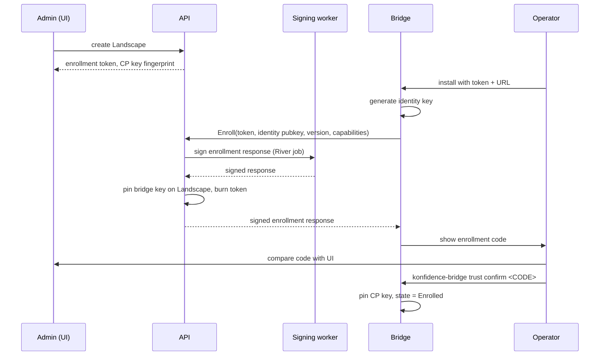

# Trust, identity and attestation

This doc defines how a bridge and the control plane come to trust each other,
how that trust survives key rotation and compromise, and how attestation
reports prove what runs on a landscape. It covers enrollment online and
offline, pinning, the customer CA mode, revocation, signing-key custody, the
report format, sequence numbers, and a threat model. Bundle layout and the
transfer protocol live in [03-bundles-and-transfer.md](03-bundles-and-transfer.md);
how gates consume attestations lives in
[05-promotion-and-rollout.md](05-promotion-and-rollout.md).

## Target design

### Two keys carry all trust

Konfidence has exactly two kinds of trust anchor.

| Key | Owner | Algorithm | Signs | Pinned by |
|---|---|---|---|---|
| Control-plane signing key | control plane, behind the `Signer` abstraction | RSASSA-PSS, 3072 bit | OCM component versions, delivery manifests, enrollment responses, key transitions | every bridge |
| Bridge identity key | one bridge, generated on first start | Ed25519 | attestation reports, state request files, enrollment requests, identity transitions; mTLS client auth | the control plane, per `Landscape` |

RSASSA-PSS is the OCM default signing algorithm, so standard `ocm verify`
tooling checks konfidence bundles without konfidence code
([OCM signing](https://ocm.software/docs/how-to/sign-and-verify/sign-component-versions/)).
The bridge key never leaves the landscape. It lives in a Kubernetes Secret in
the bridge namespace, readable only by the bridge ServiceAccount.

TLS protects the channel, not the content. The bridge checks the control
plane's TLS server certificate against WebPKI or an operator-supplied CA,
configured at bridge install. The control-plane signing key signs every artifact that changes landscape
state. A broken TLS channel therefore
exposes content but cannot change it.

The bridge authenticates gRPC streams with mTLS. Its client certificate is
self-signed over the identity key. The API matches the certificate's public
key fingerprint (SHA-256 over the SubjectPublicKeyInfo) against the pinned key
on the `Landscape`. In customer CA mode the API checks the chain instead.

### Enrollment pins both keys in one step

An admin creates a `Landscape` in the UI. The API returns a one-time
enrollment token (single use, 24 h TTL) and shows the control-plane key
fingerprint. The landscape operator installs the bridge with the token and the
control-plane URL.

Both sides then compute the same **enrollment code**: the first 10 base32
characters of `SHA-256(landscapeID ‖ controlPlaneKeyFP ‖ bridgeKeyFP)`. The
bridge prints it, the UI shows it, and the operator compares them. One
comparison covers both directions of D-TRUST-01, because each side computes
the code from the key it received.



The API pins the bridge key when it accepts a valid token. The bridge stays
in state `PendingConfirmation` until the operator confirms the code. In that
state it keeps the stream open for status but applies no bundle.
`konfidence-bridge trust confirm --skip-check` pins without comparison. The
bridge records the skip in its enrollment record and reports it in the
handshake. The API writes an audit event, and the UI shows the landscape as
"fingerprint not checked" (D-TRUST-02).

### Offline enrollment uses a request and a response file

Isolated landscapes enroll through two files. The courier carries them like a
CTF archive.

1. The operator runs `konfidence-bridge enroll request --out enroll-request.json`.
   The file holds the identity public key, bridge version, capabilities and a
   random nonce, signed by the identity key.
2. An admin imports the file in the UI for a `Landscape` created with
   `connectivity: isolated`. The authenticated import replaces the token as the
   control plane's proof. The API pins the key and shows the enrollment code.
3. The API exports `enroll-response.json`. It contains the landscape ID, the
   control-plane signing public key, the trust mode (pinning or CA, with root
   certificate and CRL), the nonce, and the current delivery sequence floor. A
   signing worker signs it.
4. The operator runs `konfidence-bridge enroll accept enroll-response.json`.
   The bridge checks the nonce, checks the signature against the enclosed key,
   prints the enrollment code and waits for `trust confirm`.

Online and offline enrollment run the same verification code on both sides.
Only the carrier differs (D-XFER-01 applies to enrollment as well).

### Keys rotate through a signed chain

A control-plane key rotation produces a **key transition**:
`{oldKeyFP, newPublicKey, issuedAtSequence}`, signed by the old key and the
new key. The new key's signature proves possession. Every delivery manifest
carries the chain of transitions from the oldest key any enrolled bridge may
still pin to the current key. The API knows each bridge's pinned key, so it
trims the chain per landscape.

The bridge walks the chain from its pinned key, checks each link, and moves
its pin to the newest key. From then on it accepts only the new key for new
deliveries. A bridge that cannot build a chain from its pin rejects the
delivery with `UntrustedSigner`.

Bridge identity rotation mirrors this. The bridge generates a new key and
sends an identity transition signed by both keys, over the stream or inside
the next attestation file. The API moves the pin and keeps the old key as
`superseded`. A report signed by a superseded key with a sequence above the
transition is rejected.

Re-pinning without a chain is a local operator action:
`konfidence-bridge trust repin --enroll-response <file>`. It accepts a fresh
enrollment response and asks for the enrollment code again. No message from
the control plane can trigger it (D-TRUST-03). This is the recovery path after
a control-plane key compromise, because an attacker holding the old key can
also sign a transition.

### Customer CA mode replaces pinning per landscape

A `Landscape` can set `trust.mode: customerCA`. Then:

- The control-plane signing key holds an X.509 certificate from the customer
  CA. The OCM signature embeds the chain, and verifiers need only the root
  ([OCM signing](https://ocm.software/docs/how-to/sign-and-verify/sign-component-versions/)).
- The bridge identity key holds a certificate from the same CA with the SAN
  URI `urn:konfidence:landscape:<LANDSCAPE_ID>`. The operator obtains it
  through the customer's own process, for example cert-manager. The bridge
  sends its certificate in the enrollment request.
- The operator installs the root certificate on the bridge locally. The
  control plane can never deliver a new root.
- Key rotation needs no transition chain. Any key with a valid,
  unrevoked certificate is accepted.

The control plane fetches the CRL from a distribution point configured on the
project, or an admin uploads it. Every delivery manifest, including every CTF
archive, carries the newest CRL (D-TRUST-04). The bridge keeps the CRL with
the highest CRL number it has seen and ignores `nextUpdate`. An isolated
landscape is therefore exactly as fresh as its last transfer. The UI shows the
CRL number and import time per landscape.

The operator can also load a CRL locally with `konfidence-bridge trust crl
import`. This path matters when the control plane itself is suspect, because a
compromised control plane can withhold a CRL.

### Revocation puts a bridge key on the deny list

An admin revokes a landscape's bridge key in the UI. The API adds the key
fingerprint to the deny list in Postgres, sets the `Landscape` condition
`Revoked`, and closes open streams. The API checks the deny list at stream
handshake, attestation import and state request import (D-TRUST-05). In
customer CA mode the CRL is checked as well.

A revoked landscape re-enrolls with a new key and a new token. The landscape
ID stays. The enrollment response carries the current delivery sequence as
the floor, so the new bridge state rejects replays of older deliveries.

### Signing keys sit behind one `Signer` interface

Only signing workers hold signing capability. The API never touches the key.
Enrollment responses and tombstones go through a short River job on the
dedicated `signing` queue, served by a separate worker Deployment with its own
ServiceAccount. Build workers that run git fetch and `helm dependency build`
never receive signing access.

```go
type Signer interface {
    KeyID() string               // SHA-256 SPKI fingerprint, hex
    Public() crypto.PublicKey
    Certificates() []*x509.Certificate // nil in pinning mode
    Sign(ctx context.Context, digest []byte) ([]byte, error)
}
```

Backends, in order of delivery:

| Backend | Key location | When |
|---|---|---|
| `secret` | Kubernetes Secret, mounted only into signing workers | v1, default |
| `pkcs11` | HSM via PKCS#11 | first hardware backend |
| `vault-transit`, cloud KMS | external service | on demand |

A signing worker verifies the digests of all resources against blob storage
before signing a component version. It signs what is stored, not what a build
worker claims.

### Attestation reports are DSSE envelopes

A report is a [DSSE](https://github.com/secure-systems-lab/dsse/blob/master/protocol.md)
envelope. The signature covers `PAE(payloadType, payload)`, so konfidence
signs the exact payload bytes and needs no canonical serialization. Consumers
use the verified bytes and never re-parse the envelope, as the DSSE protocol
requires.

- `payloadType`: `application/vnd.konfidence.attestation.v1+json`
- `payload`: protojson of the `Report` message from the shared protobuf schema
- `signatures[0].keyid`: bridge key fingerprint

The payload binds the fields D-ATT-01 names:

```yaml
landscapeID: lsc-7f3a
reportSequence: 1184          # bridge-owned, strictly increasing
deliverySequence: 311         # last applied delivery
observedAt: 2026-10-29T08:12:00Z   # informational, never used for freshness
policyVersion: sha256:…       # landscape-wide default policy
applications:
  - name: payments
    releaseID: rel-…
    componentVersionDigest: sha256:…
    policyVersion: sha256:…
    effectiveValuesDigest: sha256:…
    state: Applied            # Applied | Refused | Blocked | Removed
    resources:                # content depends on reporting level
      - {apiVersion: apps/v1, kind: Deployment, namespace: pay, name: api, health: Healthy}
```

The reporting level (D-POL-05) decides content per application. `none` omits
the application. `health` sends `state` and an aggregated health. `resources`
adds the resource list. `full` adds status messages and conditions.

### Two monotonic counters guard freshness

Freshness never depends on wall-clock time (D-ATT-02). Konfidence uses two
strictly increasing counters, each owned by the side that writes it.

| Counter | Owner | Carried in | Receiver rule |
|---|---|---|---|
| delivery sequence | control plane, per landscape, Postgres | delivery manifest, tombstone | bridge rejects a delivery below its last applied sequence; equal sequence with equal digest is an idempotent no-op |
| report sequence | bridge, persisted in its state Secret | attestation report, state request file | API rejects a report at or below the last imported one |

Gaps are fine. A courier may skip CTF archives, and a newer one supersedes
older ones. The bridge persists its last applied delivery sequence before it
hands manifests to Flux. Losing the state Secret means re-enrollment, which
restores the floor from the control plane.

### One import path serves stream and file

`attest.Import(envelope []byte, source)` runs for gRPC messages and for files
uploaded through the API. It runs these checks in order and stops at the
first failure:

1. Parse the DSSE envelope and look up the `Landscape` by `keyid`.
2. Reject keys on the deny list, superseded keys past their transition, and
   certificates revoked by the CRL.
3. Verify the signature against the pinned key or the CA chain.
4. Check that `landscapeID` in the payload matches the key's landscape.
5. Check `reportSequence` against the last imported one.
6. Check that `deliverySequence` was issued for this landscape.

On success the API appends the raw envelope and the parsed report to the
attestation history in Postgres. It then patches `status.attestation` on each
affected `Deployment` with report sequence, delivery sequence, observed state
and import time. Gates read only that CRD status (D-TOPO-07). A failed import
writes an audit event with the reason and changes no status.

### Threat model

| Compromised party | Can do | Cannot do | Detection and recovery |
|---|---|---|---|
| Build worker | Inject content into builds it runs before upload; the signing worker then signs it | Sign anything; read the signing key; alter stored blobs after digest check | Release ID ties content to source SHAs; rebuild and compare digests (later); rotate the worker, rebuild affected releases |
| Control plane (API, DB, signing worker) | Sign and deliver arbitrary bundles to every landscape, within each `ApplicationPolicy` and `Boundary`; withhold deliveries and CRLs; sign a key transition to its own key | Connect into a landscape; read landscape secrets; override local policy; forge attestations; trigger a re-pin; make a bridge accept a lower sequence | HSM backend limits it to signing while compromised. Recovery: new key, local `trust repin` on every bridge, local CRL import in CA mode |
| One bridge | Forge attestations for its own landscape; read bundles delivered to it | Forge reports for other landscapes; read git credentials or other landscapes' bundles; affect other bridges | Revoke the key (deny list), re-enroll |
| Transport (network, TLS broken) | Read bundle content; delay or drop messages | Modify content; replay an older delivery or report; impersonate a bridge without its key | Signatures and sequences reject tampering; UI shows "attested at T", so a delay is visible |
| CTF courier | Read archive content; withhold or reorder archives; deliver an archive to the wrong landscape | Tamper (signature fails); apply an older archive than the last applied; make a foreign archive apply (landscape ID is signed); replay a report file | Stale "attested at T" and gaps in delivery sequence in the UI |
| Stolen enrollment token | Enroll a rogue bridge before the real one | Pass the enrollment code check; reuse the token | Real bridge fails enrollment; admin revokes and re-issues |

Bundles are signed, not encrypted. Anyone who can read the transport or the
CTF archive can read charts and images. Secrets never travel in bundles
(D-POL-03), so this exposure is limited to application code and configuration.

## Decisions applied

- **D-TRUST-01**: bridge pins the control-plane key and the API pins the
  bridge key during one enrollment, online or offline.
- **D-TRUST-02**: the enrollment code is the fingerprint check; `--skip-check`
  is explicit, reported and audited.
- **D-TRUST-03**: key transitions signed by old and new key; `trust repin` is
  local only.
- **D-TRUST-04**: `customerCA` mode with a locally installed root; newest CRL
  in every delivery manifest and CTF; freshness shown in the UI.
- **D-TRUST-05**: deny list checked at handshake, attestation import and state
  request import.
- **D-ATT-01**: DSSE report signed by the bridge key, binding all required
  fields; one `attest.Import` for stream and file.
- **D-ATT-02**: delivery sequence rejects older bundles; report sequence
  rejects older reports; no wall-clock checks.
- **D-XFER-01**: one bridge identity per landscape, used for mTLS and report
  signing; enrollment uses the same online/offline split as transfer.
- **D-BUN-01**: OCM component versions signed with RSASSA-PSS, verifiable by
  standard OCM tooling.
- **D-PROD-05**: the control plane never connects into a landscape and can
  never re-pin or install a root on it.

## Interfaces other docs depend on

- **Delivery manifest trust fields** (layout owned by
  [03-bundles-and-transfer.md](03-bundles-and-transfer.md)): `landscapeID`,
  `deliverySequence`, component version reference and digest, key transition
  chain, CRL (CA mode), tombstones. The control-plane signing key signs the
  manifest.
- **`Landscape` trust fields** (names owned by
  [02-domain-model.md](02-domain-model.md)): `spec.trust.mode`
  (`pinning | customerCA`), `spec.connectivity`, `status.trust` with pinned
  bridge key fingerprint, enrollment state, `fingerprintChecked`, CRL number,
  last report sequence, last delivery sequence. Condition `Revoked`.
- **`Deployment.status.attestation`**: report sequence, delivery sequence,
  observed state, import time. Consumed by gates in
  [05-promotion-and-rollout.md](05-promotion-and-rollout.md) and by the UI's
  *attested at T* view in [08-api-and-ui.md](08-api-and-ui.md).
- **RPCs** (schema in [08-api-and-ui.md](08-api-and-ui.md)): `Enroll`,
  `ImportEnrollmentRequest`, `ExportEnrollmentResponse`, `ImportAttestation`,
  `RevokeLandscapeKey`, plus the report and identity-transition messages on the
  bridge stream.
- **Files**: `enroll-request.json`, `enroll-response.json`, attestation DSSE
  envelope. Each carries a format version independent of the API version,
  like the CTF (D-BUN-03).
- **`Signer` interface** and the `signing` River queue, used by bundle
  assembly in [03-bundles-and-transfer.md](03-bundles-and-transfer.md) and by
  tombstones in [05-promotion-and-rollout.md](05-promotion-and-rollout.md).
- **Bridge CLI**: `enroll request`, `enroll accept`, `trust confirm`,
  `trust repin`, `trust crl import`, `attest export`. The bridge itself is
  described in [06-landscape-bridge-and-policy.md](06-landscape-bridge-and-policy.md).

## Path

### v1 first steps

1. Bridge generates an Ed25519 identity key into its state Secret and uses it
   for mTLS. API matches the SPKI fingerprint against `Landscape.status`.
2. `Signer` interface with the `secret` backend. Signing workers on the
   `signing` queue sign OCM component versions with RSASSA-PSS. A test runs
   `ocm verify` against a produced bundle.
3. Online enrollment: token, `Enroll` RPC, enrollment code on both sides,
   `trust confirm` and `--skip-check` with audit.
4. Delivery sequence allocated in Postgres, persisted by the bridge before
   apply, rejection of lower sequences. Test: replaying an older CTF fails.
5. DSSE report over the stream and `attest.Import` writing history and
   `Deployment.status.attestation`. Then file import through the same
   function.
6. Offline enrollment files and `enroll accept`.
7. Deny list with revocation in the UI.

Steps 1 to 5 together satisfy the trust part of the acceptance test in
D-PROD-04.

### Later

- Control-plane key transitions and bridge identity rotation. The manifest
  field for the chain ships in v1, empty.
- Customer CA mode with CRL distribution and local CRL import.
- `pkcs11` backend, then Vault Transit and cloud KMS.
- Reproducible-build check: a second worker rebuilds a release and compares
  component version digests.
- Hardware-backed bridge identity (TPM) for operators who ask for it.

## Open questions

1. Does the OCM Go library accept an external `crypto.Signer` for component
   version signing, or does the `pkcs11` backend need an OCM signing handler
   plugin? (unverified)
2. Should a landscape operator be able to require a second signature, for
   example a customer co-sign, before a bundle applies? This would extend
   `ApplicationPolicy` image and signature rules.
3. Where does the bridge state Secret's sequence live for operators who
   restore clusters from backup? A restored older Secret lowers the floor; the
   enrollment response floor fixes it only after re-enrollment.
