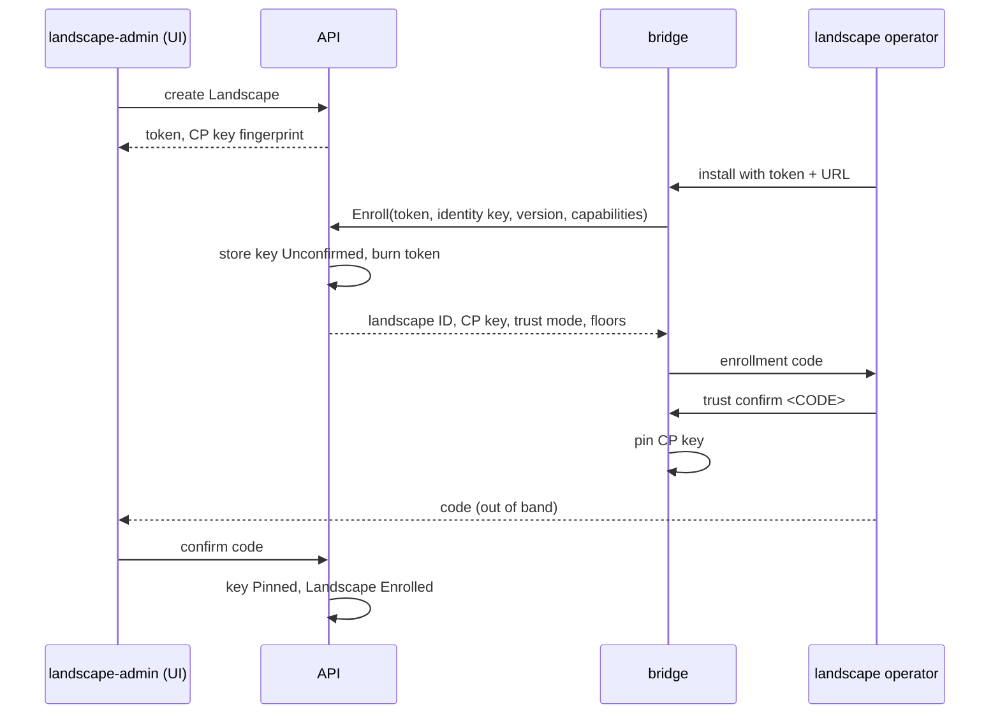

# Trust, identity, and attestation

This page defines how a bridge and the control plane come to trust each
other, how that trust survives rotation and compromise, and how signed
reports prove what runs on a landscape. Bundle and delivery layout are in
[03](03-bundles-and-transfer.md), and gates that consume attestations are in
[05](05-promotion-and-rollout.md). Field, table and reason names come from
[02](02-domain-model.md), RPC names from [08](08-api-and-ui.md).

## Target design

### Two keys carry all trust

| Key | Held by | Algorithm | Signs | Pinned by |
| --- | --- | --- | --- | --- |
| Release-signing key | the signing worker only (D-TRUST-06) | RSASSA-PSS, 3072 bit | bundles, deliveries, later key transitions | every bridge |
| Bridge identity key | one bridge process, generated on first start | Ed25519 | reports, state request files, enrollment requests; mTLS client auth | the control plane, in `bridge_keys` |

RSASSA-PSS is the OCM default, so stock `ocm verify` checks konfidence
bundles
([OCM signing](https://ocm.software/docs/how-to/sign-and-verify/sign-component-versions/)).
The bridge key stays in the bridge process and its state Secret. Operators
reach the bridge through its admin endpoint and need no `exec` or Secret
access (D-LAND-06).

TLS protects the channel; signatures protect the content. A broken channel
exposes content but can't change it. The bridge checks the server certificate
against WebPKI or an operator-supplied CA. It authenticates gRPC with mTLS and a self-signed certificate over its
identity key. The API matches the SHA-256 SubjectPublicKeyInfo fingerprint
against `bridge_keys`. In `CustomerCA` mode (M3) it checks the chain instead.

### Only the signing worker holds the release-signing key

The signing worker is its own Deployment with its own ServiceAccount. A
NetworkPolicy limits its egress to Postgres, the blob store, and the
Kubernetes API (D-TRUST-06). It runs the `signing` queue: bundle signing and
the per-landscape delivery job ([01](01-control-plane.md) owns the kinds).
Before it signs, it re-hashes every resource blob from the blob store. It
signs what the store holds, not what a build worker claims. Processes that
fetch git, run helm or builders, or reach public registries never hold the
key.

```go
type Signer interface {
    KeyID() string                     // hex SHA-256 SPKI fingerprint
    Public() crypto.PublicKey
    Certificates() []*x509.Certificate // nil in Pinned mode
    Sign(ctx context.Context, digest []byte) ([]byte, error)
}
```

Backends: `secret`, a Kubernetes Secret mounted only into the signing worker
(M1); `pkcs11` for an HSM (Later); Vault Transit or cloud KMS on demand.
Enrollment responses carry no signature. The enrollment code comparison
authenticates the key they contain, so `Enroll` needs no job round trip.

### Enrollment counts only after both sides confirm the code

An admin creates a `Landscape`. The API mints the landscape ID and a
one-time enrollment token (single use, 24 h TTL) and shows the control-plane
key fingerprint. The operator installs the bridge with token and URL.

Both sides compute the **enrollment code**: the first 16 base32 characters
(80 bits) of `SHA-256(landscapeID ‖ controlPlaneKeyFP ‖ bridgeKeyFP)`, shown
in groups of four. Each side computes it from the key it received, so one
code covers both directions (D-TRUST-02). 80 bits stop a courier who swaps
files from grinding a collision offline.



- **Control plane.** `Landscape.status.phase` runs `Pending`, then
  `Unconfirmed`, then `Enrolled`. Until `Enrolled`, the control plane
  dispatches nothing to the landscape and rejects its reports with
  `EnrollmentUnconfirmed`.
- **Bridge.** The bridge pins the control-plane key only after
  `trust confirm`. Until then it applies nothing.
- **Skipping.** Either side may skip the comparison, explicitly and with a
  reason. The bridge records `trust confirm --skip-check` and reports it. The
  API audits a skip and the UI labels the landscape "fingerprint not
  checked".
- **Out-of-band fingerprint.** With `--cp-key-fingerprint <FP>`, the bridge
  pins only that key and needs no control-plane UI (D-TRUST-03).

### Offline enrollment moves the same messages as files

1. The operator runs `konfidence-bridge enroll request --out
   enroll-request.json`. It holds identity key, version, capabilities and a
   nonce, signed by the identity key.
2. An admin imports it for a `Landscape` with `spec.mode: Isolated`. The
   authenticated import replaces the token. The key lands `Unconfirmed`.
3. The API exports `enroll-response.json`: landscape ID, control-plane public
   key, trust mode (with root certificate in `CustomerCA` mode), the nonce,
   and both counter floors.
4. The operator runs `konfidence-bridge enroll accept enroll-response.json`.
   The bridge checks the nonce, prints the code and waits for
   `trust confirm`. The admin enters the code in the UI.

Both carriers run the same verification code (D-XFER-01). `OfflineService`
in [08](08-api-and-ui.md) carries every courier file.

### Compromise recovery runs on the landscape, never from the control plane

A planned control-plane key rotation (Later) produces a key transition
`{oldKeyFP, newPublicKey, issuedAtSequence}`, signed by old and new key. Each
delivery carries the chain from the oldest pinned key to the current one. The
bridge walks it and moves its pin. A bridge without a valid chain rejects the
delivery. Bridge identity rotation mirrors this, and the old key becomes
`Retired`.

Transitions don't help after a compromise, because the attacker can sign one
too. Recovery is local on every bridge (D-TRUST-03):

1. Each operator freezes applies with `updates: Manual` on the `default`
   policy (D-POL-07). The control plane can't accept on their behalf.
2. The security office rebuilds the control plane and generates a new key.
   It publishes the fingerprint through its own channel.
3. Each operator runs `konfidence-bridge trust repin --cp-key-fingerprint
   <FP> --enroll-response <file>`. No control-plane message can start a
   repin.
4. A `landscape-admin` confirms the bridge's code on the clean control plane.

A security office that must revoke control-plane keys uses `CustomerCA` mode
with an offline root.

### Customer CA mode replaces pinning per landscape (M3)

With `spec.trust.mode: CustomerCA`:

- The release-signing key holds an X.509 certificate from the customer CA.
  The OCM signature embeds the chain, and verifiers need only the root.
- The bridge key holds a certificate from the same CA with SAN URI
  `urn:konfidence:landscape:<landscape ID>`.
- The operator installs the root on the bridge. The control plane can never
  deliver a new root.
- Rotation needs no chain: any key with a valid, unrevoked certificate counts.

Every delivery, including every CTF, carries the newest CRL (D-TRUST-04). The
bridge keeps the CRL with the highest CRL number and ignores `nextUpdate`, so
an isolated landscape is exactly as fresh as its last transfer. The UI shows
CRL number and import time. A compromised control plane can withhold a CRL,
so operators can also run `konfidence-bridge trust crl import`.

### A revoked bridge key goes on the deny list (M2+)

An admin revokes a bridge key in the UI. The API sets
`bridge_keys.state: Revoked` and sends `NOTIFY revoke:<landscape ID>`. The
replica that holds the stream closes it. The API checks the key at `Connect`,
report import and state request import (D-TRUST-05); in `CustomerCA` mode it
checks the CRL too. The landscape re-enrolls with a new key and a new token,
and keeps its landscape ID. The floors in the response stop replays.

### Reports are DSSE envelopes signed by the bridge

A report is a [DSSE](https://github.com/secure-systems-lab/dsse/blob/master/protocol.md)
envelope. The signature covers `PAE(payloadType, payload)`, so no canonical
serialization is needed. Consumers use the verified bytes and never re-parse
the envelope. `payloadType` is `application/vnd.konfidence.attestation.v1+json`,
the payload is protojson of the `Report` message, and `keyid` is the bridge
key fingerprint. The payload binds what D-ATT-01 names:

```yaml
landscapeID: lsc-7f3a9c
reportSequence: 1184               # bridge-owned
deliverySequence: 118              # last applied delivery
observedAt: 2026-10-29T08:12:00Z   # display only, never freshness
applications:
  - { project: payments, application: payments-api, releaseID: sha256:…, componentDigest: sha256:…,
      policyVersion: sha256:…, policyRefs: [default@3], effectiveValuesDigest: sha256:…,
      reason: Applied, health: Healthy, resources: [] }
```

`reason` comes from the one reason table in [02](02-domain-model.md).
D-POL-05 defines what each reporting level adds; `None` omits the
application. The bridge computes `policyVersion` (D-POL-06); the control
plane records it and never compares it.

### Counters only move upward

Freshness never depends on wall-clock time (D-ATT-02).

| Counter | Allocated by | Stored | Receiver rule |
| --- | --- | --- | --- |
| delivery sequence | control plane, own transaction | `landscape_sequences.delivery_sequence`; bridge state Secret | bridge rejects one at or below its last applied; equal with another digest alarms |
| report sequence | bridge | bridge state Secret; `landscape_sequences.report_sequence` | API accepts a stored one with the same digest as a no-op; rejects any other at or below the last accepted |

The bridge persists the delivery sequence before it hands anything to Flux.
Gaps are fine: a courier may skip a CTF, and the newer one supersedes it.

Recovery after a restore moves counters up, never down:

- **Bridge restored** (D-ATT-03). `Welcome` and every delivery carry the
  control plane's delivery floor and last accepted report sequence. The
  bridge sets its floor to the maximum of its Secret, the highest verified
  delivery in its store and the received floor. It raises its report counter
  above the accepted value. No re-enrollment is needed. Until the next
  connect or CTF, a regressed report from a valid key sets
  `BridgeStateRegressed` on the `Landscape`.
- **Postgres restored** (D-ATT-04). The delivery sequence restarts at
  max(restored value, highest sequence any bridge reported) + 1000. No
  signed number, including one in a CTF a courier holds, is reissued.

A compromised control plane can only raise counters, which costs no more
than withholding deliveries.

### One import path serves stream and file

`attest.Import(envelope, via)` runs for `SubmitReport` (`Stream`), for
uploaded attestation files and for reports inside a state request file
(`File`). It stops at the first failure with an API error:

1. Look up the key by `keyid`: unknown or `Revoked` gives `KeyRevoked`;
   `Unconfirmed` gives `EnrollmentUnconfirmed`.
2. Verify the signature, or the chain in M3: `SignatureInvalid`.
3. Match `landscapeID` to the key's landscape: `LandscapeMismatch`.
4. A report already in `attestations` with the same `payload_digest`
   succeeds without a write, so courier retries are harmless. Otherwise a
   `reportSequence` at or below `report_sequence` gives
   `ReportSequenceRegressed`.

On success one transaction appends to `attestations`, raises
`report_sequence` and sends `NOTIFY attested:<landscape ID>`. Then D-ATT-05
matching runs ([05](05-promotion-and-rollout.md)). The API patches
`status.attestation` only when a decision-relevant field changes, so
heartbeats cause no Kubernetes writes. Unmatched entries go to history only.

### Threat model

| Compromised party | Can do | Cannot do | Detection and recovery |
| --- | --- | --- | --- |
| Build worker | inject content into builds it runs | sign; change stored blobs after the re-hash | release ID ties content to SHAs; rebuild affected releases |
| Control plane (API, DB, signing worker) | sign and deliver anything within each policy and `Boundary`; withhold deliveries and CRLs; sign a transition | connect into a landscape; read landscape secrets; override local policy or `Manual` acceptance; forge reports; start a repin; lower a counter | `Manual` brake, new key, local `trust repin`, local CRL import |
| One bridge | forge reports for its own landscape; read its bundles | forge reports for others; read git credentials or other landscapes' bundles | revoke the key, re-enroll |
| Network or broken TLS | read content; delay or drop messages | modify content; replay an older delivery or report; impersonate a bridge | signatures and counters; "attested at T" makes delay visible |
| CTF courier | read; withhold, reorder or misroute archives; swap enrollment files | tamper; apply an older or foreign archive; replay a report; pass the 80-bit code check | stale "attested at T", sequence gaps |
| Stolen enrollment token | enroll a rogue bridge first | get past `Unconfirmed`: it receives nothing and counts for nothing | the real bridge finds its token burned; admin revokes and re-issues |

Bundles are signed, not encrypted. Anyone who reads the transport or a CTF
reads charts and images. Secrets never travel in bundles (D-POL-03).

## Interfaces other docs depend on

- This page owns the report envelope, `attest.Import`, the counter floors in
  `Welcome` and in the delivery manifest ([03](03-bundles-and-transfer.md)),
  and the enrollment files. Each file has its own format version (D-BUN-03).
- **Bridge CLI**: `enroll request`, `enroll accept`, `trust confirm`,
  `trust repin`, `trust crl import`, `attest export`
  ([06](06-landscape-bridge-and-policy.md)).

## Path

[09-roadmap.md](09-roadmap.md) owns the milestone list.

1. **M1** Ed25519 identity key in the bridge state Secret, mTLS, SPKI match
   against `bridge_keys`.
2. **M1** `Signer` with the `secret` backend in the signing worker, with its
   NetworkPolicy and the re-hash before signing. A test runs `ocm verify`.
3. **M1** Online enrollment with both-side code confirmation and audited
   skip.
4. **M1** Offline enrollment files and `enroll accept`.
5. **M1** Counter rules: bridge persists before apply, floors in `Welcome`
   and every delivery. Test: replaying an older CTF fails.
6. **M1** DSSE reports over `SubmitReport` and inside the state request file,
   one `attest.Import`, D-ATT-05 matching.
7. **M2+** Deny list and revocation, `trust repin --cp-key-fingerprint`, and
   the restore drill for both counter rules.

### Later

- M3-06: `CustomerCA` mode with CRL import, and the `pkcs11` backend. Both
  ship before key transitions and before any customer whose security office must
  approve the fleet trust root.
- Control-plane key transitions and bridge identity rotation.
- Customer co-sign: `ApplicationPolicy.spec.requiredSignatures` (additive).
  `Manual` acceptance covers four-eyes review until then.
- Per-application applied delivery sequence in reports, with per-application
  apply ([03](03-bundles-and-transfer.md)).
- Reproducible-build check and TPM-backed bridge identity.

## Open questions

1. Does the OCM Go library accept an external `crypto.Signer`, or does
   `pkcs11` need an OCM signing handler plugin? (unverified)
