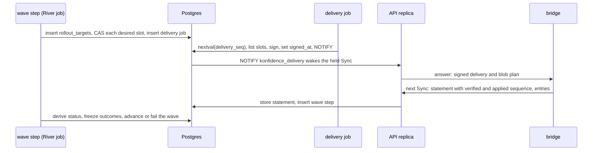

# Promotion, rollout and removal

A promotion moves one release, or a removal, to landscapes in gated waves.
Each wave step writes desired slots with one compare-and-set, and every
target status derives from the slot and the latest statement. Names come
from [02](02-domain-model.md), job kinds from [01](01-control-plane.md), the
delivery format from [03](03-bundles-and-transfer.md), and statement
verification from [04](04-trust-and-attestation.md).

## A PromotionConfig declares where releases go

`PromotionConfig` is the one intent object for rollout (D-TOPO-07). Its
`source` decides which releases start a promotion:

- `{application}` starts one for every release of the application that turns
  `Ready`.
- `{promotionConfig}` (M2+) starts one for every release whose promotion
  through the upstream config `Succeeded`. This chains dev, staging and prod
  without a pipeline kind.
- `mode: Manual` starts none. Only API calls create promotions.

`waves` is an ordered list. Each wave has a landscape `selector`, `gates`, a
`failureThreshold` (an integer or a percentage of the wave), and a
`timeout`. Selectors see only landscapes with a `LandscapeGrant` in the
project. A landscape joins the first wave whose selector matches it; a
landscape that matches no wave is not a target. A gate that must hold before
any rollout sits on the first wave.

`values` and `landscapeValues` are the promotion-target values layer
(D-POL-02). The API rejects a key outside the application's `overridable`
list when it creates the promotion.

## A promotion is a row that snapshots its config

The API inserts a `promotions` row and takes its `seq` from the identity
column. The row copies `waves`, `values` and `landscape_values` from the
config, so editing the config never changes a running promotion.
`release_id` is NULL for a removal.

An ad-hoc promotion is an API call against a config. It names a `Ready`
release or a removal and may narrow the waves to a list of landscapes. Each
wave keeps its gates, so no API call skips approval. Override is the only
bypass, and it is audited.

`promotions.state` starts `InProgress` and ends `Succeeded`, `Failed` or
`Rejected`. Superseded is never a promotion state: it is a target status,
derived from the slot.

## Gates follow ADR-0039 through one write

Every gate write is `SetGateState(promotion, wave, type, state, reason)`
(D-PROMO-01). Approval, external writers, override and reject all use it,
and each call writes one `gate_states` row plus an `audit_log` row.

- The wave step is type-agnostic. A wave clears when every gate of the wave
  is `Satisfied`. `Pending` and `Error` both hold it.
- Gate rows are seeded `Pending` when the previous wave completes, so a soak
  gate counts from the right moment.
- A caller who does not own the gate type needs project-admin and a reason.
  The row gets `override = true` (M2+).
- `Rejected` ends the promotion as `Rejected`. The wave step writes no
  further slots. Slots already written stay; rollback is a new promotion.

| Gate type | Writer | Satisfied when | Milestone |
| --- | --- | --- | --- |
| `explicit-approval.konfidence.cloud` | a user with approval rights on the project | the user approves | M1 |
| `soak.konfidence.cloud` | core gate writer | the configured duration has passed since seeding | M2+ |
| external, DNS-style name | a runtime component through the API (D-PROD-03) | the writer says so | M2+ |

Machine writers authenticate through trust rules and appear as
`<issuer>#` in `set_by` (D-API-04, M2+). A gate that needs data the
reporting level withholds stays `Pending` until the wave timeout
(D-POL-05). No config check runs at save time.

## A wave step writes slots with one compare-and-set

When a wave's gates clear, the wave step resolves the wave's selector
against granted landscapes and inserts one `rollout_targets` row per
landscape with no outcome. Per target it writes the slot with the
compare-and-set from [02](02-domain-model.md): `bundle_digest` is the
release's bundle, or NULL for a removal. In the same transaction it inserts
the landscape's delivery job, which coalesces with any job already waiting
(D-TOPO-05).

The predicate `d.promotion_seq < excluded.promotion_seq` is the only
supersede rule and the only fence (D-PROMO-06). Zero affected rows mean a
higher promotion owns the slot, and the target freezes as `Superseded`. A
newer promotion that writes the slot later turns the older target
`Superseded` through row 2 of the status function. Older promotions never
overwrite newer ones, so promotions cannot ping-pong. A newer promotion
preempts an older one in flight on purpose, because it is usually a fix or a
rollback.

The delivery job lists only slots whose `required_capabilities` the
landscape's latest statement has. A slot it holds back shows
`Blocked(MissingCapability)` until the bridge upgrades or the wave times out
(D-BUN-03).

## Target status is derived, and only outcomes are stored

The wave step evaluates the 13-row status function in
[02](02-domain-model.md) for every open target. It runs when the wave
starts, when a statement for one of its landscapes is imported, when a gate
changes, and at the wave timeout. Statement import inserts the wave step for
every promotion with an open target on that landscape, in the import
transaction.

A statement entry `e` matches slot `s` when both hold (rows 8 to 13):

- `e.entryDigest` equals the digest of the delivery entry built from `s`;
- `e.deliverySequence` is at or above `s.first_delivery_seq`.

A new slot write resets `first_delivery_seq`, so a statement about an older
delivery of the same release (A, then B, then A) never matches the new
slot. An entry that matches no slot only feeds history. The policy version
is recorded, never compared (D-POL-06).

## A wave succeeds within its failure threshold

The wave step freezes a target's outcome the first time the status function
gives a final answer:

| Derived status | Frozen outcome | Counts toward the threshold |
| --- | --- | --- |
| `Healthy`, `Received` at level `None`, `Dispatched` on row 6 | `Succeeded` | no |
| `Failed` | `Failed` with reason `Failed` | yes |
| `Refused` | `Refused` | no; an operator saying no is policy (D-LAND-05) |
| `Superseded` | `Superseded` | no |

Before the timeout only a terminal Flux failure fails a target. `Blocked`,
`Received` and `Applied` wait. At the wave timeout, measured from the moment
the wave's gates cleared, every open target freezes as `Failed` (D-PROMO-05):

- with reason `NoStatement` when no statement arrived after the first
  delivery listing the slot was signed;
- with reason `WaveTimeout` otherwise.

The timeout of a wave with isolated landscapes covers export, the courier
trip and statement import. When `Failed` outcomes exceed `failureThreshold`,
the promotion turns `Failed` and no later wave starts. Slots already written
stay; the bridges keep converging to them. When every target of a wave has
an outcome within the threshold, the next wave's gates are seeded. After the
last wave the promotion is `Succeeded`.

A late statement updates the derived view in the UI, never a frozen outcome.

## Rollback promotes an earlier release

Rollback is an ad-hoc promotion of an earlier `Ready` release under a new
promotion sequence (M2+). It passes the same gates and waves; in an
emergency the operator overrides a gate. Every release stays in `releases`,
so any earlier release can be the target. Helm remediation inside a
landscape stays a chart-level `HelmRelease` setting.

## Removal is a slot that points at nothing

A removal promotion has `release_id` NULL (M2+). Its wave step writes slots
with `bundle_digest` NULL, and the delivery carries them as tombstones
(D-PROMO-04). Gates, waves, thresholds and the compare-and-set work
unchanged: a removal supersedes an older deploy on the same slot and the
other way around. A tombstone target reaches `Healthy` when the bridge
reports `Removed`.

Absence never removes. A landscape that leaves a config's selectors keeps
its slot and what it runs; an ad-hoc removal narrowed to that landscape
removes it. A new landscape that joins a selector gets the application with
the next promotion, or with an ad-hoc promotion of the current release
narrowed to it. Charts dropped between releases need no tombstone; the
bridge's one reconcile removes them
([06](06-landscape-bridge-and-policy.md)).

The API refuses to delete an `Application` while any of its slots points at
a bundle. Remove it everywhere first.

## Path

1. **M1** `PromotionConfig` with `source: {application}`, `mode`, and one
   wave; `promotions` rows with the snapshot; ad-hoc promotions.
2. **M1** Wave step: `rollout_targets`, the compare-and-set, the delivery
   job insert, capability hold-back.
3. **M1** Status function with its golden test, entry matching, frozen
   outcomes, `NoStatement` and `WaveTimeout`.
4. **M1** `SetGateState` for `explicit-approval.konfidence.cloud` and
   `Rejected`.
5. **M2+** Selectors over labels, several waves, thresholds above zero,
   `source: {promotionConfig}` chaining.
6. **M2+** Rollback, removal promotions, the `Application` delete check.
7. **M2+** Override, `soak.konfidence.cloud`, external gate writers with
   D-API-04 authentication.

Later: pause and resume, opt-in automatic rollback on wave failure,
cross-application ordering.
