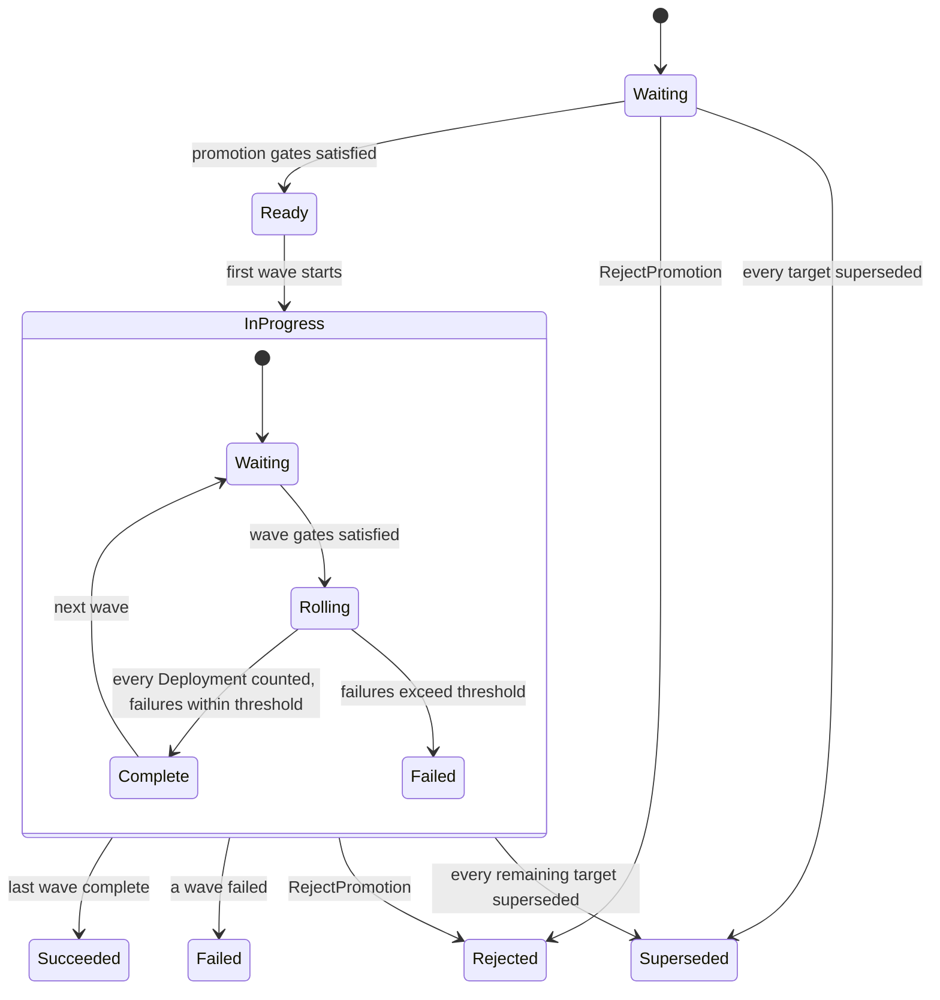
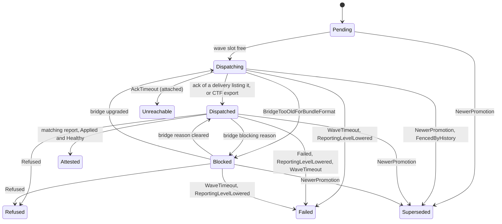
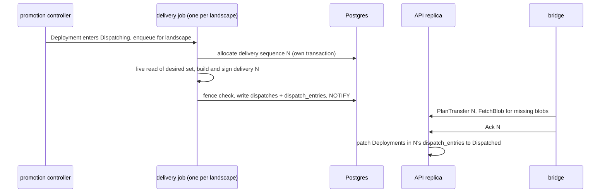

# Promotion, rollout and removal

A `Release` reaches landscapes through `PromotionConfig` → `Promotion` →
`Deployment`. This page defines gates, waves, completion, superseding,
dispatch, rollback, and removal. Names, enums and the reason-to-phase table
come from [02](02-domain-model.md), job kinds from [01](01-control-plane.md),
the delivery format from [03](03-bundles-and-transfer.md), report
verification from [04](04-trust-and-attestation.md).

## Three kinds carry the flow

| Kind | Lifetime | Answers |
| --- | --- | --- |
| `PromotionConfig` | long-lived, one per application and target set | Where does a release go, in which waves, behind which gates? |
| `Promotion` | one per (config, promotion sequence) | Is this release cleared, and how far has it rolled out? |
| `Deployment` | one per (promotion, landscape) | What did this landscape get, and what did it report back? |

Every `Promotion` belongs to a `PromotionConfig`, so rollbacks and removals
inherit its gates, waves and targets.

## A PromotionConfig declares source, targets, waves and gates

- **Source.** `{application}` creates a promotion for every new `Release`.
  `{promotionConfig}` (M2+) creates one for every release that reached
  `Succeeded` through the upstream config, which chains dev → staging → prod
  without a pipeline kind. Without a source, or with `mode: Manual`, only
  the API creates promotions.
- **Targets.** A list of entries, each with `landscapes` or a `selector`
  (M2+) plus promotion-target values (D-POL-02). Only landscapes with an
  `Approved` `LandscapeGrant` are valid targets.
- **Waves.** Waves partition the targets. A target joins the first wave whose
  selector matches; a last wave without selector takes the rest. A target
  that matches no wave is a validation error. `maxConcurrent` and
  `failureThreshold` take an integer or a percentage of the wave.
- **Gates.** At promotion scope and per wave (D-PROMO-02).

Chaining and catch-up read `status.lastSucceeded`, never old `Promotion`s.

## A Promotion snapshots everything it needs

At creation the controller copies into `Promotion.spec`: release, operation
(`Deploy` or `Remove`), gates, waves with their resolved landscapes, and the
targets with values and `valuesDigest`. Selectors resolve once. Later config
edits never change a running promotion.

Each promotion takes the next number from
`Application.status.nextPromotionSequence`. Ordering, superseding and the
dispatch fence use this promotion sequence, never the release sequence. A
rollback is therefore a `Deploy` of an older release under a newer promotion
sequence.

## Gates follow ADR-0039 at two scopes

Gate semantics stay as in ADR-0039 (D-PROMO-01):

- The controller is type-agnostic. A scope is cleared when every gate entry
  in it is `Satisfied`.
- Gate types are DNS-style names, written by the API, core gate controllers
  or third parties.
- Entries are seeded `Pending` and carry `state`, `reason`, `setBy`, `setAt`.
- Override (`OverrideGate`, M2+) sets a gate `Satisfied` through the API,
  with the session as `setBy` and the justification as `reason`, audited.

The redesign adds `scope`: `promotion` or `wave/<name>`. Promotion gates hold
the whole promotion in `Waiting`. Wave gates are seeded when the previous wave
completes, so a soak gate starts counting at the right moment.

External writers set gates only through the API (`SetGateState`, owned by
[08](08-api-and-ui.md)). This is the gate contract for the runtime
(D-PROD-03). Machine writers authenticate with workload OIDC trust rules and
appear as `<issuer>#` in `setBy` (D-API-04, M2+).

| Gate type | Writer | Satisfied when | Milestone |
| --- | --- | --- | --- |
| `explicit-approval.konfidence.cloud` | API `ApproveGate` | a user with approval rights on the project approves | M1 |
| `soak.konfidence.cloud` | core gate controller | the configured duration has passed since the scope became eligible | M2+ |

`RejectPromotion` follows ADR-0040. The API writes `status.rejection` in `Waiting` or
`InProgress`. The promotion stops dispatching at once and turns `Rejected`,
which is terminal. Deployments already dispatched stay as they are.

## Validation rejects gates a landscape cannot feed

A gate or completion rule that needs data a landscape never sends is a
configuration bug (D-POL-05):

- `completion: Attested` needs reporting level `Health` or `Resources` on
  every landscape of the wave. `None` allows only `Dispatched` (D-PROMO-03).
- A gate entry may declare `requiresReporting: Health | Resources`. Core
  gates declare it in code, third-party gates in the config entry.
- The control plane learns each landscape's effective level per application
  from the handshake or the last state request file.

The API rejects a failing `PromotionConfig` write with an error, not a status
reason. The config controller re-checks when targets or levels change and
sets `Valid=False`; an invalid config creates no promotions. If a running
promotion meets a lowered level, the affected gates go `Error` and every
non-terminal deployment goes `Failed`, both with `ReportingLevelLowered`.

## Rollout runs wave by wave

In `Rolling` the controller keeps at most `maxConcurrent` deployments of the
wave in flight. Pending deployments of connected landscapes take free slots
first (`Landscape.status.connection`). When `failed + unreachable` exceeds
`failureThreshold`, the wave fails, the promotion goes `Failed`, and nothing
further dispatches. Deployments already out are not rolled back; rollback is
an explicit promotion.

A promotion with failures inside the threshold is `Succeeded`. `Refused`
never counts toward the threshold: an operator saying no is policy, not a
broken rollout (D-LAND-05).

## A Deployment moves through dispatch, report and outcome

- **Wave counting.** With completion `Dispatched`, reaching `Dispatched`
  counts as done. With `Attested`, only `Attested` does. `Failed`,
  `Unreachable`, `Refused` and `Superseded` always count. A phase change
  after the wave counted a deployment never changes the wave result.
- **Blocked** covers every blocking bridge reason, including
  `AwaitingLocalAcceptance` under `updates: Manual` (D-POL-07). It counts as
  neither complete nor failed and is bounded by the wave `timeout`, which
  runs from `Dispatching`; for isolated landscapes it must cover export,
  courier trip and report import.
- **Failed** from a report means reason `Failed`: Flux has given up on a
  `HelmRelease` ([06](06-landscape-bridge-and-policy.md)). `Progressing`
  never fails a deployment; only the wave `timeout` does (`WaveTimeout`).
- **Unreachable** applies to attached landscapes whose delivery is not acked
  within the wave `ackTimeout` (default 15 min, D-PROMO-05). It frees the
  slot, counts toward the threshold and shows separately from `Failed`. The
  release stays desired, so the bridge pulls it on reconnect. A late ack or
  report updates conditions and history, not the phase.

## The delivery, not the Deployment, is what gets dispatched

A `Deployment` is the per-landscape record for waves and the UI. The unit of
dispatch is the landscape's signed delivery (D-BUN-04). It lists the
landscape's full desired set: per application, a bundle by digest with
promotion-target values and the grant ID, or a tombstone.

1. **Enqueue.** For an attached landscape the controller enqueues its
   delivery job, unique per landscape over non-finished states, so changes
   coalesce (D-TOPO-05). It re-enqueues while a `Dispatching` deployment has
   no `status.delivery.sequence`.
2. **Desired set.** The job reads `Deployment`s with a live, uncached read.
   Per (project, application) the desired entry is the non-superseded
   `Deployment` with the highest promotion sequence in `Dispatching` or later.
3. **Sequence and fence.** The delivery sequence comes from
   `landscape_sequences` in its own transaction; gaps are allowed (D-ATT-02).
   The transaction writing `dispatches` and `dispatch_entries` checks only
   `Deployment`s not yet in the landscape's `dispatch_entries`. It refuses one
   whose promotion sequence is not above the last dispatched one for that
   (application, landscape), or whose promotion is terminal in history, and
   marks it `Superseded` with `FencedByHistory`. This is the one DB read that
   decides (D-TOPO-07), so a restored CRD state never rolls a landscape back.
4. **Ack.** An ack of delivery N moves the `Deployment`s in its
   `dispatch_entries` that are still `Dispatching` to `Dispatched`.
5. **Isolated.** The CTF export runs the same build and marks listed
   `Dispatching` deployments `Dispatched` with `Exported` (D-UI-02).

## A report attests only the Deployment it matches

A verified report entry updates the current desired `Deployment` for
(application, landscape) only if two checks pass (D-ATT-05):

- the report's delivery sequence is at or above
  `Deployment.status.delivery.sequence`;
- the reported component digest equals `spec.componentDigest`.

The sequence check stops a report from an older delivery of the same release
(A → B → A) from attesting the new `Deployment`. A match
with `Applied` and `Healthy` makes it `Attested`; for `operation: Remove`,
`Removed` does. Entries that match no current `Deployment` go to history
only. The policy version is recorded, never compared (D-POL-06).

## The newest promotion sequence owns each landscape

The control plane holds one desired entry per (application, landscape). Two
rules in the leader-elected promotion controller keep it so:

1. When a deployment enters `Dispatching`, every non-terminal deployment for
   the same (application, landscape) with a lower promotion sequence becomes
   `Superseded` with `NewerPromotion`. That includes one already
   `Dispatched` and waiting for its report.
2. A deployment never dispatches if one with a higher promotion sequence for
   the same (application, landscape) already did. It becomes `Superseded`.

Older promotions never touch newer ones, so promotions cannot ping-pong.
Preempting an in-flight deployment is deliberate: a newer promotion is
usually a fix or a rollback.

## Rollback promotes an earlier release

`RollbackPromotion` (config, release, optional targets; M2+) creates an
ordinary `Deploy` promotion of the earlier release under a new promotion
sequence. It passes the same gates and waves; in an emergency the operator
uses `OverrideGate`. The rollback window is the retained `Release` set of
D-TOPO-07, and the API rejects anything outside it. Helm remediation inside a
landscape stays a chart-level `HelmRelease` setting.

## Removal is a promotion that carries a tombstone

A promotion with `operation: Remove` (M2+) has no release. Its deployments put
a tombstone into the delivery instead of a bundle reference (D-PROMO-04).
Gates, waves, thresholds and superseding work unchanged, and a removal
supersedes an older deploy on the same target and the other way around.
With completion `Attested` the bridge must report `Removed`; with
`Dispatched` the delivery ack or export is enough.

Removal is always explicit. A landscape that drops out of a config's targets
keeps what it runs; the config status lists it as an orphaned target, and
`RemoveApplication` (config, targets) removes it. Deleting an `Application`
that still runs anywhere is refused until its removals succeed or the user
confirms abandonment. Charts dropped between releases need no tombstone; the
bridge removes them by diffing releases ([06](06-landscape-bridge-and-policy.md)).

A landscape that newly matches a config's selector gets a catch-up
`Promotion` of `status.lastSucceeded.release` (M2+). It passes the config's
gates: skipping approval for a new production landscape is the wrong default.

## Path

1. **M1** `PromotionConfig` with a `landscapes` target list and one wave;
   `Promotion` and `Deployment` with the state machines above; the two
   superseding rules and the promotion sequence.
2. **M1** Delivery job hook-up: enqueue per landscape, the fence with
   `FencedByHistory`, ack and export moving `dispatch_entries` to
   `Dispatched`, `ackTimeout` and `Unreachable`.
3. **M1** Completion `Dispatched` and `Attested`, the D-ATT-05 matching rule,
   reporting-level validation and `ReportingLevelLowered`.
4. **M1** Gates with `(scope, type)` keys, `explicit-approval` through
   `ApproveGate`, and `RejectPromotion`.
5. **M2+** Selectors, multiple waves, `maxConcurrent` and `failureThreshold`
   above one, `source.promotionConfig` chaining.
6. **M2+** `RollbackPromotion`, `RemoveApplication` and tombstones; catch-up
   promotions.
7. **M2+** `OverrideGate` with audit, `soak`, the gate-writer library,
   `SetGateState` for external writers with D-API-04 authentication.

Later: pause and resume, opt-in automatic rollback on wave failure,
cross-application ordering.
