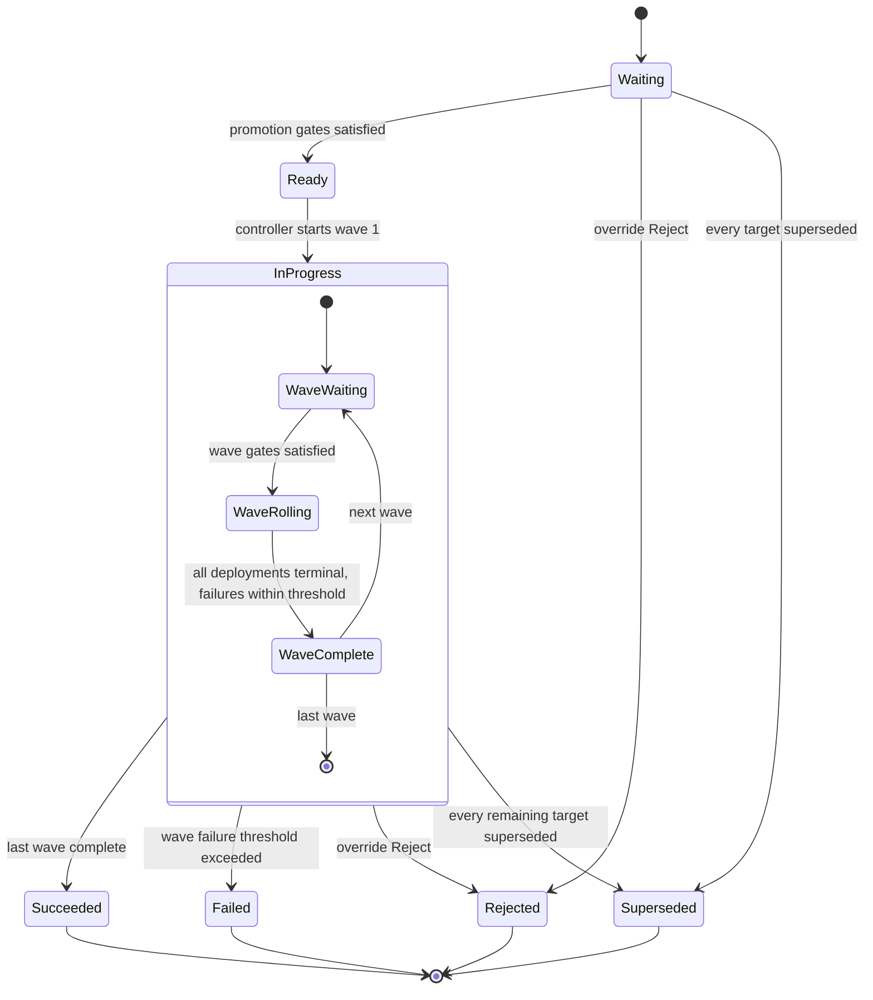
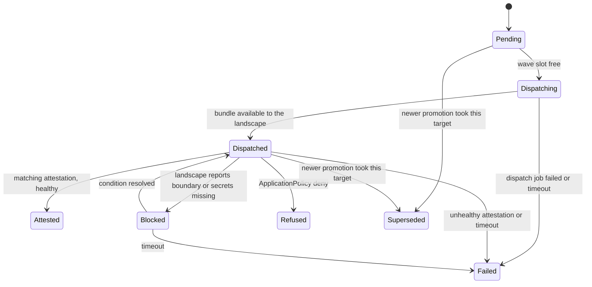

# Promotion, rollout and removal

This doc defines how a `Release` reaches a set of landscapes. It covers the
path `PromotionConfig` → `Promotion` → `Deployment`, gates, waves, the
per-wave completion rule, serialization and superseding per target, removal
through tombstones, and rollback. It does not define bundle assembly or
transfer ([03-bundles-and-transfer.md](03-bundles-and-transfer.md)),
attestation format and signature checks
([04-trust-and-attestation.md](04-trust-and-attestation.md)), or how the
bridge applies a bundle ([06-landscape-bridge-and-policy.md](06-landscape-bridge-and-policy.md)).
Field names are owned by [02-domain-model.md](02-domain-model.md); the
sketches here show only what the flow needs.

## Target design

### Three kinds carry the flow

| Kind | Lifetime | Written by | Answers |
| --- | --- | --- | --- |
| `PromotionConfig` | long-lived, per application and target set | API (user intent) | Where does a release go, in which waves, behind which gates? |
| `Promotion` | one per (config, release, action) | promotion controller creates; API and gate writers update status | Is this release cleared, and how far has it rolled out? |
| `Deployment` | one per (promotion, landscape) | promotion controller creates; workers and API (attestations) update status | What did this landscape get, and what did it report back? |

A `Promotion` always belongs to a `PromotionConfig`. Ad-hoc promotions,
rollbacks and removals are created through the API against a config, so they
inherit its gates, waves and target set. There is no promotion path that
skips a config.

### PromotionConfig declares targets, gates and waves

```yaml
apiVersion: konfidence.cloud/v1alpha1
kind: PromotionConfig
metadata: { name: payments-prod, namespace: team-payments }
spec:
  application: payments
  source:                       # what creates promotions automatically
    promotionConfig: payments-staging   # or: application (every new Release)
  targets:
    selector: { matchLabels: { tier: prod } }   # or: landscapes: [a, b]
  gates:                        # promotion-level, ADR-0039 model
    - type: explicit-approval.konfidence.cloud
  waves:
    - name: canary
      selector: { matchLabels: { ring: canary } }
      maxConcurrent: 1
      failureThreshold: 0
      completion: attested
      timeout: 30m
      gates:
        - type: soak.konfidence.cloud
    - name: rest                # no selector: takes every remaining target
      maxConcurrent: 20%
      failureThreshold: 5%
      completion: attested
      timeout: 2h
```

Source has two forms. `source.application` creates a promotion for every new
`Release` of the application. `source.promotionConfig` creates a promotion
for every release that reached `Succeeded` through the upstream config. That
chains environments (dev → staging → prod) without a separate pipeline kind.
A config without `source` never creates promotions on its own; the API
creates them on request.

Waves partition the target set. A target joins the first wave whose selector
matches. The last wave may omit its selector and takes the rest. A target
that matches no wave is a validation error, not a silent skip.
`maxConcurrent` and `failureThreshold` accept an integer or a percentage of
the wave's targets.

### Promotion snapshots everything it needs

On creation the promotion controller copies into the `Promotion` spec, as
ADR-0032 did: the release (ID and sequence label), the action (`Deploy` or
`Remove`), the gates, the waves, the promotion-target values digest, and the
resolved target list per wave. Later edits to the config never change a
running promotion. Selectors resolve once, at creation.

Each promotion gets a sequence number from a per-application counter.
Ordering, superseding and rollback all use this promotion sequence, never the
release sequence: a rollback promotes an older release under a newer
promotion sequence.

### Gates follow ADR-0039, at two scopes

Gate semantics are unchanged from ADR-0039:

- The controller is type-agnostic. A scope is cleared when every gate entry
  in it is `Satisfied`.
- Gate types are DNS-style names. Writers are external: the API, core gate
  controllers, or a third party.
- Entries are seeded `Pending` at creation, keyed by type, and carry
  `state`, `reason`, `setBy`, `setAt`.
- Override is setting a gate `Satisfied` by hand through the API, with the
  session identity as `setBy` and the justification as `reason`.

The redesign adds a scope. `status.gates` entries are keyed by
`(scope, type)`, where scope is `promotion` or `wave/<name>`. Promotion-level
gates hold the whole promotion in `Waiting`. Wave gates hold one wave in
`Waiting` after the previous wave completed. Wave gates are seeded `Pending`
when the wave becomes eligible, so a time-based gate such as soak starts
counting at the right moment.

All gate writes from outside the control plane go through the API
(`SetGateState`), which takes identity from the authenticated session. This
is the contract the vector runtime and other extensions use (D-PROD-03).
Core gate controllers run in-process and use the same Go library ADR-0039
defines.

Core gate types for v1:

| Gate type | Writer | Satisfied when |
| --- | --- | --- |
| `explicit-approval.konfidence.cloud` | API | A user with approval rights on the project approves. |
| `soak.konfidence.cloud` | core gate controller | The configured duration has passed since the scope became eligible. Uses the ADR-0039 gate `spec` extension for the duration. |

Rejection follows ADR-0040: `status.override` with `type: Reject`, written
only by the API. It is allowed in `Waiting` and `InProgress`. A rejected
promotion stops dispatching at once; deployments already dispatched stay as
they are. `Rejected` is terminal and no gate writer can undo it.

### Gates are validated against reporting levels

A gate or completion rule that needs data a landscape never sends is a
configuration bug. Validation catches it before rollout, and runtime
fails closed.

- `completion: attested` needs reporting level `health` or higher on every
  target of that wave (D-PROMO-03).
- A gate entry may declare `requiresReporting: health | resources | full`
  and `on: source | wave`. Core gates declare it in code; third-party gates
  declare it in the config entry. A gate without the field needs no
  reporting.
- The reporting level per (landscape, application) is the effective
  `ApplicationPolicy` value, known to the control plane from the bridge
  handshake or the last imported state request file.

Validation runs in two places. The API rejects a `PromotionConfig` write that
fails it against the current target set. The config controller re-checks when
the target set or a reporting level changes and sets `Valid=False` with the
offending landscapes; an invalid config creates no promotions. A promotion
created from a valid config can still meet a lowered level later. Then the
affected gate goes to `Error` with reason `ReportingLevelInsufficient`, and
an `attested` deployment fails with the same reason (D-POL-05). Nothing
passes by default.

### Rollout runs wave by wave



Inside `WaveRolling` the controller keeps at most `maxConcurrent` deployments
of the wave non-terminal and dispatched at the same time. When one reaches a
terminal state, the next pending deployment dispatches. When the count of
`Failed` deployments in the wave exceeds `failureThreshold`, the wave fails
and the promotion goes `Failed`. It dispatches no further deployments, and it
does not roll back the ones that went out. Rollback is a separate, explicit
promotion (see below).

A promotion that completes with failures inside the threshold is `Succeeded`
and records the failure count. The UI shows it; downstream configs treat it
as succeeded.

### Deployment is the per-landscape record



- **Dispatching.** The controller enqueues a River job that assembles the
  bundle for (release, landscape) and stages it for transfer. The job is
  unique per (release, landscape) (D-TOPO-05). The controller assigns the
  next landscape sequence number at this point; bundles and tombstones share
  that counter (D-ATT-02).
- **Dispatched.** For an attached landscape: the bridge acknowledged receipt
  of the complete bundle. For an isolated landscape: the CTF archive that
  contains it was exported. The landscape's desired release in its CRD is
  updated here (D-TOPO-07).
- **Attested.** A verified attestation names this landscape, this release
  digest and the expected policy version, with health `Ready`. Attestations
  from an imported file go through the same path.
- **Terminal states.** With completion `dispatched`, `Dispatched` is
  terminal-success for the wave. With `attested`, `Attested` is. `Failed`,
  `Refused` and `Superseded` are always terminal.
- **Refused** does not count toward the failure threshold. A landscape
  operator saying no is policy, not a broken rollout. The UI shows it as
  "refused by landscape" (D-LAND-05).
- **Blocked** covers "waiting for boundary approval" and unbound secret
  requirements as reported by the bridge. It is non-terminal and bounded by
  the wave `timeout`.

The wave `timeout` applies from `Dispatching` on. For waves of isolated
landscapes with `completion: attested`, the timeout has to cover the manual
export, carry and import cycle; the config author sets it accordingly.

### One desired release per (application, landscape)

Serialization is per target, not per config. For each (application,
landscape) the control plane holds exactly one desired release: the one
from the `Deployment` with the highest promotion sequence that has reached
`Dispatching`. Two rules enforce it in the promotion controller, which is
leader-elected and processes dispatch decisions on one worker:

1. When a deployment starts `Dispatching`, every non-terminal deployment for
   the same (application, landscape) with a lower promotion sequence becomes
   `Superseded`. That includes one already `Dispatched` and still waiting for
   its attestation. The bridge applies the newer bundle because its landscape
   sequence is higher.
2. A deployment never dispatches if a deployment for the same (application,
   landscape) with a higher promotion sequence has already dispatched. It
   becomes `Superseded` instead.

Newer promotions are never touched by older ones. Two promotions on
overlapping targets therefore cannot ping-pong. A promotion becomes
`Superseded` only when every target it has left is superseded; until then it
keeps rolling out to the rest. This scoping also covers two configs whose
selectors overlap: they no longer fight, the newer promotion wins per
landscape.

Preempting an in-flight deployment is deliberate. The common reason for a
newer promotion during a rollout is a fix or a rollback, and it must not wait
for the broken release to time out.

### Rollback is promoting an earlier release

The API offers `Rollback(promotionConfig, release, targets?)`. It creates an
ordinary `Promotion` of the earlier release with a new promotion sequence,
optionally narrowed to a subset of the config's targets. It passes the same
gates and waves; in an emergency the operator overrides gates through the
audited API. Because its promotion sequence is higher, rule 1 above
supersedes whatever is in flight on those landscapes.

The release must still be deliverable. Bundle retention keeps every release
that a landscape currently runs plus the previous N per landscape
(D-TOPO-07); rollback targets outside that window are rejected by the API
with a clear error.

There is no automatic rollback on wave failure in v1. Helm's own upgrade
remediation inside a landscape stays a chart-level setting of the
`HelmRelease` (Flux `.spec.upgrade.remediation`, verified) and is independent
of promotions.

### Removal goes through the same path

A promotion with `action: Remove` removes the application from its targets.
Its deployments carry a signed tombstone instead of a bundle (D-PROMO-04).
The tombstone names the application and carries the next landscape sequence
number, so the bridge orders it against bundles with the same monotonic
check. Gates, waves, `maxConcurrent`, failure threshold and superseding work
unchanged. A removal promotion supersedes an older deploy promotion on the
same target and the other way around.

Completion for a removal:

- `attested`: the bridge attests the application absent.
- `dispatched`: the tombstone reached the landscape or was exported.

Removal is always explicit. A landscape that drops out of a config's target
set keeps running what it has; the config controller lists it as an orphaned
target in status, and the API offers `Remove(promotionConfig, targets)`.
Deleting a control-plane `Application` that still runs anywhere is blocked
until removal promotions have succeeded or the user confirms abandonment.
Charts removed from an application between two releases need no tombstone;
the bridge removes them by diffing the old and new release
([06-landscape-bridge-and-policy.md](06-landscape-bridge-and-policy.md)).

### Landscapes that join a target set later catch up

Selectors resolve at promotion creation. When a landscape newly matches a
config's target set, the config controller creates a catch-up `Promotion`
of the config's last succeeded release, targeted at that landscape only. It
passes the config's gates like any other promotion.

### Retention

Terminal promotions and their deployments stay in CRDs bounded by
`keepLastPromotions` per config and `ttlAfterFinished`, as in ADR-0032. Every
state transition is appended to the history tables in Postgres when it
happens, so the audit trail and the release path view (D-REL-03) survive CRD
cleanup. Reconcile decisions never read that history.

## Decisions applied

- **D-PROMO-01:** `Promotion` over a `Release`, inline `status.gates`,
  type-agnostic controller, external writers, override as gate set
  `Satisfied` with audit. ADR-0040 `Reject` adds the terminal veto.
- **D-PROMO-02:** target list or selector, one `Deployment` per landscape,
  waves with `maxConcurrent` and `failureThreshold`, gates at promotion and
  wave scope.
- **D-PROMO-03:** `completion: attested | dispatched` per wave; validation
  forbids `attested` on reporting level `none`.
- **D-PROMO-04:** `action: Remove` promotions carry tombstones through the
  same gates and waves; chart removal by release diff is left to the bridge.
- **D-POL-05:** gate and completion validation against reporting level on
  write and on change; fail closed with `ReportingLevelInsufficient`.
- **D-ATT-02:** landscape sequence assigned at dispatch, shared by bundles
  and tombstones, so rollback and removal order correctly on the bridge.
- **D-TOPO-05:** dispatch is a River job unique per (release, landscape);
  the controller only decides.
- **D-TOPO-07:** desired release per landscape lives in CRDs; history is
  appended to Postgres and never read for decisions.
- **D-LAND-05, D-TEN-01, D-POL-03:** `Refused` and `Blocked` deployment
  states surface policy deny, boundary approval and unbound secrets.
- **D-UI-02:** `Dispatched` and `Attested` are distinct deployment states
  the UI shows as they are.
- **D-PROD-03:** `SetGateState` on the API is the gate contract for the
  runtime and other extensions.

## Interfaces other docs depend on

- **API ([08-api-and-ui.md](08-api-and-ui.md)):** `SetGateState(promotion,
  scope, type, state, reason)`, `Approve` (sugar for the approval gate),
  `Reject(promotion, reason)`, `Promote(config, release, targets?)`,
  `Rollback(config, release, targets?)`, `Remove(config, targets?)`. All
  take identity from the session.
- **Domain model ([02-domain-model.md](02-domain-model.md)):** owns field
  names for `PromotionConfig`, `Promotion`, `Deployment`; this doc needs the
  per-application promotion sequence counter, per-landscape sequence
  counter, `(scope, type)` gate keys, `status.override`, and deployment
  states listed above.
- **Bundles and transfer ([03-bundles-and-transfer.md](03-bundles-and-transfer.md)):**
  a River job `dispatch(release | tombstone, landscape, landscapeSequence)`
  that ends with a signed receipt acknowledgment (attached) or an exported
  CTF (isolated). Its result moves a deployment to `Dispatched`.
- **Trust and attestation ([04-trust-and-attestation.md](04-trust-and-attestation.md)):**
  a verified attestation event with landscape ID, release digest (or
  "absent" for removal), policy version, health, and the blocking reasons
  `BoundaryPending`, `SecretsUnbound`, `Refused`.
- **Bridge ([06-landscape-bridge-and-policy.md](06-landscape-bridge-and-policy.md)):**
  effective reporting level per application in the handshake and the state
  request file; tombstone handling; chart removal by release diff.
- **Releases ([07-sources-and-releases.md](07-sources-and-releases.md)):**
  an event on new `Release`, which the config controller turns into
  promotions for configs with `source.application`.

## Path

### v1 first steps

1. `PromotionConfig` with a static `targets.landscapes` list, one implicit
   wave, no gates. `Promotion` and `Deployment` CRDs with the state machines
   above. Promotion controller with the two serialization rules and the
   per-application promotion sequence.
2. Dispatch through the River job from
   [03-bundles-and-transfer.md](03-bundles-and-transfer.md); completion
   `dispatched` only. This alone passes the D-PROD-04 acceptance test for one
   attached and one isolated landscape.
3. Completion `attested` wired to verified attestations, with reporting-level
   validation and `ReportingLevelInsufficient`.
4. Gates: `status.gates` with `(scope, type)` keys, the Go writer library,
   `explicit-approval.konfidence.cloud`, `SetGateState`, `Reject`.
5. `Rollback` and `Remove` API calls; tombstones on the shared landscape
   sequence.
6. Selectors, multiple waves, `maxConcurrent`, `failureThreshold`,
   `source.promotionConfig` chaining.

### Later

- `soak.konfidence.cloud` and gates contributed by the vector runtime.
- Catch-up promotions for landscapes that join a selector.
- Pause and resume of a running promotion.
- Automatic rollback on wave failure, as an opt-in per config.
- Cross-application ordering, once D-LAND-03 lifts the v1 restriction.

## Open questions

1. Should catch-up promotions for new landscapes pass the config's gates,
   including manual approval? Passing them is safe; it is also noisy at
   500–1000 landscapes.
2. Is `Refused` excluded from the failure threshold in every case, or should
   a config be able to count it?
3. Dispatch receipt for attached landscapes: is a signed transfer
   acknowledgment enough for `Dispatched`, or should it wait for the bridge's
   first attestation of the new sequence? Owned jointly with
   [04-trust-and-attestation.md](04-trust-and-attestation.md).
