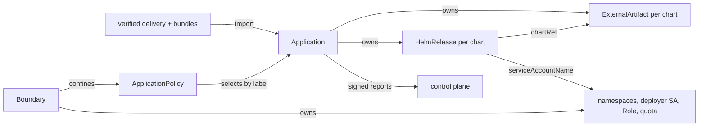

# Landscape: bridge, policy and tenancy

The bridge is the only konfidence component in a landscape. This page
defines what it does with a verified delivery; transfer lives in
[03](03-bundles-and-transfer.md), keys and reports in
[04](04-trust-and-attestation.md), names in [02](02-domain-model.md).

## The bridge renders verified deliveries into Flux objects under operator policy

Each application entry becomes a cluster-scoped `Application` of
`landscape.konfidence.cloud`. The bridge evaluates policy and renders Flux
objects; Flux deploys, and the bridge never runs Helm actions itself.



## One bridge pod runs every loop

In v1 the bridge is one Deployment with one replica, `Recreate` strategy and
a Lease against two processes after a force-delete or partition (D-TOPO-01).
Blob store and artifact server share the pod and one ReadWriteOnce volume.

| Component | Job |
| --- | --- |
| link | gRPC stream to the control plane, or CTF import and state request file export ([03](03-bundles-and-transfer.md)) |
| importer | verify and unpack deliveries and bundles, write `Application` objects |
| artifact server | serve chart tarballs in-cluster for `ExternalArtifact` URLs |
| flux manager | install or adopt Flux, run the capability probe |
| boundary controller | namespaces, deployer ServiceAccount, Role and quota per `Boundary` (M2+) |
| application controller | resolve policy, bind secrets, check admission, render Flux objects |
| reporter | build signed reports at the policy's reporting level ([04](04-trust-and-attestation.md)) |
| admin endpoint | serve the bridge CLI (D-LAND-06) |

The accepted v1 cost: on node loss, eviction plus volume reattach can take
minutes, during which imports, reports and reconciles of changed charts
pause. Running workloads are unaffected. The bridge retries the stream and
transfers with exponential backoff and full jitter from 1 s to 5 min. Bridge
releases ship as a signed chart plus image set that the operator imports into
the landscape registry; deliveries never carry them.

## The bridge CLI talks to an admin endpoint, never through exec

The `konfidence-bridge` CLI calls a ClusterIP admin endpoint through
`kubectl port-forward` or an exposure the operator chooses. It checks the
bearer token with TokenReview and each verb with SubjectAccessReview on
`bridgeoperations.konfidence.cloud`.

| Shipped Role | Verbs | Used for |
| --- | --- | --- |
| `konfidence-bridge-courier` | `export`, `import` | state request file out, CTF and report files in |
| `konfidence-bridge-admin` | `enroll`, `trust`, `accept` | enrollment, `trust repin`, `trust crl import`, update acceptance |

No operator task needs `exec` into the bridge or read access to its Secrets.
Client-certificate users run `kubectl create token` for a ServiceAccount bound
to one of these Roles.

## The bridge adopts a Flux that passes a behavioural probe

At start and whenever the helm-controller Deployment changes, the flux
manager picks a mode:

1. **Adopt (M1).** Flux CRDs exist. The bridge never edits an adopted Flux.
   It runs the probe and reports `FluxManaged=False`.
2. **Install (M2+).** No Flux CRDs exist and install is enabled. The bridge
   applies the pinned Flux manifests from its own release, with the
   `ExternalArtifact` feature gate and the lockdown flags
   `--no-cross-namespace-refs=true`, `--default-service-account=default` and
   `--no-remote-bases=true`
   ([multi-tenancy](https://fluxcd.io/flux/installation/configuration/multitenancy/)).

The `ExternalArtifact` default differs between Flux versions
([options](https://fluxcd.io/flux/components/helm/options/),
[HelmRelease](https://fluxcd.io/flux/components/helm/helmreleases/)), so the
probe tests behaviour, not flags. The bridge publishes a probe chart without
container images as an `ExternalArtifact` and `HelmRelease` in its own
namespace. If it reaches `Ready`, `FluxReady=True`; if not, every
`Application` reports `FluxUnavailable`. Adopted Flux without lockdown flags
gets `FluxLockdown=False` as a warning only, because tenants have no rights on
Flux kinds (D-TEN-03).

## Each chart becomes one ExternalArtifact and one HelmRelease

A landscape `Application` is 1..n charts (D-LAND-03). Per chart the
application controller writes an `ExternalArtifact`
(`source.toolkit.fluxcd.io/v1`) whose `status.artifact` points at the
artifact server, and a `HelmRelease` with `chartRef` to it
([ExternalArtifact](https://fluxcd.io/flux/components/source/externalartifacts/)).
All Flux objects of one `Application` live in its `targetNamespace`, because
`--no-cross-namespace-refs` allows references only within one namespace. The
chart order becomes `dependsOn` between the `HelmRelease`s of one
`Application`, never across applications.

| `HelmRelease` field | Value | Why |
| --- | --- | --- |
| `serviceAccountName` | the `Boundary`'s deployer ServiceAccount | Helm runs with tenant RBAC, never with helm-controller's cluster-admin rights |
| `install.crds`, `upgrade.crds` | `Skip`, or the chart's `crds` policy once the `Boundary` approves its CRDs | CRDs need manual approval (D-TEN-01); both fields are always set |
| `valuesFrom` | one Secret with the effective values | values never sit in plain `HelmRelease` specs |
| `postRenderers` | kustomize `images`, digest-pinned to the landscape registry | image relocation (D-XFER-06) |
| labels | the reserved `konfidence.cloud/` labels | policy, `Boundary` and reporter select by verified identity |

Images land in the operator-provided landscape registry (D-XFER-04). With
`images.transfer: Full` the bridge pushes the image blobs from the transfer
under a per-project path. `Thin` (M2+) checks that every digest already
exists there. Without a configured registry, an application with images stops
with `RegistryNotConfigured`.

## Admission uses the bundle's build-time metadata

Before writing a `HelmRelease`, the bridge checks the bundle's build-time
metadata ([03](03-bundles-and-transfer.md)): rendered kinds and `crds/`.

- Cluster-scoped kinds, CRDs, webhooks or namespaced kinds outside the base
  set that the `Boundary` has not approved stop the application with
  `WaitingForBoundaryApproval`.
- Flux kinds, `landscape.konfidence.cloud` kinds, or objects in namespaces
  outside the `Boundary` stop it with `OutsideBoundary`.
- Images outside `images.registries`, or unsigned while
  `requireSignatures` is set (M2+), stop it with `ImageRuleViolation`.

The tenant Role is the hard guard for kinds that appear only with landscape
values. Those fail at apply time as `Failed` with Flux's RBAC message.

## Ownership follows the Application, deletion is always explicit

The cluster-scoped `Application` owns its `HelmRelease`s, `ExternalArtifact`s
and values Secrets. `Boundary` owns namespaces and never an `Application`
(D-LAND-04).

The bridge removes an application for three reasons only: a tombstone (M2+),
a chart dropped between releases, or `action: Deny`. It sets `Removing`, and a
finalizer deletes the `HelmRelease`s in reverse `dependsOn` order. Helm keeps
CRDs and StatefulSet PVCs, the documented default.

A local delete without a removal reason removes nothing. The finalizer strips
owner references, and the importer recreates the `Application` from the last
applied delivery and re-adopts the Flux objects (D-LAND-05). A `Boundary`
with applications left does not delete; `status.blockingApplications` lists
them.

## Exactly one policy applies, plus the default

`ApplicationPolicy` is cluster-scoped, written only by the landscape operator
and authoritative on the landscape (D-POL-01). M1 ships the policy named
`default` only; per-application policies are M2+.

1. The bridge sets `konfidence.cloud/project` and
   `konfidence.cloud/application` from the verified bundle identity, and
   `konfidence.cloud/landscape-grant` from the grant ID in the delivery
   entry. It drops every `konfidence.cloud/` label a bundle carries
   (D-POL-04).
2. It finds the `Boundary` whose `spec.grant` equals that grant ID. No match
   means `WaitingForBoundaryApproval`.
3. Among policies with that `boundaryRef`, it evaluates selectors. Policies
   of other boundaries never match.
4. Two matches stop the application with `AmbiguousPolicy`. Nothing merges.
5. The effective policy is `default` with the matching policy laid over it,
   field by field.

Without a `default` policy the bridge uses `action: Allow`, `updates: Auto`,
the `Boundary`'s first namespace, `images.transfer: Full`, `reporting:
Health`. The bridge computes the policy version over the effective policy and
reports it with `policyRefs` (D-POL-06).

## Values merge in four layers, last wins

1. chart defaults,
2. application values from the bundle,
3. promotion-target values from the delivery entry,
4. policy `values`.

Layers 3 and 4 may set only keys on the application's `overridable` list
(D-POL-02). The control plane checks layer 3 at promotion time, the bridge
checks layer 4. A policy override outside the list, or a result failing the
chart's values schema, stops the application with `ValuesRejected`; the
operator's answer to a bad allow-list is deny. Reports carry only
`effectiveValuesDigest`.

## Secret requirements bind to local stores

A bundle declares secret requirements by name and keys (D-POL-03). Each entry
in `secretBindings` binds one requirement:

- `secretRef` names an existing Secret in the `targetNamespace`. The bridge
  checks the keys and never copies Secrets across namespaces.
- `secretStoreRef` plus `remoteKey` (M2+) makes the bridge write an External
  Secrets Operator `ExternalSecret` (`external-secrets.io/v1`) with one
  `data` entry per key ([ESO](https://external-secrets.io/latest/api/externalsecret/)).

An unbound requirement, or a bound Secret missing a key, stops the
application with `UnboundSecret` naming the requirement. Secret values never
enter reports.

## Reporting level filters what leaves the landscape

`reporting` is `None`, `Health` or `Resources`; D-POL-05 fixes what each
level sends, and no resource `status` subtree ever leaves the landscape. The
handshake and the state request file carry the effective level per
application. When a level drops below what a running promotion needs, the
control plane sets `ReportingLevelLowered` and gates fail closed
([05](05-promotion-and-rollout.md)). At `None` the bridge keeps local status
and sends nothing about the application.

## The operator can hold updates for local acceptance

`updates: Manual` (D-POL-07) is the operator's brake. The bridge still
verifies and stores every delivery. For that application it applies a changed
release or a tombstone only after the operator runs:

```sh
konfidence-bridge accept <PROJECT>.<APPLICATION> <COMPONENT_DIGEST_OR_TOMBSTONE_SEQUENCE>
```

Until then the application keeps its applied release, `status.pendingUpdate`
names the waiting digest, and the reason is `AwaitingLocalAcceptance`.
`accept` writes `status.acceptedUpdate`; a later delivery with a different
digest waits again. `Manual` on `default` holds the whole landscape, also as
the stopgap after a control-plane key compromise (D-TRUST-03). The control
plane can never accept.

## Deny refuses and removes

`action: Deny` never installs a new application and removes an installed one
through the finalizer path, with reason `Refused` (D-LAND-05). It is the only
way an operator says no.

## A Boundary confines one grant, and tenant RBAC is the hard guard

The landscape admin copies a `LandscapeGrant`'s minted grant ID from the UI
into `Boundary.spec.grant` (D-TEN-02). A recreated grant or project gets a new
ID and waits for boundary approval again. Per `Boundary` the deployer setup is
the template namespaces, one deployer ServiceAccount used by every
`HelmRelease`, a konfidence-defined Role bound to it in each namespace, and a
ResourceQuota per namespace.

The Role covers a fixed base set: core ConfigMaps, Secrets, Services, Pods,
ServiceAccounts and PVCs; `apps`; `batch`; `autoscaling`; PodDisruptionBudgets;
Ingresses and NetworkPolicies; Roles and RoleBindings; Leases. It adds the
namespaced kinds in `approvedNamespaced`. It never includes
`*.toolkit.fluxcd.io` or `landscape.konfidence.cloud` kinds, or the `bind`,
`escalate` and `impersonate` verbs, and is never the built-in `edit` or
`admin` ClusterRole (D-TEN-03). RBAC escalation prevention keeps chart-created
Roles within that set.

Cluster-scoped kinds, CRDs and webhooks always wait for a human. Admission
lists them in `Boundary.status.pendingClusterScoped`; the admin approves by
copying entries into `approvedClusterScoped`. The bridge then extends the
deployer rights by exactly those items and sets the chart's CRD policy.

In M1 the operator creates the namespaces, ServiceAccount, Role and quota
from the example manifests the bridge chart ships. The boundary controller
automates them in M2+.

## The bridge reports one reason per application

The landscape `Application` has a `Ready` condition with one reason from
[02](02-domain-model.md), sent in every report at `Health` or above.
`Failed` means Flux has given up on a `HelmRelease` after its retries and
remediation. Inference:
helm-controller shows this as the `Stalled` condition with reason
`RetriesExceeded`. TODO(bridge): verify against the helm-controller API docs
before coding against it. `Progressing` is never a failure.

## Path

Milestones are defined in `09-roadmap.md`.

1. **M1** Bridge pod with Lease, in-pod blob store and artifact server,
   admin endpoint with TokenReview and SubjectAccessReview, shipped Roles.
2. **M1** Flux adopt mode with the behavioural probe; `FluxReady`,
   `FluxLockdown`, `FluxManaged`.
3. **M1** Application controller: charts with `dependsOn`, values Secret,
   images post-renderer, full transfer into the landscape registry,
   `RegistryNotConfigured`, orphan and recreate on local delete.
4. **M1** `default` policy only: values layers, `secretRef` binding,
   `action: Deny`, `updates: Manual` with `accept`.
5. **M1** Hand-written `Boundary` matched by grant ID; admission from
   build-time metadata; example deployer manifests.
6. **M1** Reporter with `None`, `Health`, `Resources` and the reason table.
7. **M2+** Per-application policies, ESO, `Thin`, image signatures, removal,
   boundary controller automation, Flux install mode.

Later: active/passive bridge replicas; a bridge-owned control namespace per
`Boundary` for the `HelmRelease`s, values Secret and deployer ServiceAccount,
after checking that `--no-cross-namespace-refs` permits `targetNamespace`;
per-chart target namespaces; a bridge support window with a pre-raise view of
landscapes that would stop receiving deliveries.
