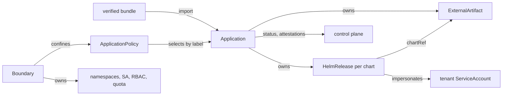

# Landscape: bridge, policy and tenancy

This page defines what the bridge does inside one landscape after it verifies and
unpacks a bundle. It covers the bridge components, Flux install and
adoption, rendering a landscape `Application` into Flux objects, ownership and
deletion, `ApplicationPolicy`, `Boundary`, tenancy, and the status the bridge
reports upward. Transfer, blob store and verify-and-unpack live in
[03-bundles-and-transfer.md](03-bundles-and-transfer.md). Keys, signatures and
attestation format live in
[04-trust-and-attestation.md](04-trust-and-attestation.md). [02-domain-model.md](02-domain-model.md)
owns field names; the sketches here show only
the fields this topic needs.

## The bridge renders verified bundles into Flux objects under operator policy

The bridge is the only konfidence component in a landscape. It turns a
verified bundle into cluster-scoped `Application` objects of the API group
`landscape.konfidence.cloud`. It then evaluates the operator's policy and
renders Flux `HelmRelease` and `ExternalArtifact` objects. Flux does the
deployment. The bridge never runs Helm actions itself.



### One leader runs every bridge loop

The bridge runs as a Deployment with 2 replicas and a
`coordination.k8s.io` Lease in its own namespace (D-TOPO-01). Only the leader
runs controllers, holds the stream to the control plane and serves chart
artifacts. The passive replica keeps its cache warm and does nothing else.

The leader runs these components in one process:

| Component | Job |
|---|---|
| link | gRPC stream to the control plane, or CTF and state request file offline ([03](03-bundles-and-transfer.md)) |
| importer | verify and unpack bundles into the blob store, write `Application` objects ([03](03-bundles-and-transfer.md), [04](04-trust-and-attestation.md)) |
| artifact server | serves chart tarballs over in-cluster HTTP for `ExternalArtifact` URLs |
| flux manager | installs or adopts Flux, runs the capability probe |
| boundary controller | materializes namespaces, ServiceAccounts, RBAC and quota per `Boundary` |
| application controller | resolves policy, binds secrets, checks admission, renders Flux objects |
| reporter | builds signed status reports at the policy's reporting level ([04](04-trust-and-attestation.md)) |

The artifact server sits behind a Service whose readiness probe passes only on
the leader. During failover helm-controller fails to fetch the artifact and
retries on its next reconcile; nothing needs to coordinate this.

### The bridge installs a pinned Flux or adopts one that passes the probe

At startup and whenever the helm-controller Deployment changes, the flux
manager decides between two modes:

1. **Install.** No Flux CRDs exist and the bridge was started with Flux
   install on. The bridge applies the Flux manifests embedded in its own
   release. The images ship with the bridge release, so isolated landscapes
   need nothing from public registries. The bridge sets the multi-tenancy
   lockdown flags (see below) and the `ExternalArtifact` feature gate.
2. **Adopt.** Flux CRDs exist. The bridge never edits an adopted Flux. It runs
   the capability probe and reports what it finds.

Parsing controller arguments is not enough. Current helm-controller docs list
the `ExternalArtifact` gate with default `true`, while the `HelmRelease` docs
still say `chartRef` to `ExternalArtifact` needs the flag
([options](https://fluxcd.io/flux/components/helm/options/),
[HelmRelease](https://fluxcd.io/flux/components/helm/helmreleases/)). The
default depends on the Flux version. The probe therefore tests behaviour: the
bridge publishes a tiny probe chart as an `ExternalArtifact` and a
`HelmRelease` in its own namespace. If the release reaches `Ready`, the
landscape is usable. If not, every `Application` reports `FluxUnavailable` and
the bridge renders nothing.

The probe also reads the lockdown flags from the controller arguments. A
missing lockdown does not block rendering because the bridge sets
`serviceAccountName` itself on every `HelmRelease` it writes. The landscape
reports `FluxLockdown=False` instead, because tenants with write access to
Flux objects could then bypass confinement.

### One HelmRelease per chart, ordered by dependsOn

A landscape `Application` is 1..n charts (D-LAND-03). For each chart the
application controller writes:

- one `ExternalArtifact` (`source.toolkit.fluxcd.io/v1`) whose
  `status.artifact` points at the artifact server URL, with `revision` and
  `digest` from the bundle
  ([ExternalArtifact](https://fluxcd.io/flux/components/source/externalartifacts/)),
- one `HelmRelease` with `chartRef` to that `ExternalArtifact`.

All Flux objects of one `Application` live in its release namespace, a
namespace of its `Boundary` chosen by the policy. With
`--no-cross-namespace-refs`, references work only within one namespace
([options](https://fluxcd.io/flux/components/helm/options/)), so the
`ExternalArtifact` sits next to its `HelmRelease`. In v1 every chart of an
application installs into that one namespace (`targetNamespace` equals the
release namespace). Charts that create objects in other namespaces of the same
`Boundary` do so through tenant RBAC, not through Flux.

The chart order from the bundle becomes `dependsOn` between the
`HelmRelease`s of the same `Application`. Flux starts a release only after its
dependencies are ready
([HelmRelease](https://fluxcd.io/flux/components/helm/helmreleases/)). The
bridge never adds `dependsOn` across applications (D-LAND-03).

Rendered settings on every `HelmRelease`:

| Field | Value | Why |
|---|---|---|
| `serviceAccountName` | the tenant ServiceAccount of the `Boundary` | Helm runs with tenant RBAC, never as helm-controller |
| `install.crds`, `upgrade.crds` | `Skip`, or `Create` / `CreateReplace` if the `Boundary` approved the chart's CRDs | CRDs need manual approval (D-TEN-01) |
| `valuesFrom` | one Secret holding the effective values | values never sit in plain `HelmRelease` specs |
| `postRenderers` | kustomize `images` with digest-pinned references | image relocation (D-XFER-06, [03](03-bundles-and-transfer.md)) |
| labels | the reserved `konfidence.cloud/` labels | lets policy, `Boundary` and reporter select by verified identity |

Flux accepts `Skip`, `Create` and `CreateReplace` for both CRD policies, with
`Create` as default; `CreateReplace` updates CRDs but never deletes them
([HelmRelease](https://fluxcd.io/flux/components/helm/helmreleases/)). The
bridge always sets both fields explicitly, so the Flux default never applies.

### The bridge checks admission before Flux sees a release

Before writing or updating a `HelmRelease`, the application controller renders
the chart offline with the effective values through the Helm SDK. It collects
every kind the chart would create and every CRD in `crds/`. The result decides
three things:

- cluster-scoped kinds, CRDs and admission webhooks not approved in the
  `Boundary` stop the application with `WaitingForBoundaryApproval`,
- images outside the policy's registry allow-list or without a required
  signature stop it with `ImageRuleViolation`,
- objects in namespaces outside the `Boundary` stop it with
  `OutsideBoundary`.

Tenant RBAC enforces the same limits again when helm-controller applies the
release. The offline render exists to give a clear status before a half-applied
Helm release, not as the only guard.

### Ownership follows the Application, deletion is always explicit

`Application` is cluster-scoped and owns its `HelmRelease`s, `ExternalArtifact`s
and values Secrets. A namespaced dependent may have a cluster-scoped owner
([Kubernetes](https://kubernetes.io/docs/concepts/overview/working-with-objects/owners-dependents/)).
`Boundary` is cluster-scoped and owns namespaces. It never owns an
`Application` (D-LAND-04).

The bridge removes an application only for one of three reasons: a signed
tombstone, a chart dropped between releases (D-PROMO-04), or a deny policy. In
each case the bridge marks the `Application` with a removal reason, then
deletes it. A finalizer deletes the `HelmRelease`s in reverse `dependsOn` order
and waits for Flux to finish each uninstall. Helm keeps CRDs and StatefulSet
PVCs. That is the documented default, and the bridge does not delete them.

If an operator deletes an `Application` locally without a removal reason, the
finalizer orphans the Flux objects by stripping their owner references. The
importer then recreates the `Application` from the last applied bundle and
re-adopts the orphaned objects (D-LAND-05). Workloads keep running throughout.

A `Boundary` with remaining applications does not delete. Its finalizer holds
and its status lists the blocking applications. Deleting the namespaces under
running workloads is never a side effect.

## ApplicationPolicy is the operator's contract with every application

`ApplicationPolicy` is cluster-scoped and written only by the landscape
operator. It is authoritative on the landscape (D-POL-01).

```yaml
apiVersion: landscape.konfidence.cloud/v1alpha1
kind: ApplicationPolicy
metadata:
  name: payments-prod
spec:
  boundaryRef: team-payments        # required, except on the default
  selector:
    matchLabels:
      konfidence.cloud/application: payments
  namespace: payments
  values: { replicaCount: 3 }
  secrets:
    - requirement: db
      externalSecret: { storeRef: vault-payments, key: payments/db }
  images: { mode: thin, registries: [registry.corp.example], requireSignature: true }
  reporting: health
  deny: false
```

### Exactly one policy applies, plus the default

Each application gets the landscape default plus at most one specific policy:

1. The bridge sets the reserved labels `konfidence.cloud/project`,
   `konfidence.cloud/application` and `konfidence.cloud/landscape-grant` from
   the verified bundle identity. It drops any label under `konfidence.cloud/`
   that a bundle carries (D-POL-04).
2. The bridge finds the `Boundary` whose grant matches the application's
   `landscape-grant` label. No match means `WaitingForBoundaryApproval`.
3. Among policies with that `boundaryRef`, the bridge evaluates selectors.
   Policies of other boundaries never match, whatever their selector says.
4. Two matches stop the application with `AmbiguousPolicy`. The bridge never
   merges.
5. The effective policy is the default with the matching policy laid over it,
   field by field.

The landscape default is the single policy marked as default, and it has no
`boundaryRef`. If none exists, the bridge uses a built-in default: allow,
release namespace from the `Boundary` template, image mode chosen by
D-XFER-04, reporting level `health`.

The policy version is the SHA-256 of the canonical effective policy. It enters
the deployment identity (D-POL-06) and every attestation. Changing a policy
that affects an application causes a new reconcile and a new report.

### Values merge in four layers

The bridge merges values in this order, last wins (D-POL-02):

1. chart defaults, inside the chart,
2. application values, from the bundle,
3. promotion target values, from the bundle for this landscape,
4. landscape policy `values`.

Layers 3 and 4 may set only keys on the application's overridable allow-list.
The control plane checks layer 3 at promotion time. The bridge checks layer 4.
A policy override outside the allow-list stops the application with
`ValuesRejected`. Operators who disagree with an application's allow-list use
deny, not a silent override. The merged result must pass the chart's values
schema. The bridge writes it to the values Secret and reports only its digest.

### Secret requirements bind to local stores

A bundle declares secret requirements by name and keys (D-POL-03). A policy
binds each requirement in one of two ways:

- **External Secrets Operator.** The bridge writes an `ExternalSecret`
  (`external-secrets.io/v1`) in the release namespace with `secretStoreRef`
  pointing at a `SecretStore` or `ClusterSecretStore`, `target.name` set to the
  requirement name, and one `data` entry per key
  ([ESO](https://external-secrets.io/latest/api/externalsecret/)).
- **Plain Secret.** The policy names an existing Secret in the release
  namespace. The bridge checks the keys and never copies Secrets across
  namespaces.

A requirement without a binding, or a bound Secret missing a key, stops the
application with `UnboundSecret` and names the requirement. The bridge never
reads secret values into reports.

### Image rules decide transfer mode and admission

The `images` block holds three rules. `mode` sets thin or full transfer, which
the bridge sends upward in the state request file and the stream handshake
(D-XFER-04, D-XFER-05). `registries` is the allow-list checked against
relocated image references. `requireSignature` makes the bridge reject images
without a verified signature in the bundle. The signature format is defined in
[04](04-trust-and-attestation.md).

### Reporting level filters what leaves the landscape

`reporting` is `none`, `health`, `resources` or `full` (D-POL-05). The reporter
cuts the signed report to that level. At `none` the bridge still keeps local
status but sends nothing about the application. If the level drops while a
promotion waits on a gate, the reporter sends the lowered level once so gates
fail closed with reason `ReportingLevelLowered`. At `none` nothing is sent,
and the control plane sees the gate stay unsatisfied.

### Deny refuses and removes

`deny: true` refuses the application. A new application is never installed.
An installed application is removed through the same finalizer path as a
tombstone. The control plane shows "refused by landscape" (D-LAND-05). Deny is
the only way an operator says no. Deleting the `Application` locally does not
work, because the bridge recreates it.

## Boundary turns a landscape grant into a confined tenant

A `Boundary` is the landscape admin's answer to a project's access request
(D-TEN-01). The project creates a `LandscapeGrant` in the control plane. The
grant ID reaches the landscape in the bundle identity. The admin writes a
`Boundary` for it.

```yaml
apiVersion: landscape.konfidence.cloud/v1alpha1
kind: Boundary
metadata:
  name: team-payments
spec:
  grant: <GRANT_ID>
  namespaces: { template: "payments-{{.Name}}", allowed: [payments, payments-jobs] }
  quota: { requests.cpu: "20", requests.memory: 64Gi }
  approved:
    crds: [paymentrules.payments.example.com]
    clusterKinds: []
    webhooks: []
```

### The bridge automates namespaced tenancy

For each `Boundary` the boundary controller creates and owns, without asking:

- the namespaces from the template,
- one tenant ServiceAccount per namespace, which every `HelmRelease` uses,
- a RoleBinding granting that ServiceAccount the namespaced edit rights it
  needs, in its namespaces only,
- a ResourceQuota per namespace.

On landscapes where the bridge installed Flux, the lockdown flags are set:
`--no-cross-namespace-refs=true` on helm-controller and kustomize-controller,
`--default-service-account=default` on both, `--no-remote-bases=true` on
kustomize-controller
([multi-tenancy](https://fluxcd.io/flux/installation/configuration/multitenancy/)).
Without a `serviceAccountName`, a `HelmRelease` runs with helm-controller's
cluster-admin rights
([HelmRelease](https://fluxcd.io/flux/components/helm/helmreleases/)). The
bridge never relies on the default and always sets the tenant ServiceAccount.

### Cluster-scoped kinds, CRDs and webhooks always wait for a human

The bridge never approves cluster-scoped resources from bundle content. The
admission check writes what it needs into `Boundary.status.pending`: CRD
names, cluster-scoped kinds, webhook configurations, each with the requesting
application and release. The admin approves by copying entries into
`spec.approved`. The bridge then extends the tenant RBAC with exactly those
cluster-scoped rights and sets the CRD policy to `Create` / `CreateReplace`
for that chart.

A dedicated single-tenant landscape still has a `Boundary`. Its admin may
approve broadly, but the approval is always written by a human.

## Status the bridge reports upward

The landscape `Application` carries a `Ready` condition and one reason from a
fixed vocabulary. The reporter sends the reason with every status report,
whatever the reporting level, except `none`. The control plane maps it onto
`Deployment` status ([05](05-promotion-and-rollout.md)) and the UI
([08](08-api-and-ui.md)).

| Reason | Meaning | Who acts |
|---|---|---|
| `Applied` | all `HelmRelease`s ready at the expected release | nobody |
| `Progressing` | Flux is installing or upgrading | nobody |
| `Failed` | a `HelmRelease` failed; message carries Flux's reason | app team |
| `Refused` | a deny policy matches ("refused by landscape") | landscape operator |
| `WaitingForBoundaryApproval` | no `Boundary` for the grant, or pending cluster-scoped items | landscape admin |
| `AmbiguousPolicy` | two specific policies match | landscape operator |
| `UnboundSecret` | a secret requirement has no binding or misses keys | landscape operator |
| `ValuesRejected` | an override is outside the allow-list or fails the values schema | operator or app team |
| `ImageRuleViolation` | a registry or signature rule fails | operator or app team |
| `OutsideBoundary` | the chart targets a namespace outside its `Boundary` | app team |
| `FluxUnavailable` | the capability probe fails | landscape operator |
| `Removing`, `Removed` | tombstone, dropped chart or deny is being applied | nobody |

Landscape-wide conditions on the bridge itself: `FluxReady`, `FluxLockdown`,
`FluxManaged` (installed versus adopted).

## Decisions applied

- **D-TOPO-01**: two replicas, Lease-based leader runs all loops.
- **D-LAND-01**: `ExternalArtifact` plus `chartRef`; install or adopt decided
  by a behavioural probe.
- **D-LAND-02**: cluster-scoped `Application`, `ApplicationPolicy`, `Boundary`.
- **D-LAND-03**: one `HelmRelease` per chart, `dependsOn` inside one
  application, explicit CRD policy, no cross-application ordering.
- **D-LAND-04**: `Application` owns Flux objects, `Boundary` owns namespaces,
  CRDs and PVCs stay on uninstall.
- **D-LAND-05**: local delete orphans and recreates; deny reports `Refused`.
- **D-XFER-04, D-XFER-06**: policy `images.mode` feeds transfer choice; image
  relocation through `postRenderers`.
- **D-POL-01**: policy fields as listed above.
- **D-POL-02**: four-layer merge, allow-list enforced on both override layers.
- **D-POL-03**: ESO or plain Secret binding, `UnboundSecret`.
- **D-POL-04**: reserved labels from verified identity, `boundaryRef`
  confinement, one-match rule, `AmbiguousPolicy`.
- **D-POL-05**: reporter filters by level, lowered level fails gates closed.
- **D-POL-06**: policy version is the effective policy digest.
- **D-TEN-01**: namespaced tenancy automated, cluster-scoped items approved in
  `Boundary.spec.approved`.

## Interfaces other docs depend on

- **Import contract with [03](03-bundles-and-transfer.md).** The importer hands
  over per application: verified identity (project, application, grant,
  release ID, sequence), ordered chart list with blob digests, application
  values, per-landscape promotion values, overridable allow-list, secret
  requirements, image list with relocation targets, or a tombstone.
- **Status reason vocabulary** in the table above, consumed by
  [04](04-trust-and-attestation.md) (report payload),
  [05](05-promotion-and-rollout.md) (wave completion and gates) and
  [08](08-api-and-ui.md) (display). Adding a reason is additive; renaming one
  is a breaking change.
- **Policy version and effective values digest**, both SHA-256 over canonical
  JSON, carried in every attestation ([04](04-trust-and-attestation.md)).
- **Transfer-relevant policy extract** (`images.mode`, registries) for the state
  request file and handshake ([03](03-bundles-and-transfer.md)).
- **Reporting level per application**, sent at handshake and in the state
  request file, used by promotion-config validation
  ([05](05-promotion-and-rollout.md)).
- **Grant ID** in the bundle identity, minted by `LandscapeGrant` in the
  control plane ([02](02-domain-model.md), [01](01-control-plane.md)).

## Path

### v1 first steps

1. Bridge skeleton with Lease leader election and the artifact server behind a
   leader-only Service.
2. Flux manager in adopt mode with the behavioural probe; `FluxReady` and
   `FluxLockdown` conditions.
3. Application controller for one chart: `ExternalArtifact`, `HelmRelease`,
   values Secret, built-in default policy, one hand-written `Boundary`. This
   deploys `example-app` to one attached landscape (D-PROD-04).
4. Multi-chart `dependsOn`, finalizer-driven ordered removal, orphan and
   recreate on local delete.
5. `ApplicationPolicy` resolution with the one-match rule, values layers,
   plain-Secret binding, deny.
6. Boundary controller: namespaces, ServiceAccount, RoleBinding, quota; offline
   admission render with `WaitingForBoundaryApproval`.
7. Reporter with reporting levels and the reason vocabulary.

### Later

- Flux install mode with embedded manifests and images.
- ESO binding, image signature rules.
- Per-chart target namespaces inside one `Boundary`.
- A CLI helper that turns `Boundary.status.pending` into an approval patch.
- Cross-application ordering, once someone shows a real need.

## Open questions

1. Which Flux version made `ExternalArtifact` default on, and should the
   pinned Flux be at least that version? The probe makes this non-blocking.
2. Should a lowered reporting level of `none` also send one final "reporting
   off" marker, so the UI shows why reports stopped instead of showing stale
   data?
3. Does the offline admission render need the cluster's API discovery for
   `Capabilities.APIVersions`, or is a render without it close enough for
   admission?
