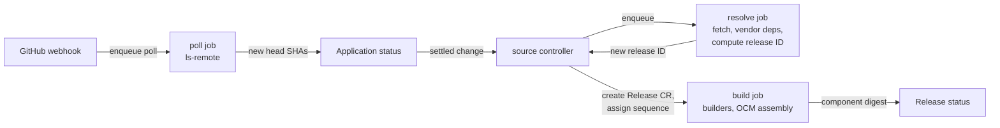

# Sources, credentials and releases

This page defines how the control plane turns git commits into releases. It
covers application sources, `GitCredential` types and their use, change
detection, the builder contract, the release ID and its hashing, and the
release diff and visualization semantics. It does not cover bundle signing and
transfer ([03](03-bundles-and-transfer.md), [04](04-trust-and-attestation.md)),
promotion ([05](05-promotion-and-rollout.md)) or the full field set of the CRDs
([02](02-domain-model.md)).

## Target design

### A release is a snapshot of commits, built once

The pipeline has four steps. Controllers decide each step; River jobs on the
workers run it.



1. **Poll.** A poll job lists remote refs for each unique (repo URL, ref,
   credential). It writes the observed head SHA into the `Application` status.
2. **Resolve.** After a settle window of 30 s without further head changes, the
   source controller enqueues one resolve job per application. The job fetches
   each source at its head SHA (depth 1), vendors chart dependencies, and
   computes the release ID.
3. **Create.** If no `Release` with that release ID exists for the application,
   the controller assigns the next sequence number and creates the `Release`.
   An equal release ID creates nothing.
4. **Build.** A build job runs the builders, assembles the OCM component
   version, stores it in the orchestrator-local registry and writes the
   component digest into the `Release` status.

The settle window groups commits pushed to several repos within seconds into
one release. It is a heuristic, not atomicity: cross-repo consistency comes
from promotion, not from source timing.

### Commits outside a source's path create no release

A source is (repo URL, ref, path). A new head SHA that leaves the tree at
`path` unchanged keeps the previous SHA for that source in the snapshot. The
resolve job compares the git tree hash of `path` with the tree hash recorded on
the previous `Release`. Monorepos therefore produce releases only when the
application's directory changes.

### An application has one or more sources, each with its own credential

```yaml
apiVersion: konfidence.cloud/v1alpha1
kind: Application
metadata: {name: payments, namespace: team-payments}
spec:
  sources:
    - name: chart
      repoURL: https://github.com/acme/payments-deploy
      ref: {branch: main}
      path: charts
      credentialRef: {name: acme-app}
      builders: [{name: helm}]
    - name: runtime
      repoURL: https://github.com/acme/payments
      ref: {branch: main}
      path: deploy/vector
      credentialRef: {name: acme-app, project: platform}
      builders: [{name: vector, config: {file: vector.yaml}}]
```

Source names are DNS labels and unique within the application. The ref is a
branch in v1. `credentialRef.project` names the owning project when the
credential is granted from another project.

### Three credential types, one Secret each

`GitCredential` is project-scoped. Its `type` selects which keys the
referenced Secret must hold. Key material lives only in that Secret, is read by
workers at job time, and never appears in the DB, in River job arguments, in
logs or in a bundle.

| Type | Secret keys | Transport | Validity probe |
|------|-------------|-----------|----------------|
| `pat` | `token` | HTTPS basic auth | `GET /repos/{owner}/{repo}` for each granted repo |
| `ssh` | `identity`, optional `known_hosts` | SSH | `ls-remote` |
| `githubApp` | `privateKey`, plus `appID` and `installationID` in spec | HTTPS with minted token | mint a token |

**SSH.** Host keys are always pinned. The control plane ships GitHub's
published `known_hosts` entries for github.com
([GitHub SSH key fingerprints](https://docs.github.com/en/authentication/keeping-your-account-and-data-secure/githubs-ssh-key-fingerprints)).
A `known_hosts` key in the Secret replaces the shipped entries. A host key
mismatch fails the job with condition `HostKeyMismatch`; nothing is learned on
first use.

**GitHub App.** The worker mints an installation token per job. It signs a
JWT with RS256, `iss` set to the app's client ID or app ID and `exp` at most
10 minutes ahead. It then calls
`POST /app/installations/{installation_id}/access_tokens` with `repositories`
set to the job's repos and `permissions` set to `contents: read`
([installation tokens](https://docs.github.com/en/apps/creating-github-apps/authenticating-with-a-github-app/generating-an-installation-access-token-for-a-github-app),
[JWT](https://docs.github.com/en/apps/creating-github-apps/authenticating-with-a-github-app/generating-a-json-web-token-jwt-for-a-github-app)).
Installation tokens expire after 1 hour. The worker caches a token in memory
per (credential, repo set) and discards it 5 min before expiry. Tokens are
never persisted. Scoping by `repositories` is what enforces grant
restrictions for App credentials, because an installation often covers a
whole organization.

### Expiry shows up as a condition before syncs fail

A credential controller probes every `GitCredential` every 6 h and after each
Secret change. It sets these conditions:

- `Ready`: the last probe succeeded.
- `ExpiresSoon`: for `pat`, the expiry lies within 14 days. The expiry comes
  from the `github-authentication-token-expiration` response header on the
  probe (unverified). If GitHub sends no header, the token has no expiry and
  the condition is `False` with reason `NoExpiry`.
- `Expired` or `Unauthorized`: the probe got 401. For `githubApp`, a
  suspended or removed installation also lands here.

Every `Application` that references the credential mirrors a failing
condition as `SourceCredentialDegraded`, so the application owner sees it
without access to the owning project. The UI raises `ExpiresSoon` on the
project page.

### Grants share a credential with other projects, limited to repos

The owning project lists grants on the credential itself:

```yaml
kind: GitCredential
metadata: {name: acme-app, namespace: platform}
spec:
  type: githubApp
  appID: "123456"
  installationID: "7890"
  secretRef: {name: acme-app}
  grants:
    - project: team-payments
      repositories: ["acme/payments", "acme/payments-*"]
```

`repositories` is a list of `owner/repo` glob patterns and is required on
every grant. Only an admin of the owning project can edit grants, which the
API enforces at write time. The API also rejects an `Application` whose
`credentialRef` points to a credential without a matching grant. The source
controller re-checks the grant before each resolve job. Revoking a grant stops
fetches at the next poll with condition `CredentialNotGranted`; existing
releases stay valid.

### Polling detects changes, webhooks only shorten the wait

A scheduler job runs every 15 s and enqueues a poll job for each due poll key
(repo URL, ref, credential). Many applications on the same repo and branch
share one poll. The poll job runs `ls-remote`, which needs no clone. The
default interval is 2 min, the minimum is 30 s, and an application can lower
its own interval. Poll jobs are River unique jobs: `ByArgs` on the poll key
(tag `river:"unique"`) plus `ByPeriod` set to the interval
([River unique jobs](https://riverqueue.com/docs/unique-jobs)).

For GitHub App credentials the API exposes `POST /webhooks/github`. It
validates `X-Hub-Signature-256` (HMAC-SHA256 over the body with the App's
webhook secret)
([validating deliveries](https://docs.github.com/en/webhooks/using-webhooks/validating-webhook-deliveries)).
A `push` event maps the repository to its poll keys and enqueues those poll
jobs right away. The control plane never takes a SHA from the payload: the
poll job reads refs from git. A forged or replayed delivery can at most cause
an extra poll.

### Builders turn a checked-out source into OCM resources

A builder is a versioned contract owned by konfidence. The build job runs the
builders listed on each source in order. `helm` is built in and runs in the
worker process. Every other builder is a container image registered in the
control-plane configuration by name, image digest and contract version
`builder/v1`. Applications reference builders by name only.

The build job runs an image builder as a Kubernetes Job in a dedicated build
namespace. Egress is denied, and the Job receives no service account token.
The builder sees this layout:

| Path | Mode | Content |
|------|------|---------|
| `/in/request.json` | read-only | contract version, application, release ID, sequence, source name, builder `config` |
| `/in/src/` | read-only | the source tree at `path`, no `.git` directory |
| `/in/vendor/` | read-only | vendored chart dependencies |
| `/out/` | read-write | files the builder produces |
| `/out/result.json` | read-write | the resource list below |

```json
{
  "contract": "builder/v1",
  "resources": [
    {"name": "payments-stage", "type": "helmChart", "version": "1.4.0",
     "path": "payments-stage-1.4.0.tgz",
     "labels": {"konfidence.cloud/builder": "vector"}}
  ],
  "images": ["ghcr.io/acme/payments@sha256:..."]
}
```

The build job adds each entry as an OCM resource with the stated type, stored
as a local blob, and records the builder name and image digest as a label.
Resource names must be unique within the release. Every image must be pinned
by digest, and [03](03-bundles-and-transfer.md) decides how images travel. A
non-zero exit, a missing `result.json` or a run longer than 15 min fails the
build. The `Release` then gets condition `BuildFailed` with the last 4 KiB of
builder output.

Only `helmChart` resources become deployable charts on a landscape (D-LAND-03).
Other OCM types such as `blob` travel with the bundle, but the bridge does not
deploy them. A builder that wants manifests deployed wraps them in a chart.

**Built-in Helm builder.** For each directory with a `Chart.yaml` under the
source path, it runs `helm dependency build` against the vendored
dependencies and `helm package`. It emits one `helmChart` resource per chart.
It collects images from `helm template` with default values, plus a list in
the chart annotation `konfidence.cloud/images`. The annotation covers images
that default values do not render.

**Vector builder (runtime team example).** The runtime team ships an image
that reads `vector.yaml` from `/in/src`. It writes a chart containing the
`Stage` manifest and returns it as a `helmChart` resource. Konfidence imports
no runtime types and only checks `result.json` (D-PROD-02, D-PROD-03).

### The release ID hashes a versioned line format

The release ID is `sha256:` plus the hex SHA-256 of this UTF-8 text. Each
line ends with `\n`, and fields are separated by a single tab:

```text
konfidence.cloud/release-id/v1
source	chart	github.com/acme/payments-deploy	charts	3f9c...e1
source	runtime	github.com/acme/payments	deploy/vector	a71b...04
dep	chart	charts/payments	postgresql	15.5.2	sha256:9d0e...
```

The serialization follows these rules:

- The first line is the format version. Changing any rule below means a new
  version line, and old IDs stay valid as they are.
- `source` lines are sorted by source name, `dep` lines by (source name,
  chart path, dependency name). Sorting is byte-wise.
- The repo URL is normalized to `host/owner/repo`: lowercase host, no scheme,
  no user, no `.git` suffix. SSH and HTTPS URLs of the same repo therefore
  hash the same.
- Paths are relative to the repo root, use `/`, and drop any leading `./` and
  trailing `/`. An empty path is written as `.`.
- SHAs are full 40-character lowercase hex.
- A dependency digest is the SHA-256 of the archive the resolve job
  downloaded, or the manifest digest for `oci://` dependencies. It is not the
  `Chart.lock` digest field. The lock file is already covered by the commit
  SHA, and the archive digest catches a re-pushed chart version.
- Values must not contain tab or newline. The API rejects such names and
  paths at write time.

Protobuf is not used because its wire encoding is not canonical (D-REL-01).
The line format can be reproduced with `printf` and `sha256sum`, which lets
an auditor recompute an ID offline. The UI shows the first 12 hex
characters.

### Three identities, three questions

| Identity | Example | Answers | Stable across rebuilds |
|----------|---------|---------|------------------------|
| Release ID | `sha256:4be1...` | which sources and dependencies | yes |
| Component digest | `sha256:77c0...` | which exact bytes ship | no, depends on builder versions |
| Sequence | `payments@42` | what humans and the CLI type | yes, one per release |

The sequence is a per-application counter kept in `Application` status. The
controller increments it with an optimistic update before it creates the
`Release`, so numbers have no gaps. The `Release` name is
`<application>-<sequence>`. Attestations, deployments and audit records store
the release ID and the component digest; the sequence is a display label.

A release ID is built once. The `Release` pins its component digest after the
first successful build. A failed build can be retried and then produces the
digest. A later builder upgrade does not rebuild existing releases.

### Release diffs and placement come from the DB history

Workers write each release's resolved content to Postgres: sources with SHA
and tree hash, dependencies, resources with type, version and digest, and
images. The API answers visualization queries from this history (D-TOPO-07
allows it, since these are not reconcile decisions). [08](08-api-and-ui.md)
owns the RPC shapes; the semantics are these:

- **Diff between two releases of one application.** For each source it
  returns the SHA range with commits. For `pat` and `githubApp` credentials
  the commits come from the GitHub compare API
  `GET /repos/{owner}/{repo}/compare/{base}...{head}`, which returns at most
  250 commits without pagination
  ([compare](https://docs.github.com/en/rest/commits/commits#compare-two-commits)).
  For `ssh` it returns the two SHAs only. It also lists dependency changes,
  resources added, removed and changed, and image changes. Removed charts feed
  removal by release diff (D-PROMO-04).
- **Placement.** For a release, or for an application, it lists the landscapes
  with their dispatched and attested release. Each entry carries the effective
  values digest and the policy version from the last attestation (D-POL-06).
- **Path.** For a release, it lists the promotions and waves it passed with
  timestamps and gate outcomes, joined from `Promotion` and `Deployment`
  history ([05](05-promotion-and-rollout.md)).

## Decisions applied

- **D-SRC-01**: only workers fetch; builders get the tree without `.git` and
  no credentials; bundles hold built resources only.
- **D-SRC-02**: `pat`, `ssh`, `githubApp`; host fixed to github.com, a base
  URL field can be added later.
- **D-SRC-03**: `GitCredential` with `type`, `secretRef` and `grants`
  limited by repo patterns.
- **D-SRC-04**: shipped or Secret-provided `known_hosts`, no TOFU; PAT expiry
  probe sets `ExpiresSoon` 14 days ahead.
- **D-SRC-05**: polling via `ls-remote` is the detector; webhooks only
  enqueue a poll.
- **D-SRC-06**: `spec.sources[]`, each with its own `credentialRef` and
  builders.
- **D-REL-01**: versioned tab-separated line format, sorted, normalized
  URLs, archive digests for dependencies.
- **D-REL-02**: release ID, component digest and sequence are separate; the
  sequence lives in `Application` status.
- **D-REL-03**: diff, placement and path queries over DB history.
- **D-TOPO-05**: poll, resolve and build are River jobs; controllers only
  decide.
- **D-BUN-01**: the resolve job vendors dependencies; the Helm builder
  packages them.

## Interfaces other docs depend on

- **Release ID format** `konfidence.cloud/release-id/v1`, used by
  [04](04-trust-and-attestation.md) in signed reports and by
  [05](05-promotion-and-rollout.md) as the promotion subject.
- **Release status** carries `releaseID`, `componentVersion` (name, version,
  digest) and conditions `Resolved`, `Built`, `BuildFailed`. Field names come
  from [02](02-domain-model.md).
- **Builder contract** `builder/v1`: the `/in` and `/out` layout and
  `result.json`. The runtime team builds against this and nothing else.
- **OCM resources from builders**: type `helmChart` is deployable, other
  types are carried. [03](03-bundles-and-transfer.md) defines component
  naming, the version string and signing.
- **Image list** per release, digest-pinned, input to thin and full transfer
  in [03](03-bundles-and-transfer.md).
- **Credential conditions** `Ready`, `ExpiresSoon`, `Expired`,
  `Unauthorized`, `HostKeyMismatch`, `CredentialNotGranted` and the mirrored
  `SourceCredentialDegraded`, shown by [08](08-api-and-ui.md).
- **Webhook endpoint** `POST /webhooks/github` on the API.

## Path

### v1 first steps

1. Implement the release ID serializer and hasher as a pure Go package with
   golden-file tests, including SSH and HTTPS URLs that hash equal.
2. Add `GitCredential` with type `pat` and the credential probe controller,
   with `Ready` and `ExpiresSoon`.
3. Add the poll scheduler and poll job (`ls-remote`, River unique by poll
   key). Write observed SHAs into `Application` status for one source.
4. Add the resolve job, the sequence assignment and `Release` creation, with
   the built-in Helm builder only. This is enough for `example-app`
   (D-PROD-04).
5. Add multiple sources, the tree-hash skip and `ssh` with shipped
   `known_hosts`.
6. Add `githubApp` with token minting and grants with repo patterns.
7. Add the release diff and placement queries.

### Later

- The image builder runner and contract `builder/v1`, delivered with the
  runtime team's vector builder as the first consumer.
- Webhooks for GitHub App credentials.
- Tag and semver-range refs.
- A shared fetch cache across workers if fetch time dominates builds.
- A GitHub Enterprise Server base URL on `GitCredential`.

## Open questions

1. Builder selection and builder `config` live in the `Application` spec, not
   in git, so changing them does not change the release ID under D-REL-01.
   Either the ID includes a digest of the build-relevant spec, or build config
   must live in the repo. See the challenge raised against D-REL-01.
2. Should the Helm builder's image discovery fail the build when `helm
   template` with default values errors, or fall back to the annotation only?
3. Is 2 min the right default poll interval at 1000 landscapes and a few
   thousand applications, given GitHub's limits for git-protocol traffic
   (unverified)?
