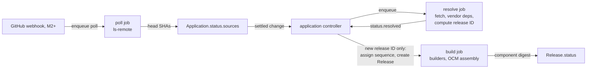

# Sources, credentials and releases

The control plane turns git commits into releases. This page defines
sources, `GitCredential` types, change detection, the `builder/v1` contract,
the release ID and the release history queries. Field names and conditions
come from [02](02-domain-model.md), River job kinds from
[01](01-control-plane.md). Bundle signing and transfer live in
[03](03-bundles-and-transfer.md), promotion in
[05](05-promotion-and-rollout.md).

## One flow creates every release

Controllers decide each step; River jobs on the workers run it (D-TOPO-05).



1. **Poll.** A poll job lists remote refs per unique (repo URL, ref,
   credential) and writes the head SHA into `Application.status.sources`.
2. **Resolve.** After 30 s without further head changes, the controller
   enqueues one resolve job per application. The job fetches each source at
   its SHA (depth 1), vendors chart dependencies, computes the release ID and
   writes `status.resolved{releaseID, at}`.
3. **Create.** If the application has no `Release` with that release ID, the
   controller takes the number from `status.nextReleaseSequence`, increments
   it and creates `<application>-<sequence>`. An equal release ID creates
   nothing (D-REL-01).
4. **Build.** The build job runs the builders, assembles the OCM component
   `konfidence.cloud/p/<project>/<application>` at version `<sequence>.0.0`,
   stores it in the orchestrator-local registry and writes
   `Release.status.component`.

The settle window groups commits pushed to several repos within seconds. It
is a heuristic: cross-repo consistency comes from promotion, not from source
timing.

## An application has one or more sources, each with its own credential

`Application.spec.sources[]` holds `name`, `url`, `ref` (`branch` or `tag`),
`credentialRef` and `builders`. `charts[]` names, per chart, its source and
`path` (D-SRC-06). Source names are DNS labels, unique within the
application. `credentialRef.project` names the owning project of a granted
credential. M1 ships one source; multiple sources are M2+.

A new head SHA that leaves every chart path of a source unchanged keeps the
previous SHA in the snapshot (M2+). The resolve job compares git tree hashes
with the ones recorded for the previous release. A source with builders
skips this check, because a builder sees the whole tree. Monorepos therefore
release only when an application's directories change.

## Three credential types, one Secret each

`GitCredential` is project-scoped. `type` selects the keys the referenced
Secret must hold. Workers read key material at job time. It never appears in
Postgres, River job arguments, logs or bundles (D-SRC-03).

| `type` | Secret keys | Transport | Validity probe | Milestone |
| --- | --- | --- | --- | --- |
| `GitHubPAT` | `token` | HTTPS basic auth | `GET /repos/{owner}/{repo}` per granted repo | M1 |
| `SSHDeployKey` | `identity` | SSH | `ls-remote` | M2+ |
| `GitHubApp` | `privateKey`; `appID`, `installationID` in spec | HTTPS with minted token | mint a token | M2+ |

**SSH.** Host keys are always pinned through `spec.knownHosts`, required for
`SSHDeployKey` (D-SRC-04). It sits in spec, not in the Secret, because it is
public and must be reviewable. GitHub publishes its entries
([fingerprints](https://docs.github.com/en/authentication/keeping-your-account-and-data-secure/githubs-ssh-key-fingerprints)).
A host key mismatch fails the job; nothing is learned on first use.

**GitHub App.** The worker signs a JWT with RS256, `iss` set to the app's
client ID or app ID and `exp` at most 10 min ahead. It then calls
`POST /app/installations/{installation_id}/access_tokens` with `repositories`
set to the job's repos and `permissions` set to `contents: read`
([installation tokens](https://docs.github.com/en/apps/creating-github-apps/authenticating-with-a-github-app/generating-an-installation-access-token-for-a-github-app),
[JWT](https://docs.github.com/en/apps/creating-github-apps/authenticating-with-a-github-app/generating-a-json-web-token-jwt-for-a-github-app)).
Tokens last 1 h. The worker caches them in memory per (credential, repo set)
and drops them 5 min before expiry. Scoping by `repositories` enforces the
grant, because one installation often covers a whole organization.

## Grants scope a credential to projects and repositories

`spec.grants` lists `{project, repositories}` and is required, the owning
project included. `repositories` holds `owner/repo` globs. Only an admin of
the owning project edits grants. The API rejects an `Application` whose
`credentialRef` has no matching grant. The controller re-checks the grant
before each resolve job. A revoked grant stops fetches at the next poll;
existing releases stay valid.

## Expiry shows up as a condition before syncs fail

The `credential.check` job ([01](01-control-plane.md)) probes every
`GitCredential` every hour and after each Secret change:

- `Valid` is `True` after a successful probe. A 401, a host key mismatch, or a
  suspended or removed App installation sets it `False` with the cause.
- `ExpiringSoon` is `True` when a `GitHubPAT` expires within 14 days, and
  `status.expiresAt` holds the date. The probe reads it from the
  `github-authentication-token-expiration` response header. TODO(sources):
  verify that GitHub sends this header; no checked GitHub page mentions it.

Every `Application` that references the credential mirrors a failure in
`CredentialsValid=False`. The application owner sees it without access to the
owning project.

## Polling detects changes, webhooks only shorten the wait

A scheduler job runs every 15 s and enqueues a poll job per due poll key
(repo URL, ref, credential). Applications on the same repo and ref share one
poll. `ls-remote` needs no clone. The default interval is 2 min, the minimum
30 s; `spec.pollInterval` sets it per application. Poll jobs are River unique
jobs, `ByArgs` on the poll key plus `ByPeriod` set to the interval
([unique jobs](https://riverqueue.com/docs/unique-jobs)).

For `GitHubApp` credentials (M2+) the API exposes `POST /webhooks/github`. It
validates `X-Hub-Signature-256`, an HMAC-SHA256 over the body with the App's
webhook secret
([validating deliveries](https://docs.github.com/en/webhooks/using-webhooks/validating-webhook-deliveries)).
A `push` event enqueues the matching poll jobs at once. The control plane
never takes a SHA from the payload, so a forged or replayed delivery causes
at most an extra poll (D-SRC-05).

## Build workers reach git and the declared dependency registries only

Only workers read git, and only github.com (D-SRC-01, D-SRC-02). The resolve
job also reaches the chart and OCI registries that charts name as
dependencies. No other control-plane process reaches outside. Builders get no
network at all.

## Builders turn a checked-out source into OCM resources

`builder/v1` is the contract the runtime team builds against, and this page
owns it (D-PROD-03). The built-in `helm` builder runs in the worker process
(M1). Every other builder is a container image registered centrally in the
control-plane configuration by name, image digest and contract version
(M2+). Applications reference builders by name only.

The build job runs an image builder as a Kubernetes Job in a build namespace.
Egress is always denied, and the Job gets no ServiceAccount token. The
builder sees this layout:

| Path | Mode | Content |
| --- | --- | --- |
| `/in/request.json` | read-only | contract version, application, release ID, sequence, source name, builder `config` |
| `/in/src/` | read-only | the source tree at its SHA, no `.git` |
| `/in/vendor/` | read-only | vendored chart dependencies |
| `/out/` | read-write | files the builder produces |
| `/out/result.json` | read-write | `contract`, `resources[]` (`name`, `type`, `version`, `path`, `labels`) and `images[]` |

The build job adds each resource as an OCM resource stored as a local blob
and labels it with the builder name and image digest. Resource names are
unique within the release, and every image is pinned by digest. A non-zero
exit, a missing `result.json` or a run longer than 15 min fails the build:
`Release.status.phase` turns `Failed` and `Built=False` carries the last
4 KiB of builder output.

Only `helmChart` resources deploy on a landscape (D-LAND-03). Other types
travel with the bundle but are not deployed. A builder that wants manifests
deployed wraps them in a chart. The runtime team's vector builder reads
`vector.yaml`, writes a chart containing the `Stage` manifest and returns it
as `helmChart`; konfidence checks only `result.json` (D-PROD-02).

**Built-in Helm builder.** Per chart in `charts[]` it runs `helm dependency
build` against the vendored dependencies and `helm package`, and emits one
`helmChart` resource. It collects images from `helm template` with default
values plus the chart annotation `konfidence.cloud/images` for images that
defaults do not render. If `helm template` fails, the build fails. A partial
image list would surface later as a missing image on an isolated landscape.

## The release ID hashes a versioned line format

The release ID is `sha256:` plus the hex SHA-256 of this UTF-8 text. Each
line ends with `\n`; fields are separated by one tab.

```text
konfidence.cloud/release-id/v1
source	app	github.com/acme/payments-api	9c1e…
dep	app	deploy/chart	postgresql	15.5.0	sha256:aa12…
layout	sha256:3b7f…
```

- The first line is the format version. Changing any rule means a new
  version line; old IDs stay valid.
- `source` lines sort by source name; `dep` lines by (source, chart path,
  dependency name). Sorting is byte-wise.
- Repo URLs normalize to `host/owner/repo`: lowercase host, no scheme, no
  user, no `.git`. SSH and HTTPS URLs of one repo hash the same.
- Paths are relative to the repo root, use `/` and drop a leading `./` and a
  trailing `/`. An empty path is `.`. Sources carry no path; chart paths
  enter through `dep` lines and the `layout` line.
- SHAs are full 40-character lowercase hex.
- A dependency digest is the SHA-256 of the archive the resolve job
  downloaded, or the manifest digest for `oci://`. The `Chart.lock` digest
  is not used: the commit SHA already covers the lock file, and only the
  archive digest catches a re-pushed chart version.
- The `layout` line is the SHA-256 of the RFC 8785 canonical JSON of the
  build- and deploy-relevant spec: `charts[]` (`name`, `source`, `path`,
  `valuesFiles`, `dependsOn`, `crds`, `overridable`), `secretRequirements`,
  and each source's `builders` with their `config`. `pollInterval`,
  `credentialRef` and `ref` stay outside; the SHA already pins the commit.
- Values containing tab or newline are rejected by the API at write time.

Equal release ID means equal deployable inputs. Changing a builder's config
or a chart's CRD policy creates a new release without a commit.
`Release.spec.layout` keeps a copy of that spec for diffs. Protobuf is not
used, because its wire encoding is not canonical. `printf` and `sha256sum`
reproduce the line part, which lets an auditor recompute an ID offline. The
UI shows the first 12 hex characters.

## Three identities answer three questions

| Identity | Example | Answers | Stable across rebuilds |
| --- | --- | --- | --- |
| release ID | `sha256:e3b0…` | which sources, dependencies and layout | yes |
| component digest | `sha256:5d41…` | which exact bytes ship | no, depends on builder versions |
| release label | `payments-api@42` | what humans and the CLI type | yes, one per release ID |

Builder image versions are not release-ID inputs; they change only the
component digest (D-REL-02). A `Release` pins its component digest after the
first successful build. A failed build can be retried. A later builder upgrade
never rebuilds existing releases. Attestations, deployments and audit records
store the release ID and the component digest; the label is for display.

## Release history answers diff, placement and path queries

Workers append every release to `releases`: sources with SHA, dependencies,
layout and component digest. Resource and image lists come from the stored
component descriptor. The API answers these queries from Postgres, because
they are not reconcile decisions (D-TOPO-07, D-REL-03). [08](08-api-and-ui.md)
owns the RPC shapes.

- **Diff** (M2+) between two releases of one application: per source the SHA
  range with commits, from `GET /repos/{owner}/{repo}/compare/{base}...{head}`
  for `GitHubPAT` and `GitHubApp`. That call returns at most 250 commits
  without pagination
  ([compare](https://docs.github.com/en/rest/commits/commits#compare-two-commits)).
  For `SSHDeployKey` the diff shows the two SHAs only. It also lists
  dependency, layout, resource and image changes. Removed charts feed removal
  by release diff (D-PROMO-04).
- **Placement:** per release or application, the landscapes with their
  dispatched and attested release, effective values digest and policy version
  from `deployment_history` and `attestations` (D-POL-06).
- **Path:** per release, the promotions and waves it passed, with timestamps
  and gate outcomes from `promotion_history`.

## Path

Milestones are defined in `09-roadmap.md`.

1. **M1** Release ID serializer and hasher, including the `layout` line, as a
   pure Go package with golden-file tests (SSH and HTTPS URLs hash equal).
2. **M1** `GitCredential` of type `GitHubPAT` with grants and the probe
   controller setting `Valid` and `ExpiringSoon`.
3. **M1** Poll scheduler and poll job for one source.
4. **M1** Resolve job, `status.resolved`, sequence assignment and `Release`
   creation; build job with the built-in Helm builder.
5. **M1** Placement and path queries for the M1 UI screens.
6. **M2+** Multiple sources, the tree-hash skip, `SSHDeployKey`.
7. **M2+** `GitHubApp` with token minting, webhooks, the diff query.
8. **M2+** Image builder runner for `builder/v1`, with the vector builder as
   first consumer.

Later: semver-range refs; a shared fetch cache across workers if fetch time
dominates builds; a GitHub Enterprise Server base URL on `GitCredential`;
worker-level dependency mirror rewrites with an extra CA bundle and
`HTTPS_PROXY`. TODO(sources): verify GitHub's git-protocol limits against
the 2 min default at a few thousand applications.
