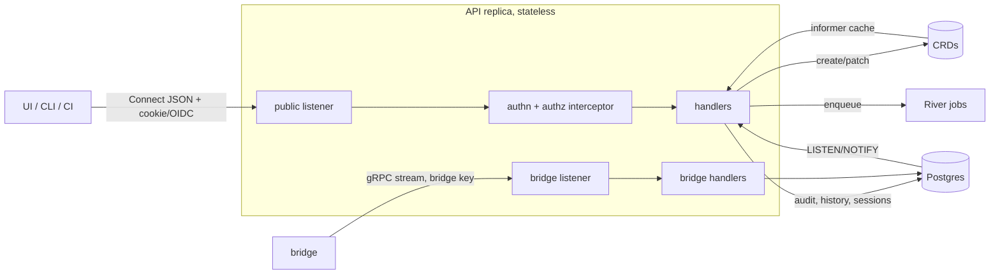

# API and UI

This doc defines how people, CI and bridges talk to the control plane. It
covers the protobuf service layout, compatibility rules, authentication, the
role model, the API write path, list and watch for the UI, and the v1 UI
screens. It does not define message semantics for transfer
([03-bundles-and-transfer.md](03-bundles-and-transfer.md)), trust and
attestation ([04-trust-and-attestation.md](04-trust-and-attestation.md)) or
field names ([02-domain-model.md](02-domain-model.md)).

## Target design

### One schema, two audiences, two listeners

All APIs live in one protobuf module served with Connect (D-API-01). Connect
handlers speak gRPC, gRPC-Web and the Connect protocol, and pick the protocol
by `Content-Type` ([connectrpc.com/docs/multi-protocol](https://connectrpc.com/docs/multi-protocol)).
The Connect protocol runs over HTTP/1.1 and HTTP/2 with JSON or binary
payloads ([connectrpc.com/docs/introduction](https://connectrpc.com/docs/introduction)).

The schema splits into two package trees with different callers:

| Package | Callers | Auth | Transport |
|---|---|---|---|
| `konfidence.bridge.v1` | bridges only | bridge identity key ([04](04-trust-and-attestation.md)) | gRPC over HTTP/2 |
| `konfidence.api.v1` | UI, CLI, CI | OIDC session or GitHub OIDC token | Connect JSON, also gRPC |

Every API replica serves both trees, but on two listeners:

- **Bridge listener.** HTTP/2 only, `MaxConnectionAge` set (D-TOPO-06), no
  CORS, no cookies. Load balancers route bridge traffic here with long idle
  timeouts.
- **Public listener.** HTTP/1.1 and HTTP/2, CORS via `connectrpc.com/cors`
  ([connectrpc.com/docs/go/deployment](https://connectrpc.com/docs/go/deployment)),
  session cookies, plain-HTTP download and upload routes.

Two listeners keep the bridge auth path free of browser concerns. An
operator can also expose them on different networks: bridges reach the
bridge listener, people reach the public one.



### Services in `konfidence.bridge.v1`

One service, `BridgeService`. [03](03-bundles-and-transfer.md) and
[04](04-trust-and-attestation.md) own the message contents; this doc owns
the shape and the compatibility rules.

- `Handshake` (unary): capability negotiation, described below. Every
  stream starts with it.
- `Sync` (bidirectional stream): the control plane pushes "new desired
  state for you" notices; the bridge sends blob inventory and attestations.
- `FetchBlobs` (server stream): chunked, resumable blob download by digest
  (D-XFER-03).

### Services in `konfidence.api.v1`

One service per resource family. Resource names follow
`projects/{project}/applications/{application}` style paths.

| Service | Covers |
|---|---|
| `AuthService` | `WhoAmI`, `Logout`, list own permissions |
| `ProjectService` | Project, role bindings, CI trust rules |
| `LandscapeService` | Landscape, enrollment, fingerprint pinning, LandscapeGrant |
| `CredentialService` | GitCredential (metadata and status, never key material on read) |
| `ApplicationService` | Application, sources, sync now |
| `ReleaseService` | Release list, get, diff between releases (D-REL-03) |
| `PromotionService` | PromotionConfig, Promotion, approve gate, override gate |
| `DeploymentService` | Deployment list, get, per-resource status, history |
| `TransferService` | CTF export, state request import, attestation import |
| `AuditService` | audit log query |
| `WatchService` | change notifications for the UI |

Secret values for `GitCredential` go through `CredentialService` as
write-only fields. The API writes them into the referenced Kubernetes Secret
and never stores or returns them (D-SRC-03).

### Compatibility rules

Operators upgrade bridges by hand, so the bridge API must accept old bridges
for a long time (D-API-02). The rules apply to both package trees:

- CI runs `buf breaking` with the `WIRE_JSON` category. Buf documents it as
  the minimum for Connect because JSON clients break on renamed fields
  ([buf.build/docs/breaking/rules](https://buf.build/docs/breaking/rules/)).
- Within `v1` only additive changes land. Removed fields become `reserved`
  with name and number. Enum values are never renumbered.
- A field is removed only after the stated minimum bridge version no longer
  uses it. Until then it carries `deprecated = true`.
- A `v2` package needs a new entry in [decisions.md](decisions.md).

### Capability negotiation at handshake

The bridge sends its version, the bundle format versions it reads (D-BUN-03)
and a set of capability strings. Strings, not enums: an old control plane
must keep an unknown capability without losing it.

```proto
message HandshakeRequest {
  string landscape_id = 1;
  string bridge_version = 2;              // semver
  repeated string bundle_formats = 3;     // e.g. "ocm-bundle/1"
  repeated string capabilities = 4;       // e.g. "transfer.thin", "tombstone"
}
message HandshakeResponse {
  string min_bridge_version = 1;
  repeated string enabled_capabilities = 2;  // intersection both sides support
  string bundle_format = 3;                  // chosen format
}
```

The control plane stores the reported version and capabilities in the
`Landscape` status. Isolated landscapes report the same data through the
state request file (D-XFER-05). Two consumers read it:

- Promotion validation rejects a target whose landscape lacks a capability
  the release needs, with `failed_precondition` and the missing capability.
- The UI marks a landscape **Bridge outdated** when its version is below
  `min_bridge_version`.

A bridge below `min_bridge_version` still completes the handshake. The
control plane then accepts inventory and attestations but dispatches nothing
new. Reporting stays intact, so the operator sees why deployments stopped.

### Authentication

The API is the only OIDC client. No IdP token reaches the browser (ADR-0030
carries over).

- **Browser.** Authorization code flow with PKCE against one IdP per
  installation. The API creates a session row in Postgres (D-TOPO-04) and
  sets an `HttpOnly`, `Secure`, `SameSite=Lax` cookie with the session ID.
  Sessions expire after an idle timeout and an absolute lifetime.
- **CLI.** Loopback PKCE flow from ADR-0030. The CLI stores the session in
  the OS keychain.
- **CI.** GitHub Actions requests an OIDC token with the API as custom
  audience ([docs.github.com OIDC reference](https://docs.github.com/en/actions/reference/security/oidc))
  and sends it as bearer token. A project CI trust rule maps
  `repository` plus `ref` or `environment` claims to a project role. No
  long-lived API tokens in v1.

Group claims from the IdP map to roles through role bindings on `Project`
and `Landscape`. The API resolves roles per request from its informer cache.
A changed binding takes effect on the next request, without new login.

CSRF: the public listener rejects state-changing requests without the
`Connect-Protocol-Version` header (unverified: that connect-web sends this
header on every request). A custom header forces a CORS preflight, which a
foreign origin fails.

### Authorization model

Roles exist at three scopes. Each role includes the ones listed above it in
its scope.

| Scope | Role | May |
|---|---|---|
| platform | `platform-admin` | create projects and landscapes, assign their admins |
| project | `viewer` | read everything in the project |
| project | `developer` | edit Application and PromotionConfig, start Promotion, trigger sync |
| project | `release-manager` | approve gates |
| project | `project-admin` | manage GitCredential and role bindings, override gates, request landscape access |
| landscape | `landscape-viewer` | read landscape status and deployments of all projects on it |
| landscape | `landscape-operator` | export CTF, import state request file, import attestation |
| landscape | `landscape-admin` | enroll bridge, pin or skip fingerprint, approve LandscapeGrant, manage boundaries, set runtime links |

Rules that cut across the table:

- **Override is not approve.** Overriding a gate (D-PROMO-01, ADR-0040)
  needs `project-admin` and a reason. The audit entry marks it as override.
- **Four-eyes on approval.** An approval gate can require that the approver
  did not start the promotion. The API enforces it, the gate model in
  [05-promotion-and-rollout.md](05-promotion-and-rollout.md) declares it.
- **Sharing needs both sides.** `project-admin` requests access, and
  `landscape-admin` approves the `LandscapeGrant` and its boundary
  (D-TEN-01).
- **Offline work belongs to the landscape.** CTF export and attestation
  import act on one landscape and include all projects deployed there, so
  they need a landscape role, not a project role.
- **Skipping fingerprint comparison** (D-TRUST-02) is a separate RPC with a
  mandatory reason, audited.

Every RPC declares its required permission as a method option:

```proto
rpc ApproveGate(ApproveGateRequest) returns (ApproveGateResponse) {
  option (konfidence.authz.v1.rule) = {
    scope: SCOPE_PROJECT, permission: "promotion.gate.approve"
  };
}
```

One interceptor reads the option, resolves the scope from the request's
resource name and checks the caller's roles. A CI lint fails on any public
RPC without the option. Permissions are strings, so roles stay a static map
from role to permission set in v1.

### The API writes CRDs; controllers do the rest

The API is the only writer of user intent into CRDs (D-API-03). A
state-changing request runs these steps:

1. Authenticate and authorize in the interceptor.
2. Validate with protovalidate, then domain checks (capabilities, reporting
   level against gates per D-POL-05).
3. Insert an audit row with outcome `pending`.
4. Create or patch the CRD with optimistic concurrency on
   `resourceVersion`. The CRD gets the audit ID as annotation.
5. Update the audit row to `succeeded` or `failed`.

A conflict returns `aborted`; the UI refetches and retries once. A crash
between steps 4 and 5 leaves a `pending` row whose annotation matches a CRD;
a sweeper resolves it. Gate approval and override patch
`Promotion.status.gates` as an external writer (ADR-0039).

Work that is not a CRD write goes to River (D-TOPO-05). The API enqueues the
job and returns a job reference; the UI watches it. CTF export is one of
these jobs.

### Files move over plain HTTP, not Connect

Browsers support only server streaming, not client or bidirectional streams
([connectrpc.com/docs/web/getting-started](https://connectrpc.com/docs/web/getting-started)).
Large files therefore bypass Connect:

- **CTF download.** `TransferService.ExportCTF` enqueues the job and later
  returns a short-lived signed URL on the public listener. The browser
  downloads it with a plain `GET`.
- **Uploads.** State request files and attestation files are small. They go
  as `bytes` in a unary Connect call, capped at 16 MiB. The attestation
  import runs the same verify code as the gRPC path (D-ATT-01).

### List from cache, watch for invalidation

Current state lives in CRDs, history in Postgres (D-TOPO-07). The read path
follows that split:

- **List and Get** for CRD kinds read the replica's informer cache. No
  request touches the Kubernetes API server for reads.
- **History** (old deployments, attestations, audit) reads Postgres with
  cursor pagination. `page_size` defaults to 50, maximum 500.
- **Watch** is a server stream: `WatchService.Watch(project, kinds)`. It
  sends change notices, `{kind, name, resource_version}`, never full
  objects. The UI refetches what it shows. Authz runs once on the watch
  scope and again on each refetch.

Notices come from two sources. Informer events cover CRD changes. Postgres
`LISTEN/NOTIFY` covers rows that other replicas wrote, such as a new
attestation (D-TOPO-04). On reconnect the UI does list then watch again. No
resume tokens in v1.

### Status shows how we know, not only what we know

The UI never shows a bare "healthy" (D-UI-02). The API computes one
observation per deployment, so UI and CLI show the same thing:

```proto
message Observation {
  Basis basis = 1;              // DISPATCHED | ATTESTED | LIVE
  google.protobuf.Timestamp observed_at = 2;
  Health health = 3;            // from the attestation; UNKNOWN when DISPATCHED
  string reason = 4;            // e.g. "refused by landscape"
}
```

| Basis | Meaning | Shown as |
|---|---|---|
| `DISPATCHED` | bundle sent or exported, no attestation for it yet | hollow chip, "dispatched 2 h ago" |
| `ATTESTED` | signed report for this release exists | health colour plus "as of <T>" |
| `LIVE` | connected landscape, stream up, report younger than the freshness window | health colour, no age |

Isolated landscapes never reach `LIVE`. Their best state is `ATTESTED` with
the attestation age always visible. Once the age passes the landscape's
staleness threshold, the chip turns dimmed and reads "stale". Blocking states
appear as `reason` and override the colour: **Refused by landscape**
(D-LAND-05), **Waiting for boundary approval** (D-TEN-01), **Unbound secret**
(D-POL-03), **Bridge outdated**.

### Runtime resources get deep links, not plugins

Attestations carry generic per-resource status, including group, kind,
namespace and name (D-UI-03). A `landscape-admin` sets URL templates per
group and kind on the `Landscape`, for example
`https://runtime.example/stages/{namespace}/{name}`. The UI renders a link
next to matching resources. Konfidence never calls the runtime's UI or API.
Users of isolated landscapes often cannot reach that UI from the control
plane network, which is acceptable: the link targets the operator's network.

### UI information architecture

The UI uses Svelte, Skeleton and `konfidence-design-system` (D-UI-01) and
calls only `konfidence.api.v1` through connect-web (D-API-03).

```text
Fleet                        all landscapes the user can see
  Landscape                  enrollment, bridge, grants, apps, transfers
Projects
  Project                    applications, promotions, settings
    Application              sources, credential status, releases, where-running matrix
      Release                commits, digests, diff, path through promotions
    Promotion                waves, gates, per-landscape deployments
      Deployment             observation, per-resource status, values and policy digest
Audit                        filterable log
```

The v1 screens, in build order:

1. **Fleet.** Table of landscapes: mode (attached or isolated), bridge
   version with outdated badge, last contact, last attestation age,
   reporting level, deployment counts per basis.
2. **Application.** A where-running matrix: rows are landscapes, cells show
   the release label (`payments@42`) and the observation chip (D-REL-03).
3. **Promotion.** Waves as columns, landscapes as cells, gates with
   **Approve** and **Override** buttons gated by role.
4. **Deployment.** Observation, per-resource status from the attestation,
   effective values digest, policy version (D-POL-06), runtime deep links.
5. **Release.** Source commits, component version digest, diff to any
   other release.
6. **Landscape.** Fingerprint shown for comparison at enrollment
   (D-TRUST-02), grants and boundary status, and for isolated landscapes the
   **Export CTF**, **Import state request** and **Import attestation**
   actions.
7. **Sign-in, project picker, audit log.**

## Decisions applied

- **D-API-01** One protobuf module, Connect on two listeners, two package
  trees.
- **D-API-02** `buf breaking` with `WIRE_JSON`, additive-only `v1`, reserved
  numbers, string capabilities at handshake, minimum bridge version, outdated
  badge.
- **D-API-03** Session in Postgres, roles from CRD bindings, API writes CRDs,
  UI calls only the public API.
- **D-UI-01** Svelte, Skeleton, `konfidence-design-system`, connect-web.
- **D-UI-02** `Observation.basis` with `DISPATCHED`, `ATTESTED`, `LIVE`;
  isolated never `LIVE`.
- **D-UI-03** Generic resource status plus URL templates per group and kind.
- **D-TOPO-03, D-TOPO-06** Stateless replicas, any replica serves any
  stream, `MaxConnectionAge` on the bridge listener.
- **D-TOPO-04, D-TOPO-07** Lists from informer cache, history from Postgres,
  `LISTEN/NOTIFY` feeds watch.
- **D-REL-03** Release diff, where-running matrix, promotion path in the UI.
- **D-TEN-01, D-TRUST-02, D-PROMO-01** Role rules for sharing, fingerprint
  skip and gate override.

## Interfaces other docs depend on

- **Proto packages** `konfidence.bridge.v1` and `konfidence.api.v1`, plus
  `konfidence.authz.v1` for the method option.
- **`BridgeService`** with `Handshake`, `Sync`, `FetchBlobs`.
  [03](03-bundles-and-transfer.md) and [04](04-trust-and-attestation.md)
  define message bodies and bridge authentication.
- **Capability strings.** Each doc that adds bridge behaviour registers its
  capability string in one Go constants file next to the proto. Known so far:
  `transfer.thin`, `transfer.full`, `tombstone`, `attestation.v1`.
- **`Landscape` status** holds bridge version and capabilities;
  **`Landscape` spec** holds role bindings, staleness threshold and runtime
  link templates. **`Project` spec** holds role bindings and CI trust rules.
  [02](02-domain-model.md) names the fields.
- **`Observation`** is the only status shape UI and CLI render.
  [04](04-trust-and-attestation.md) supplies attestation time and health;
  [05](05-promotion-and-rollout.md) reuses `basis` for `attested` and
  `dispatched` wave completion (D-PROMO-03).
- **Role names and permission strings** from the table above. Other docs
  reference permissions by string, for example `promotion.gate.override`.
- **Audit annotation** `konfidence.cloud/audit-id` on every CRD the API
  writes.

## Path

### v1 first steps

1. Create the proto module with both package trees, `buf lint` and
   `buf breaking --against` main using `WIRE_JSON` in CI.
2. Add the `konfidence.authz.v1.rule` option, the interceptor and the lint
   that rejects public RPCs without it.
3. Implement `BridgeService.Handshake` and store version and capabilities
   on `Landscape` status. Enough for the D-PROD-04 acceptance test.
4. Implement OIDC login, the Postgres session table, `WhoAmI` and role
   resolution from `Project` bindings.
5. Implement read services for Application, Release, Promotion and
   Deployment from the informer cache, plus `WatchService`.
6. Implement the write path for Application, Promotion and gate approval
   with audit rows.
7. Implement `ExportCTF`, the signed download route and attestation import.
8. Build the UI screens in the order listed above, starting with Fleet and
   Application.

### Later

- GitHub OIDC trust rules first; long-lived API tokens only if non-GitHub CI
  needs them.
- Custom roles, once the static role map proves too coarse.
- Watch resume tokens, if reconnect refetch becomes measurable load.
- Runtime link templates provided by the bridge from landscape config,
  instead of set centrally.

## Open questions

1. Does the landscape admin author `Boundary` in the control plane, or only
   on the landscape? The permission is `landscape-admin` either way;
   [06-landscape-bridge-and-policy.md](06-landscape-bridge-and-policy.md)
   decides the flow.
2. Is four-eyes approval the default for gates on landscapes labelled
   production, or always opt-in?
3. Does `platform-admin` create every `Landscape`, or may a project request
   a new landscape that its own operator enrolls?
4. What is the default freshness window for `LIVE` and the staleness
   threshold for isolated landscapes? Both depend on the report interval set
   in [04-trust-and-attestation.md](04-trust-and-attestation.md).
